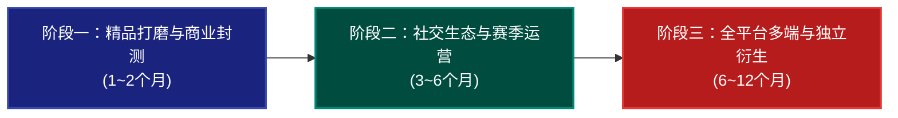

# 《孤城神机营》未尽构想与长远演进战略规划蓝图 (ROADMAP)

> **文档定位**：本项目未尽研发构想整理、中远期系统规划演化路径与技术架构发展总览。  
> **制定时间**：2026年10月  
> **核心原则**：恪守严格分层解耦（`src/core/` 纯无头 Headless 零 DOM / 零 Phaser 依赖）、7步伤害流水线与反应防崩阀门数学硬上限、100% 自动化测试回归守护。

---

## 一、 当前工程基线与已交付全景 (Current Baseline)

截至当前版本，本项目已完成以下十一大核心系统的工业级交付与双端验证：

| 模块系统 | 交付状态 | 核心技术与业务成果 |
| :--- | :---: | :--- |
| **M1: 沙盘网格与触控交互** | 100% 交付 | 5×5 城头沙盘、1×1~2×2 多格器械占位、Touch Y-Offset (+80px) 防指遮挡、2合1升星、曼哈顿智能挤位、Row 0 前排专属拒止 |
| **M2: 十六型军械与元素反应** | 100% 交付 | 四大流派（神火/墨家/守御/奇门）全十六型军械、四大元素反应（猛火轰爆/雷火天劫/碎冰崩裂/幽冥毒火）与内置防崩阀门 |
| **M3: 7步伤害流水线与主帅** | 100% 交付 | 7步严格顺序流水线、加算 $\le 150\%$、独立乘区 $\le 3$ 门各 $25\%$、暴击 $\le 75\%/2.0$、保底 $\ge 1.0$；4 大主帅技能矩阵 |
| **M4: 数据驱动波次与60s引导** | 100% 交付 | 波次状态机、4 类敌军推进、抗性衰减曲线、利息经济、60s FTUE 纯无头引导脚本 |
| **M5: 军备商店与36张肉鸽兵法** | 100% 交付 | 商店连续 3 刷对子保底防脸黑、36 张肉鸽兵法全编目、流派智能权重加减权、赤金双 ★3 融合觉醒 |
| **M6: 表现层渲染与双端打包** | 100% 交付 | Phaser 3 渲染、粒子与过程式音效、Web 端与抖音小游戏（`tt.*`）双端适配打包 |
| **GL-1: 长线数值与主城** | 100% 交付 | 军机处军械升级（Lv.1~20）、武经总要科技树（攻伐/坚守/巧变 Lv.0~30）、持久化存储与损坏自愈 |
| **GL-2: 商业化与平台社交** | 100% 交付 | 单局看广告局内复活（城防恢复50%+击退250px）、战后 3 倍军饷激励、抖音高光录屏与话题分享、异形屏安全区自适应 |
| **GL-3: 战役波次与关卡打磨** | 100% 交付 | 5 大章节 20 关数据驱动怪潮、天象环境修正、波次出征战报横幅、实时三星监视、战败智能军师复盘锦囊 |
| **GL-4: 神机演武与双榜天梯** | 100% 交付 | 无尽防守指数级递增曲线、6 大精锐词缀引擎、5 关首领轮巡、八阶正统大明官阶头衔、FNV-1a 防作弊签名、全国/同省双标签战功榜 |
| **GL-5: 首领掉落与神机天工坊** | 100% 交付 | 战役关底与无尽首领专属图纸与玄铁掉落、三槽位（身管/机匣/引信）部件打造、十六型军械自由装配与实战增益接入 |

---

## 二、 前期已构想但尚未落地的功能清单 (Unimplemented Previous Ideas & Backlog)

在前期数轮演进研讨与头脑风暴中，团队提出了若干极具可玩性与商业价值、但尚未正式排期编码落地的功能点。现进行全面系统归集：

### 1. 军械部件深度淬炼与神机词条洗炼 (Weapon Component Refinement & Affix Re-rolling)
- **背景与痛点**：当前天工坊已实现 9 大部件锻造与自由穿卸，但部件属性为固定静态配置，当玩家集齐全部位部件后，玄铁与图纸的长线消耗动力会逐步平缓。
- **构想机制**：
  - **淬火升星 (Star Refinement)**：消耗天外玄铁，部件可从 ★0 淬火至 ★5，每星级按固定阶梯微量提升基础词条属性（如火力 $+2\%$、射程 $+10\text{px}$）。
  - **灵火洗炼 (Affix Re-roll)**：紫/金品质部件开放 1~2 个随机词条槽位，消耗“淬火砂”（由多余图纸分解或无尽高波次产出），在受限词条库中洗炼专属词条。
  - **特色特质词条池**：
    - `弹道穿甲`: 击中敌人时有 $25\%$ 概率穿透至下一个目标；
    - `击杀回怒`: 装备该器械击杀精锐/首领时，额外为主帅提供 $5 / 20$ 点怒气；
    - `灼烧增幅`: 命中带有【灼烧】的敌军时，暴击率额外 $+10\%$。
- **架构红线约束**：洗炼词条的加成必须严格折算回现有的 7 步伤害流水线或特殊效果触发器中，严禁脱离通用加算区封顶（$\le 150\%$）与暴击硬上限（$\le 75\%$）。

### 2. 残局解谜模式：二十大兵法破局演武 (Historical Tactics Puzzle Mode)
- **背景与痛点**：GDD V3.0 §10 曾设计了极其精妙的 20 关“残局通关标准考题”（如第 3 关《孤高之炮》卖弩变现孤军奋战、第 4 关《暗夜照影》电网破隐+床弩穿透、第 5 关《背水一战》排雷变现合出三星一窝蜂引爆火药兵）。当前战役关卡已具备环境修正，但未剥离为专门的“固定残局模式”。
- **构想机制**：
  - **纯策略单格残局**：不设商店刷新，玩家开局持有固定银两与限定器械，城墙血量仅为 $1 / 1$（一碰即溃）。
  - **唯一/最优解破局**：玩家必须利用空间几何、合成时机、元素相克或兵法特性（如《孤高重器》、《阵列同心》）在单波怪潮内实现 0 损防守。
  - **通关犒赏**：通关专属残局奖励大量图纸与大明功勋印章，且极具短视频攻略自传播效应。

### 3. 好友/同省异步攻防切磋 (Asynchronous PvP / Friend Fortress Siege)
- **背景与痛点**：当前战功排行榜为单向比拼无尽波次分数，缺乏玩家与玩家之间的策略互动与阵容博弈。
- **构想机制**：
  - **城垣防守阵型存档 (Defense Snapshot)**：玩家可在主城将自己最得意的 5×5 沙盘配置与器械等级“封存为城防镜像”。
  - **异步攻城演练 (Siege Assault)**：挑战者调遣攻城部队（由 AI 驱动不同配比的铁浮屠、冲车、死士浪潮），攻打好友或同省上榜玩家的防守沙盘。
  - **克制博弈**：守方器械针对攻方敌军类型自动反击，攻方可在波次间隙选择“强攻军令”尝试破城，产出同省声望与切磋犒赏。

### 4. 深度视听触觉与战斗打击感微调 (Sound & Haptics Juice Polish)
- **背景与痛点**：当前战斗已有过程式音效与元素粒子，但移动端小游戏的微震动触感（Haptics）与紧张感音乐情绪调动仍有很大提升空间。
- **构想机制**：
  - **微触觉反馈接入 (`PlatformBridge.vibrateShort()`)**：
    - 大炮齐射与迫击炮落地爆破时触发中度触觉反馈；
    - 首领巨力撞墙（城防耐久骤降）时触发重度双震；
    - 主帅怒气满槽可释放绝技时触发提示性轻微脉冲。
  - **动态心流战乐 (Adaptive Dynamic BGM)**：
    - 常规防御期播放沉稳厚重的大明鼓乐；
    - 首领降临或城墙耐久降至 $30\%$ 以下时，BGM 无缝切换至加急战鼓与紧迫号角，视效叠加心跳急促红晕。

### 5. 首领多阶段暴怒与破甲断肢形态演变 (Boss Multi-Phase Transformation)
- **背景与痛点**：目前首领技能已具备护盾与蓄力打断，但模型在血量跌破 $50\%$ 时视觉形态无变化，首领战的史诗感可进一步拔高。
- **构想机制**：
  - **视觉形态破损与暴怒**：
    - 铁塔熊王血量低于 $50\%$：抛掷重锤，双目赤红，周身爆发烈火气焰，冲刺速度 $+80\%$；
    - 玄武巨舰血量低于 $50\%$：甲板起火冒出浓烈黑烟，正面铁幕破碎并进入两舷全炮齐射狂轰模式；
    - 饕餮攻城机打断失败/成功：弱点打断成功时外壳崩飞露出内部齿轮红温过载冒烟瘫痪 5 秒；打断失败则释放全屏震荡破城光束。

---

## 三、 整体长远战略规划蓝图 (Long-Term Roadmap)

项目后续演化划分为三大战略阶段：

---

### 阶段一：精品打磨与商业化封测 (Phase 1: Production Polish & IAA/IAP Beta)
**时间跨度**：近期 1 ~ 2 个月  
**核心目标**：实现次日留存率 $\text{D1} \ge 45\%$、七日留存率 $\text{D7} \ge 18\%$，IAA 广告点位转化率与 eCPM 收益最大化，顺利通过字节跳动小游戏平台首发上线审核。

#### 1.1 玩法深化
- [ ] **落地残局解谜演武 (Puzzle Mode)**：剥离 20 关固定残局，提供独立入口与三星解密星级评价；
- [ ] **天工坊深度养成闭环**：落地部件淬炼升星（★0~★5）与词条洗炼，打造深度玄铁回收水池；
- [ ] **首领战斗打击感与触觉振动**：封装 `tt.vibrateShort` / `tt.vibrateLong`，配合炮口火光与击退震屏。

#### 1.2 商业化与平台合规闭环
- [ ] **IAA 广告场景全覆盖与防疲劳控制**：
  - 局内单次复活（已交付）
  - 战后 3 倍战利品（已交付）
  - 每日军机处军饷与科技巡检补给（已交付）
  - 商店免费刷新次数看广告补充（新增）
  - 战败后“神机军师锦囊”直接借用 1 尊高星武器助战（新增）
- [ ] **轻度 IAP 商业化设计预留**：
  - “崇祯特许度支金令”（免广告通行证）
  - “神机月卡”每日赠送玄铁与图纸
  - “首领讨伐令”双倍掉落特权
- [ ] **抖音小游戏首包优化 (Subpackaging)**：
  - 严格限制主包体积 $< 4.0\text{ MB}$；
  - 音频与 3D 复杂模型提取为子包动态远程加载（CDN Preload），首屏秒开 $< 1.5\text{s}$。

---

### 阶段二：社交裂变与赛季化运营 (Phase 2: Social Viral & Seasonal Operations)
**时间跨度**：中期 3 ~ 6 个月  
**核心目标**：打通抖音短视频自传播裂变闭环（K-Factor $\ge 0.35$），建立以 30 天为周期的版本赛季循环，维持核心玩家中长线活跃。

#### 2.1 赛季制演武 (Seasons System)
- [ ] **30 天天梯赛季更迭**：每个赛季推出专属战场主题（如“第 1 赛季：辽东风云”、“第 2 赛季：鄱阳水战”）；
- [ ] **赛季专属变异与限定兵法**：每赛季更新 4 张全新赤金兵法卡与 2 个全新精锐词缀；
- [ ] **赛季战令 (Battle Pass)**：通过无尽波次与每日功勋解锁赛季专属主帅皮肤与军械特效（如“锦衣卫·王守仁”、“烈火神机·金龙大炮”）。

#### 2.2 抖音原生社交与短视频生态
- [ ] **大明封赏令动态战报海报生成**：
  - 战胜或创纪录时，由客户端离屏 Canvas 动态绘制国潮战报长图；
  - 嵌入玩家抖音头像、大明官阶印章、结算击杀雷达图与专属小程序跳转码；
- [ ] **一键带话题发布高光视频**：
  - 结合剪映模版与 `tt.shareAppMessage`，自动附带 `#孤城神机营 #抖音小游戏 #明代重工业` 官方话题标签；
- [ ] **同省战盟（府州营房）**：
  - 玩家按 IP 省份自动归入“北直隶营”、“南直隶营”、“山东行省营”等；
  - 设立每周“天下第一卫所”全省积分总榜，同省玩家享有全员产出加成。

#### 2.3 英雄与军械阵营扩充
- [ ] **新主帅参战**：
  - **戚继光**（绝技：鸳鸯阵壁垒，全场前排拒马获得 3 秒无敌金身并反弹远程穿透）；
  - **毕懋康**（绝技：自生火铳齐射，全场神火单位立即重置装填并进行一次 300% 暴击盲射）；
- [ ] **新器械原型加入**：
  - **虎蹲炮**（1×1 扇形大范围霰弹压制）；
  - **神火飞鸦**（全图巡航制导轰炸）。

---

### 阶段三：全平台生态与独立游戏衍生 (Phase 3: Cross-Platform & Standalone IP)
**时间跨度**：远期 6 ~ 12 个月  
**核心目标**：将《孤城神机营》打造成具备长线生命力的国潮策略 IP，由单平台小游戏向全平台、多端乃至 Steam 独立端拓展。

#### 3.1 微信小游戏与多端统一跨平台架构
- [ ] **微信小游戏适配层 (`WechatPlatform`)**：
  - 复用现有的 `IPlatform` 接口，无缝实现 `wx.*` 对应实现；
  - 依托 Cloud Base（微信云开发 / 抖音开发者后台）实现多端档案云同步与账号绑定；
- [ ] **TapTap / 移动端原生 App 封装**：
  - 利用 Capacitor / Electron / 独立 WebGL 容器打包为原生 Android/iOS 客户端，支持 120Hz 高刷新率与物理手柄震动。

#### 3.2 Steam 宽屏 HD 重制版 (PC Standalone Edition)
- [ ] **16:9 横屏战术沙盘重构**：
  - 保持底层 `src/core/` 零修改，上层表现层扩展为 1920×1080 宽屏视角；
  - 沙盘扩充为城前阵地、瓮城与内城多层递进防御；
- [ ] **商业模式转向单机买断制**：
  - 剥离所有广告模块，转为纯单机无内购买断体验；
  - 接入 Steam 成就系统、云存档与集换式卡牌；
- [ ] **创意工坊 (Steam Workshop & Custom Stage Editor)**：
  - 开放可视化怪潮编辑器、自制兵法与自定义器械数值导入工具，由社区玩家创作历史真实战役（如北京保卫战、浑河之战）。

---

## 四、 架构演进与技术质量护栏 (Architecture Evolution & QA Gates)

为支撑上述长远业务演进，底层技术架构必须坚决贯彻以下四大工程准则：

### 1. 纯无头核心领域层隔离（绝对不可逾越）
- `src/core/` 必须永远保持 0 导入 Phaser、0 导入 DOM、0 导入 Canvas。
- 所有新系统（淬炼洗炼、赛季算法、异步切磋、战盟计算）必须首先在 `src/core/` 完成无头模型构建，并通过 100% 独立 Node.js / Vitest 单元测试覆盖。

### 2. 内存治理与对象池全量管控
- 针对移动端小游戏 1GB 内存红线，所有频繁创建/销毁的实体（伤害跳字、弹道光束、粒子发生器、敌军精灵）必须实现统一生命周期对象池（Object Pool）；
- 杜绝闭包引用泄漏，严格在战斗退出与重试时执行 `destroy(true)` 与纹理引用解绑。

### 3. 数值硬上限与防崩流水线不变量
- 无论未来引入多少新兵法、新装备、新羁绊词条，最终造成的伤害与控制衰减必须永远收敛于以下数学防崩阀门：
  $$\text{Additive Bonuses} \le 150\%$$
  $$\text{Independent Multipliers} \le 3 \text{ gates, each} \le 25\%$$
  $$\text{Crit Rate} \le 75\%,\quad \text{Crit Multiplier} \le 2.0$$
  $$\text{Damage Floor} \ge 1.0$$
  $$\text{CC Duration} \times 0.70^k \ge 0.2\text{s},\quad \text{Tenacity Window} = 1.5\text{s}$$

### 4. 自动化回归测试底线（持续绿灯）
- 全工程当前保持 **59 个测试套件，1042 项测试 100% 通过**。
- 后续每增加一个功能分支，必须同步补充对应的边界、对抗与极端数值测试，确保总测试数随系统复杂度线性稳步增长，严禁降级交付。

---

> **结语**：《孤城神机营》不仅是一款快节奏的自走棋与空间管理守城小游戏，更是一套依托严谨数学流水线与高度模块化分层解耦的工业级游戏架构工程。本规划蓝图将作为后续各阶段迭代开发的战略灯塔，指引游戏持续进化与商业价值爆发。
