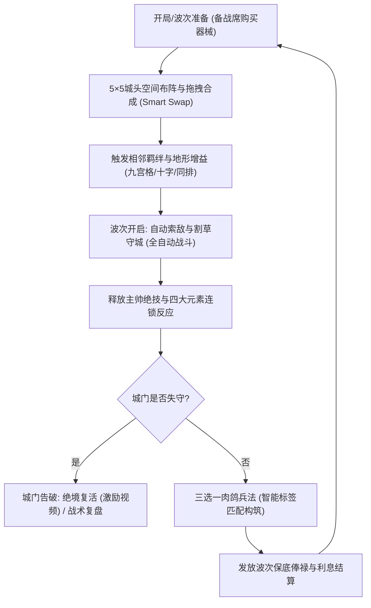
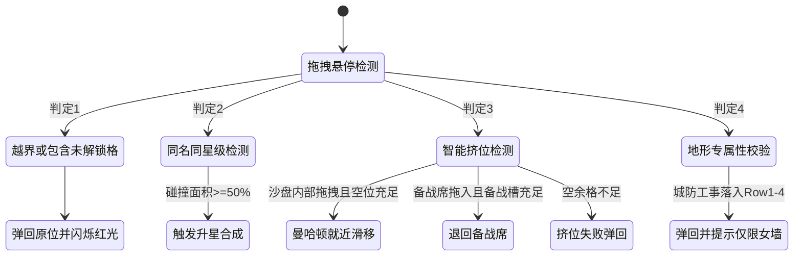
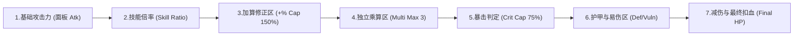
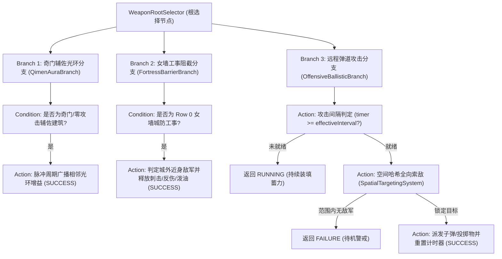
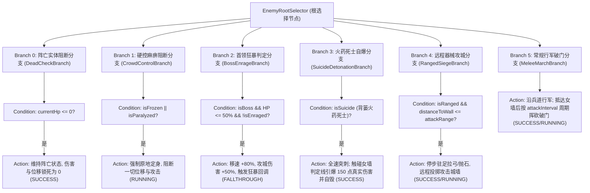
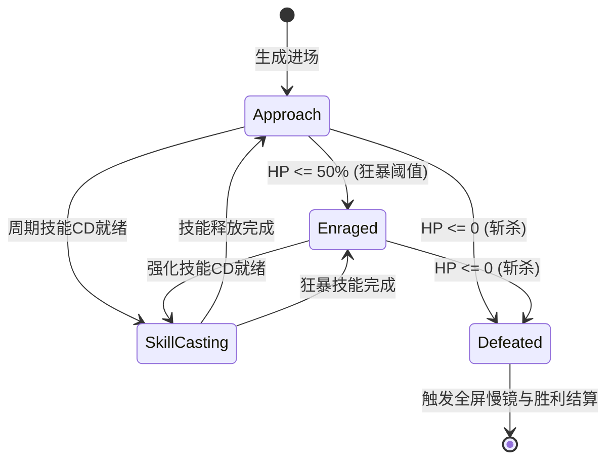
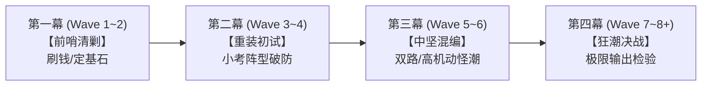

# 《孤城神机营·完整工业级执行设计书》终极全案文档 (GDD V3.0 完全体)

> [!IMPORTANT]
> **文档密级：** 内部研发与工业级执行总纲（完全体·拒绝缩减版）  
> **核心定位：** 2D 网格空间策略（背包空间管理） + 肉鸽词条构筑（Roguelike） + 自走棋合成升星 + 割草守城单机核心  
> **目标平台：** 抖音小程序 / 微信小游戏（竖屏单手操作）  
> **开发引擎：** Cocos Creator 3.8.x (TypeScript)  
> **商业模式：** IAA 广告主导（绝境逆转高转化） + IAP 轻度内购（月卡/战令/军饷） + 弱联网同省社交与异步攻城  
> **设计基准：** 单局 10~15 波（3~5 分钟爆爽闭环），前 3 秒买量吸睛，前 30 秒出爽点，7 天长线养成，30 天赛季更迭  

---

## 目录索引 (Table of Contents)
1. [一、 项目立项总览、心流模型与抖音爆款脚本](#一-项目立项总览心流模型与抖音爆款脚本)
2. [二、 5×5 城头沙盘与触控几何算法（像素级精度）](#二-55-城头沙盘与触控几何算法像素级精度)
3. [三、 底层数值公式、流水线与防崩阀门](#三-底层数值公式流水线与防崩阀门)
4. [四、 商店发牌算法与肉鸽卡池伪随机规则](#四-商店发牌算法与肉鸽卡池伪随机规则)
5. [五、 主帅系统（四大统领全维度配表）](#五-主帅系统四大统领全维度配表)
6. [六、 全十六型军械与兵种图鉴（★1~★4 属性与质变机制）](#六-全十六型军械与兵种图鉴14-属性与质变机制)
7. [七、 兵家流派羁绊与三十六张肉鸽兵法卡池](#七-兵家流派羁绊与三十六张肉鸽兵法卡池)
8. [八、 敌军、精锐兵种与五章守关首领机制](#八-敌军精锐兵种与五章守关首领机制)
9. [九、 九州战役模式：全二十关主线总表与核心波次配表](#九-九州战役模式全二十关主线总表与核心波次配表)
10. [十、 墨门残局模式：全二十关完整解谜蓝图（唯一标准解全收录）](#十-墨门残局模式全二十关完整解谜蓝图唯一标准解全收录)
11. [十一、 战局星级评定、结算评价与局外长线养成](#十一-战局星级评定结算评价与局外长线养成)
12. [十二、 商业化变现（IAA + IAP）与抖音裂变体系](#十二-商业化变现iaa--iap与抖音裂变体系)
13. [十三、 技术实现与 Cocos Creator 3.8.x 极致性能红线](#十三-技术实现与-cocos-creator-38x-极致性能红线)
14. [十四、 软件著作权申报《主要功能》合规文本](#十四-软件著作权申报主要功能合规文本)
15. [十五、 美术与音频资产量产需求表（Art & Audio Asset Bible）](#十五-美术与音频资产量产需求表art--audio-asset-bible)
16. [十六、 配置文件 Schema 与 Excel 导表规范（Data Config Schema）](#十六-配置文件-schema-与-excel-导表规范data-config-schema)
17. [十七、 弱联网后端与安全防作弊协议（Network & Anti-Cheat Protocol）](#十七-弱联网后端与安全防作弊协议network--anti-cheat-protocol)
18. [十八、 数据埋点与运营监控字典（Analytics & Telemetry Dictionary）](#十八-数据埋点与运营监控字典analytics--telemetry-dictionary)
19. [十九、 全二十关过渡关卡波次节奏设计规范（Chapters 2~5 Complete Waves Flow）](#十九-全二十关过渡关卡波次节奏设计规范chapters-25-complete-waves-flow)
20. [二十、 QA 测试用例与自动化平衡仿真（Test Cases & Monte Carlo Simulation）](#二十-qa-测试用例与自动化平衡仿真test-cases--monte-carlo-simulation)
21. [二十一、 UI 国潮重工与宣德朱砂印章视觉体系（National Tide Industrial UI & Vermilion Seal）](#第二十一章-ui-国潮重工与宣德朱砂印章视觉体系-national-tide-industrial-ui--vermilion-seal)
22. [二十二、 战场环境物理分层、城楼瓮城砖石质感与地表痕迹预烘焙规范（M_VJ2）](#第二十二章-战场环境物理分层城楼瓮城砖石质感与地表痕迹预烘焙规范-m_vj2)
23. [二十三、 军械/敌军材质细节、开火热量发光、打击感与四大元素反应规范（M_VJ3）](#第二十三章-军械敌军材质细节开火热量发光打击感与四大元素反应规范-m_vj3)
24. [二十四、 神机演武 · 无尽防守模式、六大精锐词缀与正统八阶军阶天梯规范（Endless Defense & Dual-Tab Leaderboard）](#第二十四章-神机演武--无尽防守模式六大精锐词缀与正统八阶军阶天梯规范-endless-defense--dual-tab-leaderboard)
25. [二十五、 首领专属掉落、神机天工坊三槽位打造与十六型军械装配增益规约（Boss Drops & Forge Workshop）](#第二十五章-首领专属掉落神机天工坊三槽位打造与十六型军械装配增益规约-boss-drops--forge-workshop)
26. [二十六、 战局微操交互深度与高阶视效打磨规范（In-Battle Micro-Ops & High-Fidelity Feedback）](#第二十六章-战局微操交互深度与高阶视效打磨规范-in-battle-micro-ops--high-fidelity-feedback)

---

## 一、 项目立项总览、心流模型与抖音爆款脚本

### 1.1 核心体验与玩法循环 (Core Game Loop)
游戏以“**明代火器黑科技与墨家机关**”为文化包装，将《背包乱斗》的空间排列策略、《自走棋》的合成升星机制与《吸血鬼幸存者》的爽感割草守城融为一体。玩家在有限的城头 5×5 沙盘网格中，通过拖拽合成兵种、布局相邻羁绊构筑火力网，抵御如潮水般涌来的敌军，并在每波次间隙抽取“兵法政令”实现战术质变。



### 1.2 黄金 60 秒新手引导 (FTUE 分步执行脚本)
针对泛休闲用户“前 15 秒决定去留、前 30 秒必须出爽点”的特质，杜绝任何冗长的世界观文字对话，进游戏直接进战斗，用强制手势引导第一步爽感：

| 时间节点 | 界面行为与镜头 | 玩家交互 | 系统反馈与数值爽点 | 留存转化目标 |
| :--- | :--- | :--- | :--- | :--- |
| **0 ~ 5s** | 镜头推近城头沙盘，中心已预置 2 个 ★1【神机火铳】 | 强手势光圈指引：拖拽一个火铳覆盖另一个火铳 | 瞬间合成 ★2【神机火铳】，全屏爆开金光、震屏伴随清脆机械卡扣音效 | 消除初始认知阻力，建立“二合一升星”核心心智 |
| **5 ~ 15s** | 镜头上拉展示城下，Wave 1 刷新 6 只脆皮【流寇轻步兵】缓慢冲锋 | 玩家双手离开屏幕，进入全自动观战 | ★2 火铳自动齐射，3 秒内将小兵全部轰杀，碎银与经验金币四溅跳出，UI 飘字爆爽 | 击穿前 15 秒视觉爽感门槛 |
| **15 ~ 30s** | 弹出 Wave 1 战胜奖励，界面亮起三张竹简兵法（必出紫卡《三段击阵法》） | 引导点击选择《三段击阵法》（同排≥3火铳攻速+80%） | 卡牌化作流光注入城楼，状态栏挂载常驻流派图标 | 确立“肉鸽词条构筑”成就感 |
| **30 ~ 45s** | Wave 2 备战：系统赠送 30 银两，商店槽位高亮 2 个 ★1【神机火铳】 | 引导点击购买并拖上阵，与原火铳排在同一横排 | 瞬间点亮《三段击阵法》金色连线，三挺火铳同时喷出烈焰弹道 | 掌握“空间阵法布局”机制 |
| **45 ~ 60s** | Wave 2 刷出 20 只奔跑战犬，怪潮密度骤增 | 玩家观察超高攻速火铳洗地，残血敌军逼近城门前被全歼 | 弹出章节通关进度（2/10）及“首局大捷”，奖励领取双倍按钮高亮 | 建立核心心流闭环，顺畅过渡到自由探索阶段 |

### 1.3 抖音 3 秒钩子与买量吸睛视频脚本
在抖音小游戏生态中，买量素材前 3 秒完播率直接决定 ROI。基于本游戏特性提炼出三大天生吸睛脚本模版：

1. **“强迫症逼死系列”（点击率最高）：**
   - **画面前 3 秒：** 上半屏 500 名重甲骑兵全速冲锋，眼看就要撞碎仅剩 1 点血的城门；下半屏沙盘凌乱不堪，主播抓耳挠腮、胡乱摆放导致红光闪烁无法落子，配音大喊：“完了完了，这关绝对过不去了！”
   - **转折点（第 4 秒）：** 突然拖动一个 2×2【襄阳发石机】强行挤位，瞬间把旁边的火药局挤入中心枢纽格，一炮轰出极寒冰霜新星冻结全屏，紧接着巨石砸下触发【碎冰崩裂】，满屏“-99999”红字全歼骑兵。
   - **评论区互动钩子：** “故意摆错阵型”，激发强迫症网友在评论区疯狂指导“把油柜放在火铳前面啊！”带动巨额自然搜索量。

2. **“数值爆炸·满屏火器洗地”（完播率最高）：**
   - **画面前 3 秒：** 展示终极觉醒阵容——★4 洪武巨炮 + 暴雨火箭车 + 铁浮屠火牛阵。
   - **视觉爆点：** 敌军 10 万战象大军压境，主帅王守仁大招“知行合一”激活，全城火器 0 冷却连发，全屏硝烟弥漫、火箭雨覆盖、电磁风暴环绕，同屏 2000 个伤害跳字直接卡顿顿挫感，BGM 搭配魔性卡点唢呐电音。

3. **“残局烧脑挑战”（高智商转化）：**
   - **画面：** 展示【墨门残局模式】第 5 关《背水一战》或第 10 关《狂象反噬》，文字标语：“99%的人卡在这一关，只有清华物理系能解开！”引发挑战欲。

---

## 二、 5×5 城头沙盘与触控几何算法（像素级精度）

### 2.1 标准竖屏分辨率与战场像素坐标映射
- **设计基准分辨率：** $750 \times 1334\text{ px}$（竖屏锁定）。
- **物理与逻辑距离换算基准：** 逻辑距离 $1.0\text{ 米} = 68\text{ px}$。
- **纵向（Y 轴，自下而上 $0 \sim 1334\text{ px}$）功能区切分规范：**
  - **$Y: 0 \sim 160\text{ px}$【底部操作与备战席区】：** 容纳 5 个备战槽位（每个槽位 $80 \times 80\text{ px}$）、军备商店刷新按钮（消耗 2 银两）、全屏开战按钮、出售回收拖拽判定区。
  - **$Y: 160 \sim 540\text{ px}$【城头 5×5 沙盘网格区】：** 居中排列，横向 $X: 185 \sim 565\text{ px}$。单格物理尺寸为 $76 \times 76\text{ px}$，格间距 $0\text{ px}$。右侧 $X: 580 \sim 730\text{ px}$ 为主帅动态立绘、怒气槽及 2 个主动绝技按钮。
  - **$Y: 540 \sim 560\text{ px}$【瓮城女墙受击判定线】：** 近战敌军行进至 $Y = 560$ 处停止位移，开始挥刀攻击城墙；城墙血条与护盾条实时悬浮显示于该线上方。
  - **$Y: 560 \sim 1240\text{ px}$【城下主战场演算区】：** 战场总纵深 $680\text{ px}$（逻辑长度 $10.0\text{ 米}$），横向活动范围 $X: 60 \sim 690\text{ px}$，涵盖敌军路径、投射物飞行轨迹与地面元素残留（油污、烈火、电网、冰面）。
  - **$Y: 1240\text{ px}$【敌军出生线 (Spawn Line)】：** 所有波次敌军与首领的生成出怪基准线。
  - **$Y: 1240 \sim 1334\text{ px}$【顶部战斗 HUD 区】：** 显示章节名称、当前波次进度（如 Wave 3/10）、城门当前/最大耐久、持有银两数、1X/2X 倍速切换开关、暂停/退出按钮。

### 2.2 触控人机工效与 Y 轴 80px 偏移防遮挡
在移动端小屏操作中，直接以手指触控点作为器械中心会导致玩家大拇指完全遮挡落子点网格及合法性高亮。系统必须实现：
1. **Touch Y-Offset（防遮挡向上偏移）：**
   - 当玩家手指按压器械开始拖拽时，被拖拽的器械显示节点（Visual Node）在逻辑坐标上**立即向上偏移 $80\text{ px}$**，使器械悬浮于玩家指尖正上方。
   - 碰撞检测点（Hit Test Point）以视觉节点的中心坐标向下映射至沙盘网格坐标系。
2. **合法性动态材质着色（Visual Feedback）：**
   - **绿色半透明虚线高亮：** 目标位置全空格合法，或目标位置存在同名同星级器械（可合成）。
   - **黄色半透明虚线高亮：** 目标位置存在不同器械，但满足智能挤位滑移条件。
   - **红色高亮与震动：** 目标位置包含未解锁格子、超出边界，或城防工事试图拖入 Row 1~4。

### 2.3 多格器械锚点定义与智能挤位（Smart Swap）规则
为消除多格重器（如 2×2 发石机）在沙盘中移动时“因单格被挡而无法放下”的操作挫败感，底层严格执行以下判定协议：

#### 1. 主锚点定义（Anchor Definition）
所有多格器械统一以**左上角占格 $(r, c)$ 作为主坐标锚点**（沙盘行号 Row $0 \sim 4$ 自下而上，列号 Col $0 \sim 4$ 自左至右）：
- **$1 \times 1$（单格）：** 占用 $(r, c)$，行合法范围 $r \in [0, 4]$，列合法范围 $c \in [0, 4]$。
- **$1 \times 2$（竖向两格，如红衣大炮）：** 占用 $(r, c)$ 与 $(r+1, c)$，锚点行范围 $r \in [0, 3]$。
- **$2 \times 1$（横向两格，如八牛床弩、聚义战鼓）：** 占用 $(r, c)$ 与 $(r, c+1)$，锚点列范围 $c \in [0, 3]$。
- **$2 \times 2$（田字四格，如襄阳发石机）：** 占用 $(r, c), (r+1, c), (r, c+1), (r+1, c+1)$，锚点范围 $r \in [0, 3], c \in [0, 3]$。

#### 2. 拖拽落子四级判定优先级状态机


- **规则 A（沙盘内部互换挤位）：** 从沙盘旧坐标拖动器械 $A$ 覆盖其他器械 $\{B_k\}$ 时，系统自动将 $A$ 腾出的旧格子与沙盘上现存的空余空格合并为可用池。以曼哈顿距离最小为原则，将 $\{B_k\}$ 自动滑动填入可用池；若可用池容量不足，则禁止落子并弹回。
- **规则 B（备战席上阵挤位）：** 若从底部备战席将器械拖入沙盘覆盖 $\{B_k\}$，且被挤压的器械数量 $\le$ 备战席当前空余槽位数（含当前器械腾出的 1 个槽位），则成功落子，$\{B_k\}$ 自动平滑退回备战席；否则弹回。
- **规则 C（地形专属性强制校验）：** 【城防工事系】（拒马、油柜、电网、长枪营）**仅可布置于最前排女墙（Row 0）**。若试图拖入 Row 1~4，系统强制弹回并弹出浮动提示：*“城防工事仅可布置于最前排女墙！”*。

### 2.4 相邻羁绊判定与去重计算法则
为了消除多格器械在相邻检测时产生的“多重重叠计算 Bug”，制定严密的数学集合定义：

设器械 $A$ 占用的格子坐标集合为 $S_A$，器械 $B$ 占用的格子坐标集合为 $S_B$。
1. **十字相邻（正交邻接，Orthogonal）：**
   $$\exists (r_1, c_1) \in S_A, (r_2, c_2) \in S_B \quad \text{s.t.} \quad |r_1 - r_2| + |c_1 - c_2| = 1$$
   满足上述条件的 $A$ 与 $B$ 互为十字相邻。
2. **九宫格相邻（八向邻接，Chebyshev）：**
   $$\exists (r_1, c_1) \in S_A, (r_2, c_2) \in S_B \quad \text{s.t.} \quad \max(|r_1 - r_2|, |c_1 - c_2|) = 1$$
   满足上述条件的 $A$ 与 $B$ 互为九宫格相邻。
3. **去重结算原则（Idempotence）：**
   无论多格器械 $A$ 与多格器械 $B$ 共有多少个接触边或接触点，**相邻羁绊或辅助建筑（如火药局、战鼓）在单次属性结算中严格判定为生效 1 次**！唯一例外为玩家抽取到金色兵法《万历大阅兵》，此时才允许按几何接触格数叠加结算。

---

## 三、 底层数值公式、流水线与防崩阀门

### 3.1 严格七步伤害结算流水线 (Damage Pipeline)
当投射物或近战判定击中敌军目标 $E$ 时，底层严密按照先后 7 个流水线步骤计算最终扣血，杜绝加算乘算混淆导致的数值发散：



1. **步骤 1：基础攻击力面板计算 ($Atk_{panel}$)**
   $$Atk_{panel} = Atk_{base} \times (1 + 0.04 \times (Level_{unit} - 1)) + Bonus_{star}$$
   其中 $Atk_{base}$ 为器械 ★1 级基准攻击力，$Level_{unit}$ 为局外造办处等级（$1 \sim 20$ 级），$Bonus_{star}$ 为局内升星附加攻击。
2. **步骤 2：技能基础伤害计算 ($Dmg_{base}$)**
   $$Dmg_{base} = Atk_{panel} \times Ratio_{skill}$$
3. **步骤 3：通用加算加成区修正 ($Dmg_{add}$)**
   $$Dmg_{add} = Dmg_{base} \times \left(1 + \min\left(\sum AdditiveBonuses, 1.50\right)\right)$$
   涵盖：火药局光环、战鼓攻强、羁绊加算、通用兵法加算。**加算区最高封顶 $+150\%$**。
4. **步骤 4：独立乘算加成区修正 ($Dmg_{mul}$)**
   $$Dmg_{mul} = Dmg_{add} \times \prod_{k=1}^{m} (1 + Multiplier_k)$$
   严格受限：全局仅允许**白名单内的独立乘区生效，且同一伤害来源最多挂载 $m \le 3$ 门独立乘算，单门增益 $\le +25\%$**（如红衣大炮《孤高重器》）。
5. **步骤 5：暴击判定与暴击伤害计算 ($Dmg_{crit}$)**
   - 计算总暴击率：$$CritRate = \min(\sum CritRateBonus, 0.75)$$，**最高锁死 $75\%$**（除特定必暴词条外，杜绝常驻满暴）。
   - 计算暴击伤害倍率：$$CritDmg = \min(1.50 + \sum CritDmgBonus, 2.00)$$，**最高锁死 $2.0$ 倍**。
   - 若判定命中暴击：$$Dmg_{crit} = Dmg_{mul} \times CritDmg$$；否则 $$Dmg_{crit} = Dmg_{mul}$$。
6. **步骤 6：护甲防御折算与破甲易伤 ($Dmg_{armor}$)**
   - 目标有效护甲：$$Armor_{eff} = \max(0, Armor_{base} \times (1 - SunderRate) - SunderFlat)$$
   - 物理抗性减免公式：$$DR_{armor} = \frac{Armor_{eff}}{Armor_{eff} + 150}$$
   - 目标承受伤害：$$Dmg_{armor} = Dmg_{crit} \times (1 - DR_{armor}) \times (1 + Vulnerability)$$
   - 特殊护盾机制：玄甲刀盾兵正面格挡减免 $40\%$ 直射物理伤害；【八牛床弩】附带 $300\%$ 破盾倍率。
7. **步骤 7：伤害保底、最终减免与实际扣血 ($Dmg_{final}$)**
   $$Dmg_{final} = \max(1.0, Dmg_{armor} \times (1 - DR_{special}))$$
   目标实际扣血量 $\Delta HP = \min(HP_{current}, Dmg_{final})$。

### 3.2 数值防崩闭环控制阀门
为从根本上避免单机肉鸽在无限叠词条后“一击秒杀一切 BOSS”导致策略崩盘，必须执行全局参数硬封顶：
- **加算区绝对截断：** $\sum AdditiveBonuses \le +150\%$。
- **暴击率与暴击伤害硬封顶：** 暴击率 $\le 75\%$，暴击倍率 $\le 200\%$。
- **独立乘区白名单准入限制：** 最多 $3$ 个独立乘算通道，单个增幅 $\le +25\%$。
- **百分比斩杀/尸爆双重阀门：**
  - 【碎冰崩裂】扣除 $8\%$ 最大生命值伤害：对首领单位每次伤害**封顶为 BOSS 最大生命值的 $3\%$**，且内置 $2.0\text{ 秒}$ 冷却。
  - 【连环引爆】尸爆火伤：对同屏单体敌军伤害设有上限，严禁发生无限连锁雪崩卡死客户端。

### 3.3 控制抗性与控制衰减递减法则 (Diminishing Returns)
为了防止高频减速、冰封与击退把首领永久定死在出生点，控制效果遵循严格的时间递减曲线：
- **韧性保护期：** 任何敌军单位（包括普通怪与精英）在连续脱离冰封/眩晕/麻痹后的 $1.5\text{ 秒}$ 内，获得【霸体】，免疫任何二次硬控。
- **控制时间衰减：**
  - 首领单位天然具备 $50\%$ 强控制减免（如原本 2 秒冰封对 BOSS 仅生效 1 秒）。
  - 在同一波次内，首领每次被施加硬控，下一次受控时长在原基础上再衰减 $30\%$（衰减公式：$Duration = Duration_{base} \times 0.70^k$），最低衰减至 $0.2\text{ 秒}$。

### 3.4 四大元素连锁反应矩阵
| 元素反应 | 触发条件 | 效果说明 | 防崩保护机制 |
| :--- | :--- | :--- | :--- |
| 🔥 **【猛火轰爆】** | 目标携带【浸油】状态时受到【火属性伤害】 | 瞬间清除浸油，引爆造成 $180\text{ pt}$ 范围火伤，并在地面留存火海 $3.5\text{ 秒}$ | 单个目标 $1.5\text{ 秒}$ 内至多触发 1 次轰爆 |
| ⚡ **【雷火天劫】** | 目标同时处于【感电】与【灼烧 $\ge 3$ 层】 | 强制击破当前所有护盾，附加 $2.0\text{ 秒}$ 全体麻痹定身，受到火伤 $+50\%$ | 首领单位麻痹时间递减，且对同一 BOSS 每次战斗至多生效 3 次 |
| ❄️ **【碎冰崩裂】** | 目标处于【冰封】状态时受到【发石机巨石 / 钝击】 | 瞬间碎冰，扣除目标 $8\%$ 最大生命值真实物理伤害，周围产生冰屑溅射减速 $40\%$ | 对首领伤害锁死在最大生命值的 $3\%$ 上限，内置 $2.0\text{ 秒}$ CD |
| 🧪 **【幽冥毒火】** | 目标携带【剧毒】状态时受到【机关喷火兽/火海】 | 剧毒转变为紫黑色幽冥冥火，持续扣血提高 $120\%$，并禁止一切生命回复 | 持续时间固定为 $4.0\text{ 秒}$，不可无限刷新叠加 |

### 3.5 局内经济模型与动态通胀控制
- **波次保底俸禄（Guaranteed Wave Income）：**
  - Wave 1: 35 银两；Wave 2: 40 银两；Wave 3: 45 银两；Wave 4: 50 银两；Wave 5: 55 银两；
  - Wave 6: 60 银两；Wave 7: 65 银两；Wave 8: 70 银两；Wave 9: 80 银两；Wave 10+: 100 银两。
- **储蓄利息（Interest）：**
  - 基础利息公式：$$Interest = \min(\lfloor Silver / 10 \rfloor, 5)$$（每存满 10 银两发放 1 银两利息，常规上限为 5 银两；抽取《屯田生息》后提升至上限 8 银两）。
- **器械出售回收（Recycle）：**
  - 默认回收折算率为 $75\%$ 累计投入银两；抽取《精兵简政》后提升为 $100\%$ 原价无损回收。

---

## 四、 商店发牌算法与肉鸽卡池伪随机规则

### 4.1 军备商店刷新权重与波次动态阶梯
军备商店刷出的器械恒定为 **★1 品质**。为了防止玩家在前期因刷出一堆高价多格重器买不起而卡手，或者在后期迟迟刷不出核心主力，军备池执行**动态波次权重分配**：

| 当前波次区间 | 凡品器械（15银单格）概率 | 良品器械（20~25银单格）概率 | 重器工坊（30~35银多格）概率 | 机制说明 |
| :--- | :--- | :--- | :--- | :--- |
| **第 1 ~ 2 波** | **75%** | **25%** | **0%** | 前两波彻底锁死多格重器，保证玩家顺畅两两合成，杜绝卡手 |
| **第 3 ~ 5 波** | **50%** | **35%** | **15%** | 引入第一批多格与重型器械（红衣大炮、八牛床弩、战鼓） |
| **第 6 ~ 8 波** | **35%** | **40%** | **25%** | 重点推进 ★2 升 ★3，重器出现率稳步提升 |
| **第 9 ~ 15 波** | **25%** | **45%** | **30%** | 高阶阵容成型期，高阶与辅助工坊器械供给充足 |

### 4.2 防卡手“对子补偿”伪随机算法 (Pity Timer)
为杜绝极端脸黑导致玩家弃坑，底层引入精准补发算法：
- 军备商店每次刷新生成 3 个独立槽位。
- 系统维持一个内部计数器 `RollsWithoutMerge`（未发生合成的连刷次数）。
- 当 `RollsWithoutMerge >= 3` 时，**第 3 个槽位触发防脸黑判定：拥有 65% 的强制概率**，直接从玩家当前沙盘及备战席上已拥有的 ★1 器械名单中随机抽取一个生成，精准送上“对子”，助其顺畅合成升星！一旦合成成功，计数器归零。

### 4.3 肉鸽兵法竹简智能标签匹配机制与保底规则
每波战斗胜利后弹出的“三选一兵法竹简”，严禁纯随机乱刷：
1. **智能标签关联度加权（Smart Tag Weighting）：**
   - 提取玩家当前沙盘上占用面积最大的流派标签（如【火器】、【墨家】、【城防】）。
   - 该流派专属兵法卡的权重**由基础权重提升至 $1.85\text{ 倍}$**。
   - 玩家沙盘上完全没有的器械专精卡，其权重下压至原本的 $0.15\text{ 倍}$（防无效污染）。
2. **赤金双系融合觉醒卡的解锁门槛：**
   - 4 张赤金双系融合卡（如《红夷雷火炮》）绝不在开局盲目进入卡池。
   - 唯有当玩家场上**同时拥有该融合卡对应的两尊 ★3 器械时**，该赤金卡才正式解锁进入候选池，且在下一波抽取时获得高达 $40\%$ 的定向强加权。
3. **品质与波次保底规则：**
   - **唯一性规则：** 除《募兵急令》《修缮女墙》《天降虎符》三张功能卡在一局内允许抽取至多 2 次外，其余 33 张兵法卡在一局内**严格限拿 1 次**（抽中后立即从本局候选池中剔除）。
   - **保底紫卡与金卡：**
     - Wave 1 战胜后：固定必出 **3 张紫色品质兵法**，迅速奠定核心战术流派；
     - Wave 5 战胜后（精英波）：固定必出 **至少 1 张金色品质兵法**；
     - Wave 10 战胜后（首领波）：固定必出 **至少 2 张金色/赤金品质兵法**。

---

## 五、 主帅系统（四大统领全维度配表）

主帅坐镇城楼右侧（$X: 580 \sim 730\text{ px}$），拥有常驻全军被动光环，并在战斗中通过杀敌积攒怒气值（满 100 怒气点亮大招），释放全屏级主动军策绝技。

| 主帅名称 | 历史典故与战术定位 | 常驻被动军策 (Passive) | 主动怒气绝技 (Ultimate, 100怒气) | 将星录进阶特权 (Meta-Star) |
| :--- | :--- | :--- | :--- | :--- |
| **王守仁**<br>*(阳明先生)* | **明代心学宗师 / 神机火器大师**<br>主打火器连发、攻速爆发与火海覆盖 | **【心学·致良知】**<br>全城神机火器攻击力 $+20\%$；每触发 1 次【猛火轰爆】，全军装填时间缩短 $0.1\text{ 秒}$。 | **【知行合一·万炮齐发】**<br>全城所有器械立即重置装填冷却，并在接下来的 $5.0\text{ 秒}$ 内装填速度提高 $150\%$，火器必出多重连射！ | **★3 将星：** 大招期间所有火器附带穿甲。<br>**★5 将星：** 初始开局赠送 1 尊 ★2【神机火铳】。 |
| **禽滑厘**<br>*(墨家巨子)* | **墨子嫡传巨子 / 守城机关神工**<br>主打空间扩建、多格重器减装填与机关控制 | **【兼爱非攻·兼守】**<br>开局沙盘直接多解锁 2 块初始格子；沙盘上合成任意 ★3 器械时，立即返还 $15$ 银两。 | **【墨守成规·铁壁天幕】**<br>城墙升起坚不可摧的机关铁幕，持续 $8.0\text{ 秒}$ 内免疫所有近战与投矛伤害，并反弹 $200\%$ 远程子弹。 | **★3 将星：** 墨家器械暴击率 $+15\%$。<br>**★5 将星：** 发石机与八牛床弩造价恒定减 $5$ 银两。 |
| **秦良玉**<br>*(白杆巾帼)* | **明末第一女帅 / 铁壁反伤阵地战**<br>主打城墙耐久堆叠、前排反伤与残血狂暴 | **【桃花马·白杆阵】**<br>城墙最大基础耐久 $+500$ 点；城墙耐久每损失 $10\%$，全城所有器械伤害获得 $+6\%$ 独立提升。 | **【血战到底·铁骑勤王】**<br>从城门两翼冲出 12 名精锐白杆枪兵，向城外发起逆向冲锋，碾压路径敌军并施加永久 $50\%$ 破甲！ | **★3 将星：** 拒马与长枪营反伤倍率翻倍。<br>**★5 将星：** 城门告破时免死 1 次（无敌 4 秒）。 |
| **刘伯温**<br>*(诚意国师)* | **明代开国元勋 / 奇门遁甲与经济大师**<br>主打利息收益、奇门光环辐射与全屏天象 | **【神机妙算·八卦】**<br>每波战斗享有 2 次免费军备商店刷新；沙盘上所有【奇门辅佐系】建筑的相邻增益数值提升 $30\%$。 | **【逆天改命·风雨雷电】**<br>全屏召唤八卦雷云，狂风使敌军全员后退 $4.0\text{ 米}$，紧接着降下天雷使全敌军陷入感电与冰封 $2.5\text{ 秒}$。 | **★3 将星：** 每波利息上限额外 $+3$ 银两。<br>**★5 将星：** 战斗结束时有 $25\%$ 概率掉落图纸。 |

---

## 六、 全十六型军械与兵种图鉴（★1~★4 属性与质变机制）

游戏核心构建了四大系、共十六种高差异化作战器械。全系器械遵循统一的二合一升星逻辑（2个★1合成★2，2个★2合成★3，2个★3合成★4），并拥有星级质变能力：

### 6.1 神机火器系（远程高爆、火海覆盖、范围杀伤）
| 器械名称 | 占格 | 初始造价 | ★1 基础面板与攻击模式 | 相邻空间羁绊特性 (Synergy) | ★3 进阶质变特性 | ★4 终极觉醒机制 |
| :--- | :--- | :--- | :--- | :--- | :--- | :--- |
| **神机火铳** | $1\times 1$ | 15 银两 | 攻击 40，攻速 0.83/s (间隔 1.2s)，全屏单体精确点射 | **【齐射列阵】** 左右紧邻同为火铳攻速 $+18\%$；<br>**【火鸦助势】** 上下紧邻火药局/祭坛弹道 $+4$ 发 | **【三管连射】** 每次射击连续喷射 3 颗爆裂弹丸，单发造成 $70\%$ 伤害 | **【穿甲爆裂弹】** 弹丸命中发生高爆破片，无视重甲护盾直接造成破甲并溅射全场 |
| **一窝蜂火箭** | $1\times 1$ | 20 银两 | 攻击 $18\times 6$ 发 (108)，攻速 0.31/s (间隔 3.2s)，中远程扇形弹幕 | **【火鸦助势】** 上下紧邻火药局时火箭弹道额外 $+4$ 发 | **【十二连珠】** 每次发射 12 发火箭，落地全额附带 $3.0\text{ 秒}$【灼烧】 | **【火龙出水】** 额外发射贯穿全屏的巨型火龙，在飞行路径残留持续 $5.0\text{ 秒}$ 的烈焰火海 |
| **震天雷投手** | $1\times 1$ | 20 银两 | 攻击 126，攻速 0.26/s (间隔 3.8s)，锁定最高血量精英投掷高爆铁雷 | **【引火烧身】** 前后紧邻猛火油柜时，震天雷暴击率提升 $+30\%$ | **【双雷连掷】** 一次投掷 2 颗震天雷，对浸油目标 $100\%$ 触发【猛火轰爆】 | **【九天神雷】** 投掷巨型震天神雷，造成 $400\%$ 范围重击并使大范围敌军眩晕 $2.5\text{ 秒}$，对机械与冲车伤害翻倍 |
| **红衣大炮** | $1\times 2$ *(竖向)* | 30 银两 | 攻击 208，攻速 0.19/s (间隔 5.2s)，全屏高抛重型开花实心弹 | **【孤高重器】** 周围 8 向无其他火器攻击单位时，伤害获得 $+50\%$ 独立乘区提升 | **【子母开花弹】** 炮弹触地爆炸后分裂出 4 枚子母雷，对处于灼烧状态的目标必定暴击 | **【洪武巨炮】** 炮弹落地撕裂地面形成永久熔岩裂隙，全图敌军产生 $0.8\text{ 秒}$ 强烈受击震退顿挫 |

### 6.2 墨家机关系（直线贯穿、高频连击、机关重器）
| 器械名称 | 占格 | 初始造价 | ★1 基础面板与攻击模式 | 相邻空间羁绊特性 (Synergy) | ★3 进阶质变特性 | ★4 终极觉醒机制 |
| :--- | :--- | :--- | :--- | :--- | :--- | :--- |
| **机关喷火兽** | $1\times 1$ | 20 银两 | 伤害 33/0.3s (3.33/s) 持续喷射，前向 90 度近距扇形火柱 | **【油火相生】** 紧邻猛火油柜时火焰转为幽蓝冥火，伤害提升 $+60\%$ 并附深度灼烧 | **【双头喷火】** 升级为双龙头反向喷射，喷射角扩大至 180 度半圆全覆盖 | **【麒麟吞天】** 周期性喷射持续 3 秒的贯穿型麒麟真火，引燃沿途毒瘴并造成百分比扣血 |
| **诸葛连弩** | $1\times 1$ | 15 银两 | 攻击 $21\times 3$ 发 (65)，攻速 0.74/s (间隔 1.35s)，直线高速点杀 | **【雁行弩阵】** 斜向（对角线）紧邻同类连弩时暴击率提升 $+15\%$ | **【扇面穿透】** 每次射出 7 支扇形穿透箭，每支箭矢可穿透 1 名敌军 | **【暴雨梨花】** 攻速大幅提升，箭矢命中自带微型击退，触碰战场边界可反弹 1 次 |
| **八牛床弩** | $2\times 1$ *(横向)* | 30 银两 | 攻击 250，攻速 0.23/s (间隔 4.4s)，巨型铁箭直线贯通全屏，破盾 | **【校准望山】** 布置于沙盘最后排 (Row 4) 时，巨箭击退距离提升 $+50\%$ | **【双生巨箭】** 同时发射 2 支平行巨箭，且附带向内牵引聚拢周遭小兵效果 | **【弑神破城】** 破盾伤害提升至 $500\%$，巨箭击杀敌军立即返还 $50\%$ 装填冷却，一箭清线 |
| **襄阳发石机** | $2\times 2$ *(田字)* | 35 银两 | 攻击 305，攻速 0.17/s (间隔 5.8s)，高抛投掷巨石造成超广域范围轰砸 | **【步炮协同】** 周围 8 向每紧邻 1 个 $1\times 1$ 近战或辅助单位，装填时间缩短 $8\%$（最高 $-40\%$） | **【寒冰陨石】** 投掷寒冰巨石，落点直接施加 $2.5\text{ 秒}$ 群体【冰封】硬控 | **【泰山压顶】** 同时抛出 3 块巨石，巨石触地向前翻滚碾压两次，触发【碎冰崩裂】伤害翻倍 |

### 6.3 城防工事系（仅限布置于前排女墙 Row 0，防守反击与地形阻截）
| 器械名称 | 占格 | 初始造价 | ★1 基础面板与防御模式 | 相邻空间羁绊特性 (Synergy) | ★3 进阶质变特性 | ★4 终极觉醒机制 |
| :--- | :--- | :--- | :--- | :--- | :--- | :--- |
| **铁索拒马** | $1\times 1$ *(Row 0)* | 15 银两 | 城墙获得 $+250$ 点常驻护盾，敌军撞城时承受 $40\%$ 物理反伤与移速衰减 | **【铁索连环】** Row 0 横向相邻拒马连体，每连 1 尊反伤额外 $+20\%$ | **【铁藜蒺藜带】** 向城外延伸出 2 米铁刺带，敌军骑兵冲锋撞击强制坠马并眩晕 2 秒 | **【机关铁锚】** 敌军撞击城墙时弹出巨型机关铁锚向前重击，将整排敌军横扫击退 3 米 |
| **猛火油柜** | $1\times 1$ *(Row 0)* | 20 银两 | 攻击 13，攻速 0.38/s (间隔 2.6s)，向城外泼洒大范围黏稠沥青，敌军移速 $-30\%$ 并挂载【浸油】 | **【引火烧身】** 正后方 (Row 1) 布置火器时，该火器暴击率提升 $+30\%$ | **【三罐连投】** 一次性向前、左前、右前泼洒 3 罐高烈度沥青油污，附带破甲效果 | **【毒菱火油】** 油污中混入剧毒铁菱角，敌军踏入每秒扣血 40 点并陷入易伤 $+50\%$ |
| **陷马电网** | $1\times 1$ *(Row 0)* | 20 银两 | 伤害 23/1.3秒脉冲，持续释放环形电磁脉冲，敌军接触附加【感电】（承伤 $+25\%$） | **【雷磁共鸣】** 沙盘上每多布置 1 尊电网，脉冲释放频率提升 $+20\%$ | **【高压电弧】** 脉冲范围提升 $+50\%$，有 $50\%$ 概率直接引爆接触的浸油目标 | **【九天雷池】** 电弧产生全屏连锁跳跃，在城门外形成永久电磁圈，永久瘫痪冲车引擎 |
| **白杆长枪营** | $1\times 1$ *(Row 0)* | 25 银两 | 召唤 4 名白杆枪兵驻守城下，单兵攻击 32 (总伤 130，间隔 1.3s) / 生命 300，有效阻截轻步兵与战犬 | **【擂鼓助威】** 处于聚义战鼓同列或范围内时，枪兵编制 $+2$ 名且获得 $20\%$ 攻击吸血 | **【重甲陌刀卫】** 枪兵晋升为重甲陌刀卫，生命提升至 800，挥刀附带半月弧光群体劈砍 | **【神威背鬼军】** 阵亡后化作不灭英灵作战 5 秒，彻底消散时自爆造成巨额范围火伤与 2 秒眩晕 |

> [!NOTE] 城防建筑自愈修补、残血合成折算与熔铸弃牌规则
> 1. 城防持续自愈机制：战时 2% MaxHP/s，脱战（>=3s未受击）6% MaxHP/s，生命值>=1.0时解除isBroken。
> 2. 残血合成折算：新星级生命按两张卡剩余生命百分比平均值折算，合成后立即修复复原。
> 3. 卡牌丢弃熔铸：拖拽卡牌至屏幕底部回收区销毁，默认返还 75% 银两，习得【精兵简政】（T03）则 100% 返还。
> 4. 移动端手势分流：短按（<220ms 且位移<=10px）弹出器械详情弹窗；长按（>=220ms 或滑动）进入沙盘布阵拖拽。

### 6.4 奇门辅佐系（空间增益、光环覆盖、经济生产与冷却缩减）
| 器械名称 | 占格 | 初始造价 | ★1 基础辅助效果 | 相邻空间羁绊特性 (Synergy) | ★3 进阶质变特性 | ★4 终极觉醒机制 |
| :--- | :--- | :--- | :--- | :--- | :--- | :--- |
| **火药局** | $1\times 1$ | 20 银两 | 九宫格范围内所有友军器械攻击力 $+20\%$，且攻击附带 $35\%$ 概率施加【灼烧】 | **【九宫火药库】** 相邻火器达到 3 门以上时，自身装填时间缩短 $20\%$ | **【烈性火药】** 攻击加成提升至 $+45\%$，且九宫格内所有器械攻击 $100\%$ 必定附加灼烧 | **【天火神机】** 九宫格内器械每累计攻击 5 次，火药局自动升空射出一发天火神鸦轰击敌群 |
| **聚义战鼓** | $1\times 2$ *(竖) / 2\times 1$ *(横)* | 25 银两 | 同排所有友军器械攻速提升 $+35\%$ | **【闻鼓进军】** 与长枪营相邻时，鼓声激励使全城所有反伤数值翻倍 | **【八面威风】** 攻速光环辐射扩大至上下相邻两排，且增幅保持 $+25\%$ | **【威震华夏】** 战鼓敲响时，全城所有器械每隔 10 秒进入持续 $2.5\text{ 秒}$ 的必定暴击状态 |
| **观星祭坛** | $1\times 1$ | 25 银两 | 十字相邻所有器械暴击率 $+18\%$，且武器命中附带减速寒气 | **【十字星芒】** 十字相邻同为奇门建筑时，自身暴击光环增幅翻倍 | **【极寒天象】** 十字暴击率提升至 $+35\%$，寒气叠加 3 层直接使敌军陷入【冰封】定身 2 秒 | **【斗转星移】** 十字相邻器械的所有武器装填时间与主动技能冷却时间缩短 $50\%$ |
| **鲁班工坊** | $1\times 1$ | 30 银两 | 经济机关，每波战斗胜利后稳定产出 12 银两 | **【巧夺天工】** 相邻器械出售回收时折算率提升至 $100\%$ 原价退还 | **【天工造化】** 每波产出提升至 30 银两，且每隔 3 波在备战席免费生成 1 尊随机 ★1 器械 | **【万机归一】** 每波产出 60 银两，并使全城所有已升星器械的基础攻击面板永久提升 $+50\%$ |

### 6.5 我方作战军械行为树（Behavior Tree）与攻击生命周期状态机

为了在纯无头逻辑层（Strictly Headless Core, Zero DOM / Zero Phaser）实现工业级解耦、易扩展且高可测的器械战斗逻辑，军械攻击调度采用**组合式行为树架构（Composite Behavior Tree）**。每帧由系统派发包含器械状态、战场怪潮与时间戳的 `WeaponBehaviorContext`，通过状态机推进完整作战生命周期：



#### 1. 行为树节点职责与分支仲裁优先级
1. **奇门辅佐分支（QimenAuraBranch）：**
   - 过滤条件：`weapon.faction === 'qimen' || weapon.baseAtk === 0`。
   - 行为表现：火药局、观星祭坛、聚义战鼓与鲁班工坊不产生实体飞行弹道，其行为树以自身 $attackInterval$（默认 2.0s）为节拍向九宫格或十字相邻器械辐射属性修正脉冲，并执行经济产出判定。
2. **女墙工事阻截分支（FortressBarrierBranch）：**
   - 过滤条件：`weapon.isFortressOnly && weapon.anchor.row === 0`。
   - 行为表现：铁索拒马、猛火油柜、陷马电网与白杆长枪营专注于城墙防线。当敌军突入其近战攻击范围（$1.0 \sim 3.0\text{ 米}$）时，优先触发近距刺击、沥青泼洒或电弧麻痹，为后方远程器械构建第一道防护纵深。
3. **远程弹道攻击分支（OffensiveBallisticBranch）：**
   - 行为表现：神机火铳、诸葛连弩、红衣大炮、八牛床弩、襄阳发石机等核心输出主力，在装填就绪后通过 `SpatialTargetingSystem` 检索战术射程范围内的有效目标；若多名敌军在阵，按【最前排优先】、【最高血量优先】或【怪潮中心优先】实施精确锁定与抛射。

#### 2. 严格五阶段攻击生命周期状态机 (Weapon Attack Lifecycle)
- **阶段 1（装填与攻速修正）：** 动态折算主帅增益与阵法加速，有效装填间隔计算公式为：
  $$Interval_{eff} = \max\left(0.10\text{s}, \frac{Interval_{base}}{1 + AspdBonus}\right)$$
  若累积时间未达到 $Interval_{eff}$，节点返回 `RUNNING` 维持蓄力状态。
- **阶段 2（空间几何射程过滤）：** 根据沙盘网格物理锚点计算器械世界坐标 $(X_{weapon}, Y_{weapon})$，以 $1.0\text{m} = 68\text{px}$ 为标尺检测敌军距离：
  $$Dist_{enemy} = \frac{\sqrt{(X_{enemy} - X_{weapon})^2 + (Y_{enemy} - Y_{weapon})^2}}{68}$$
  若所有敌军均满足 $Dist_{enemy} > Range_{weapon}$，节点返回 `FAILURE` 保持待机。
- **阶段 3（索敌策略仲裁）：** 依据器械配表设定的索敌策略（First / Strongest / LowestHp / AreaCenter）在射程内有效敌军子集中执行 $O(N)$ 优选。
- **阶段 4（弹道发射与行为回调）：** 触发 `onFire(weapon, targetEnemy)` 回调，向表现层派发投射物实体对象，同步将内部装填计时器清零 `timer = 0`，节点返回 `SUCCESS`。
- **阶段 5（后摇与下次蓄力）：** 重置装填计时循环，保证战斗帧率抖动时数值结算的绝对确定性。

---

### 6.6 十六型军械写实重工国潮美术资产与渲染规格 (Art & Visual Specification)

为摆脱传统卡牌生硬框线，实现“沙盘大明守城”沉浸式写实暗黑硬核战地质感，全十六型军械确立了高精度写实美术规范与无头/表现层解耦接入流水线：

#### 1. 美术基调与视觉定位
- **历史工业厚重感**：融合明代《武备志》《火龙神器阵法》与明末工业实录，以干裂老榆木、冷锻粗生铁、斑驳铸造青铜与火绳/引线为核心材质，严禁现代玄幻花哨粒子与卡通塑料质感。
- **2.5D 轴测大俯视角与沙盘融合**：器械采用 $45^\circ \sim 60^\circ$ 俯视微侧面，自然投射向右下方的柔和接触地影，器械直接站立在青石城砖之上，彻底消除突兀的卡牌方框包边。

#### 2. 分辨率与占格尺寸对应表 (Public Assets: `assets/weapons/*.png`)
| 器械类型 | 占格规格 | PNG 贴图分辨率 | 纹理键名 (Texture Key) | 视觉特征与材质结构 |
| :--- | :--- | :--- | :--- | :--- |
| **神机火铳** | $1\times 1$ | $256 \times 256\text{ px}$ | `weapon_fire_lance` | 三眼铳身，榆木长杆，铁质枪箍，粗糙铁砂引线 |
| **一窝蜂火箭** | $1\times 1$ | $256 \times 256\text{ px}$ | `weapon_rocket_box` | 六角木质火箭箭箱，青铜包角，数十枚露出箭镞 |
| **震天雷投手** | $1\times 1$ | $256 \times 256\text{ px}$ | `weapon_thunder_thrower` | 铸铁生锈西瓜雷体，麻绳吊网，火星四溅点燃引信 |
| **红衣大炮** | $1\times 2$ *(竖)* | $256 \times 512\text{ px}$ | `weapon_red_cannon` | 巨型青铜加铸铁重炮身，厚重双轮实木大炮架，铁索紧固 |
| **机关喷火兽** | $1\times 1$ | $256 \times 256\text{ px}$ | `weapon_flame_beast` | 青铜饕餮兽首喷口，齿轮铜曲柄双动活塞箱，机油渗漏 |
| **诸葛连弩** | $1\times 1$ | $256 \times 256\text{ px}$ | `weapon_repeating_crossbow`| 精巧机关木弩匣，黄铜齿轮摇柄，多支带倒钩淬毒短矢 |
| **八牛床弩** | $2\times 1$ *(横)* | $512 \times 256\text{ px}$ | `weapon_bed_crossbow` | 粗壮三重复合木弩臂，牛筋绞盘绞索，两米长三棱破城巨箭 |
| **襄阳发石机** | $2\times 2$ *(田)* | $384 \times 384\text{ px}$ | `weapon_catapult` | 庞大重锤配重框架，浸油巨木立柱，粗麻绳索网兜巨大凿痕青石 |
| **铁索拒马** | $1\times 1$ *(Row 0)* | $256 \times 256\text{ px}$ | `weapon_barricade` | 交叉削尖硬木原木，缠绕粗重带刺生铁锁链与倒钩铁蒺藜 |
| **猛火油柜** | $1\times 1$ *(Row 0)* | $256 \times 256\text{ px}$ | `weapon_oil_cabinet` | 铁皮包角油柜，双联抽压铜柄，前置滴漏黑色黏稠石油长喷管 |
| **陷马电网** | $1\times 1$ *(Row 0)* | $256 \times 256\text{ px}$ | `weapon_electric_grid` | 铜柱线圈地桩，雷火石发生器，地面积水流窜微弱幽蓝电弧 |
| **白杆长枪营** | $1\times 1$ *(Row 0)* | $256 \times 256\text{ px}$ | `weapon_spear_camp` | 四柄斜刺白蜡木长枪，带钩倒刃枪头，系染血红色缨穗 |
| **火药局** | $1\times 1$ | $256 \times 256\text{ px}$ | `weapon_powder_bureau` | 铁皮防火木箱，堆叠青花瓷火药陶罐，干燥粗麻火药包 |
| **聚义战鼓** | $1\times 2$ / $2\times 1$ | $256 \times 512$ / $512 \times 256\text{ px}$ | `weapon_war_drum` | 巨型双面牛皮军鼓，朱红褪色木鼓身，粗大铜铆钉，两根硬木鼓槌 |
| **观星祭坛** | $1\times 1$ | $256 \times 256\text{ px}$ | `weapon_stargazer` | 青石八卦地台，中心黄铜浑天仪与磁石司南，暗金星象刻度 |
| **鲁班工坊** | $1\times 1$ | $256 \times 256\text{ px}$ | `weapon_luban_workshop` | 机关营造工作台，铺设羊皮纸营造图纸，木工墨斗与精细齿轮组 |

#### 3. 生产流水线与表现层去卡牌化渲染法则
1. **透明通道羽化处理**：通过无头 Chrome HTML5 Canvas 算法对 AI 生成的原图进行白底羽化抠图（`tools/convert-weapons.cjs`），消除白底硬边缘，保留器械本体与投射地影。
2. **UnitSprite 去卡牌化层叠**：
   - 弱化底层底板为 0.28 低透明度石质台面，消除传统方块卡牌边界感。
   - 器械真实 PNG 精灵（`this.spriteImage`）充满网格实体空间，成为战场核心主体。
   - 星级外框（★1 铸铁铆钉、★2 青铜角板、★3 兽首云纹、★4 鎏金赤金印）与微型书法名牌、星级角标在表现层分层堆叠，兼顾写实度与战斗辨识度。
3. **平台工程打包合规**：
   - 在 `scripts/build-douyin.js` 与 `scripts/build-wechat.js` 构建脚本中启用递归文件复制，将 `assets/weapons/` 全部透明贴图同步打包至小游戏主包或分包中，总包体增量仅 1.5MB，确保双端冷启动极速加载。

---

## 七、 兵家流派羁绊与三十六张肉鸽兵法卡池

### 7.1 四大兵家流派阵营羁绊 (Faction Synergies)
当沙盘上布置同系不同名（或达到对应数量）的器械时，激活强大的流派共鸣光环：

| 兵家流派 | 2 件套阵营效果 | 4 件套终极流派效果 |
| :--- | :--- | :--- |
| **【神机营】** *(火器流)* | 全城火器装填速度 $+20\%$，敌军身上的【灼烧】最大叠加层数由 4 层扩充至 8 层。 | 每次攻击有 $20\%$ 概率触发【弹药连发】；【猛火轰爆】连锁爆炸伤害翻倍。 |
| **【墨家巨子】** *(机关流)* | 墨家器械暴击率 $+20\%$，所有直射弹道穿透数 $+1$。 | 暴击时削减目标 $5\%$ 基础护甲并向周围弹射飞镖；多格器械占地增益数值提升 $+40\%$。 |
| **【铁壁守军】** *(城防流)* | 城墙基础最大耐久度 $+400$ 点，城墙反伤效果提升 $+50\%$。 | 城墙每秒自动修缮恢复 15 点耐久；城墙每累计承受 200 点伤害，向城外发射一轮全屏铁蒺藜击退全军。 |
| **【奇门遁甲】** *(辅佐流)* | 沙盘上每存在 1 个奇门建筑，全城所有器械最终伤害获得 $+10\%$ 独立提升。 | 奇门辅助建筑的光环范围突破十字/九宫格限制，**直接全沙盘 5×5 全域覆盖**！ |

### 7.2 三十六张肉鸽兵法政令全卡池一览
卡池严密划分为五大类共 36 张，每张卡牌均有明确的前置条件、品质与底层机制：

#### 一、 通用经济与空间类（8张）
1. **[蓝] 募兵急令：** 立即获得 35 银两，且本波军备商店刷新费用降至 1 银两。*(当局限拿2次)*
2. **[蓝] 修缮女墙：** 立即修缮城墙，恢复其 $40\%$ 最大耐久度，并永久提高城墙耐久上限 300 点。*(当局限拿2次)*
3. **[蓝] 精兵简政：** 器械拖回商店出售时享有 $100\%$ 全额原价退款，并立即赠送 15 银两。
4. **[紫] 屯田生息：** 每波储蓄利息收益结算上限由 5 银两提升至 8 银两，且利息比率由 $10\%$ 翻倍至 $20\%$。
5. **[紫] 鲁班括地：** 立即免费解锁沙盘上 3 块未开放网格；沙盘上每解锁 1 格，全军器械伤害永久 $+2\%$。
6. **[紫] 以战养战：** 本局战斗中每累计击杀 40 名敌军，在波次结束时备战席自动随机刷出 1 尊 ★1 军械。
7. **[金] 天降虎符：** 获得一枚【黄金升星虎符】，可拖拽指定沙盘上任意一尊 ★3 及以下器械免费晋升 1 星。*(当局限拿2次)*
8. **[金] 多多益善：** 沙盘上每存在 1 尊独立器械，全军攻速提升 $+4\%$；当 25 格全部摆满时，全军获得 $+40\%$ 最终伤害加成。

#### 二、 神机火器专精类（8张）
9. **[蓝] 改良黑火药：** 所有火器伤害提升 $+25\%$，【灼烧】持续时间延长 $2.0\text{ 秒}$。
10. **[蓝] 散霰铁砂：** 【神机火铳】每次射击额外附带 2 颗造成 $50\%$ 伤害的散落铁砂。
11. **[紫] 三段击阵法：** 同一横排存在 $\ge 3$ 尊火铳时，该排所有火铳攻速固定提升 $+80\%$。
12. **[紫] 焦土火海：** 【一窝蜂】与【震天雷】引燃的地面火海持续时间延长至 $5.0\text{ 秒}$，火海内敌军移速降低 $40\%$。
13. **[紫] 重炮开花弹：** 【红衣大炮】爆炸半径提升 $+45\%$，且对处于灼烧状态的目标命中必定产生暴击。
14. **[金] 神机百炼：** 玩家当前每持有 10 银两，全城火器伤害提升 $+3\%$（最高持有 300 银两获得 $+90\%$ 伤害提升）。
15. **[金] 连环引爆：** 处于【灼烧】或【浸油】状态的敌军死亡时产生剧烈尸爆，对周围造成其最大生命值 $15\%$ 的范围火伤并传染状态。
16. **[金] 万历大阅兵：** 【红衣大炮】与【八牛床弩】相邻辅助建筑结算时解除去重限制（按接触格数重复结算），且主炮管数 $+1$。

#### 三、 墨家机关专精类（8张）
17. **[蓝] 淬毒弩簇：** 所有弩类器械命中使目标陷入【剧毒】，每秒扣血并在持续时间内降低其受到治疗效果的 $30\%$。
18. **[蓝] 牛筋绞弦：** 墨家器械基础暴击率提升 $+15\%$，暴击伤害倍率提升 $+30\%$。
19. **[紫] 分裂机关箭：** 【诸葛连弩】命中敌军后分裂出 2 支小型机关箭，自动索敌射击周围敌军。
20. **[紫] 巨石滚木：** 【襄阳发石机】巨石体积极限放大 $+40\%$，巨石翻滚中每多碾压 1 名敌军，伤害额外递增 $+10\%$。
21. **[紫] 透甲重锤：** 【八牛床弩】对护盾造成的伤害提升至 $300\%$，且一箭击杀敌军时返还 $30\%$ 装填时间。
22. **[金] 墨门机巧心：** 墨家器械每次产生暴击，全城所有器械装填冷却立即缩短 $0.2\text{ 秒}$。
23. **[金] 万箭穿心：** 所有弩箭射程覆盖全图，触碰战场侧面边界时可发生 1 次无衰减几何反弹。
24. **[金] 泰山压顶：** 发石机攻速降低 $20\%$，但每次抛出 3 块重型巨石，【碎冰崩裂】扣除最大生命值伤害倍率翻倍。

#### 四、 城防控制专精类（8张）
25. **[蓝] 猛火沥青：** 【猛火油柜】泼洒的油污范围扩大 $+35\%$，油污中敌军攻击力降低 $30\%$。
26. **[蓝] 荆棘铁甲：** 【铁索拒马】与【长枪营】的反伤倍率提升 $+100\%$，并使攻击者附带持续 2 秒的流血伤害。
27. **[紫] 雷火交加：** 【陷马电网】释放脉冲时有 $50\%$ 概率直接引爆接触到的浸油目标，引发全屏雷火殉爆。
28. **[紫] 陷阵死士：** 【白杆长枪营】士兵阵亡后以狂暴英灵形态继续作战 $4.0\text{ 秒}$，消散时自爆造成全屏眩晕 $2.0\text{ 秒}$。
29. **[紫] 极寒星象：** 【观星祭坛】十字范围内敌军移速额外降低 $30\%$，对处于冰封状态的目标造成的暴击伤害提升 $+80\%$。
30. **[金] 固若金汤：** 将城墙当前最大耐久度的 $25\%$ 按比例转化为全城器械的攻击力面板提升。
31. **[金] 元素乱流：** 每次触发四大元素连锁反应，全军恢复 8 点主帅怒气，且全军攻速提升 $+5\%$（最高可叠 10 层）。
32. **[金] 阵列同心：** 当任意 $1\times 1$ 器械四向（上下左右）全部被填满时，该核心器械攻击力提升 $+100\%$，攻速提升 $+50\%$。

#### 五、 双系融合觉醒类（4张赤金级·终极神技）
*(解锁门槛：场上必须同时拥有该卡牌对应的两尊 ★3 器械)*
33. **[赤金] 红夷雷火炮：**
   - **合成前置：** ★3【红衣大炮】 + ★3【陷马电网】
   - **觉醒效果：** 红衣大炮重型炮弹升级为“电磁聚能炮”，落点释放大范围电磁风暴圈，持续拉扯周围所有敌军并高频触发【雷火天劫】。
34. **[赤金] 暴雨火箭车：**
   - **合成前置：** ★3【诸葛连弩】 + ★3【一窝蜂火箭】
   - **觉醒效果：** 连弩与火箭双系深度合体，连弩射速提升至 3.0/s，且射出的每一支箭矢均挂载高爆微型火箭，命中即产生范围爆炸与灼烧。
35. **[赤金] 铁浮屠火牛阵：**
   - **合成前置：** ★3【白杆长枪营】 + ★3【猛火油柜】
   - **觉醒效果：** 长枪兵升级为身披重甲、尾系烈火的铁甲火牛，向前方战场发起摧枯拉朽的冲锋，将接触的所有敌军碾碎并铺满烈火。
36. **[赤金] 九天星陨石：**
   - **合成前置：** ★3【襄阳发石机】 + ★3【观星祭坛】
   - **觉醒效果：** 发石机引动九天星辰，每次投掷召唤巨大星陨石从天而降，造成全屏极寒冰霜新星与连续碎冰崩裂，直接瓦解怪潮！

---

## 八、 敌军、精锐兵种与五章守关首领机制

### 8.1 十二种常规与精英敌军属性配表
战场敌军拥有清晰的体积、护甲类型与战术克制关系，驱动玩家动态调整布阵：

| 敌军名称 | 敌军类型 | 生命系数 ($\times BaseHP$) | 移动速度 | 护甲类型与特性 | 战术克制与破局要领 |
| :--- | :--- | :--- | :--- | :--- | :--- |
| **流寇轻步兵** | 小型普通 | 1.0 | 常规 (0.75 m/s) | 无甲。大群成群推进，前期经济来源 | 火铳、连弩、喷火兽轻松割草刷银两 |
| **狂暴战犬** | 小型普通 | 0.6 | 迅疾 (1.6 m/s) | 无甲。体型极小，易高速突袭穿透防线 | 必须在 Row 0 布置【铁索拒马】或【油柜】减速拦截 |
| **玄甲刀盾兵** | 中型普通 | 2.8 | 慢速 (0.50 m/s) | 重甲。持盾行进，**正面免疫 $40\%$ 物理直射伤害** | 需依靠【八牛床弩】穿甲，或【红衣大炮/火海】破盾 |
| **黑山投矛手** | 中型远程 | 1.4 | 中速 (0.65 m/s) | 轻甲。推进至距城门 5 米处停止，远程投矛消耗城墙 | 需靠长手火器（火铳/连弩/床弩）超视距精准狙杀 |
| **背篓火药死士** | 小型特殊 | 1.2 | 突刺 (1.3 m/s) | 无甲。身背炸药包撞城自爆，直接扣除城墙 150 耐久 | **高危目标**！火器可提前引爆，利用其自爆清空周围敌兵 |
| **泥沼腐尸** | 中型特殊 | 2.2 | 慢速 (0.45 m/s) | 软体法系。阵亡时分裂出 2 只小型腐泥怪 | 需靠【机关喷火兽】或【火海】持续灼烧连带消灭分裂怪 |
| **轻装游骑兵** | 中型骑兵 | 3.5 | 冲锋 (1.4 m/s) | 中甲。冲锋首次撞击造成双倍伤害 | 撞击【铁索拒马】或踏入【陷马电网】强制坠马倒地 |
| **鬼影刺客** | 小型精英 | 3.0 | 快速 (1.2 m/s) | 无甲隐形。潜行状态下无法被锁定 | 踏入油污、触碰电网或靠近城门 3 米时显形，破除隐身 |
| **萨满祭司** | 中型精英 | 4.5 | 慢速 (0.40 m/s) | 法袍。周期性吟唱为全屏敌军回血并施加加速狂暴 | 索敌优先级设为最高血量，由八牛床弩或震天雷斩首 |
| **铁浮屠重骑** | 大型精英 | 12.0 | 重步 (0.80 m/s) | 极重甲。免疫普通击退，常规物理伤害减免 $60\%$ | 弱雷！承受【感电】伤害翻倍，配合火系触发【雷火天劫】 |
| **攻城木冲车** | 巨型器械 | 20.0 | 极慢 (0.25 m/s) | 木质重装。撞门每次扣除 150 耐久，被毁时蹦出 6 刀盾 | 弱火！承受火伤 $+100\%$，用红衣大炮或震天雷集火打烂 |
| **南蛮披甲战象** | 巨型精英 | 28.0 | 慢速 (0.40 m/s) | 厚皮重型。血量极厚，常规枪弹犹如刮痧 | 受到单次高爆伤害超 $25\%$ 时触发【受惊发狂】，反向踩踏友军 |

### 8.2 五章守关 BOSS 详细技能轴与克制机制

#### 1. 第一章首领：黑风寨主·铁塔熊王（第 4 关《潼关决战》，基准血量 $150\times BaseHP = 135,000$）
- **技能机制：**
  - **阶段一（100%~50%血量）：** 手持双柄重锤，每隔 10 秒跳斩重砸 Row 0 女墙，造成震荡波使前排器械眩晕瘫痪 3.0 秒。
  - **阶段二（50%~0%血量·狂暴）：** 抛掷战锤进入赤血狂暴，移速提升 $+80\%$，并持续召唤奔跑战犬群冲阵。
- **破局克制：** 核心利用【猛火油柜】在 Row 0 铺设黏稠油污，延缓其冲刺；后排架设 ★2 以上【八牛床弩】与【红衣大炮】对准其头部实施精准火力压制。

#### 2. 第二章首领：机关楼船·玄武巨舰（第 8 关《火烧连营》，基准血量 $280\times BaseHP = 364,000$）
- **技能机制：**
  - **三体复合部件：** 由【左翼连弩塔】（血量 85,000）、【右翼投石臂】（血量 85,000）与【主舰核心】组成，横向跨越半个战场。
  - **玄武铁幕：** 每隔 10 秒开启一面巨大的玄武铁幕护盾，**完全阻挡并吸收一切直线弹道**（火铳、连弩、床弩直射伤害全部归零），唯有高抛弹道与地面火海可越过护盾！
- **破局克制：** 彻底放弃直射轻武器，全力起用【红衣大炮】【震天雷投手】与【襄阳发石机】等高抛重器越过铁幕轰击其核心，同时用【一窝蜂火箭】在舰体下方铺满烈焰火海。

#### 3. 第三章首领：漠北狼主·金帐可汗（第 12 关《狼山王庭》，基准血量 $400\times BaseHP = 1,080,000$）
- **技能机制：**
  - **极速折返冲杀：** 骑乘汗血宝马，在战场横向 $X: 100 \sim 650\text{ px}$ 之间做高频折返冲刺，常规慢速弹道极易打空。
  - **狼魂冰箭：** BOSS 每损失 $25\%$ 血量，朝城头射出一支狼魂冰箭，强制冻结城头随机一整横排与一整竖列器械 3.0 秒，并伴生 8 名【铁浮屠重骑】护驾。
- **破局克制：** 依靠【观星祭坛】的十字极寒光环快速为其叠加寒气，将其强制【冰封】定身，再由【襄阳发石机】猛砸巨石触发【碎冰崩裂】扣除百分比生命！

#### 4. 第四章首领：五毒教主·万蛊尸魔（第 16 关《剑门天险》，基准血量 $550\times BaseHP = 2,970,000$）
- **技能机制：**
  - **毒瘴回血阵：** 沿途持续释放紫黑色万蛊毒瘴，且每隔 12 秒吞噬全场存活小兵，每吞噬 1 只小兵恢复自身 $10\%$ 最大生命值！
- **破局克制：** 毒瘴遇火即燃！必须使用【机关喷火兽】或【猛火油柜】+【一窝蜂火箭】引燃毒瘴，毒瘴一旦爆燃会反向烧毁尸魔自身，每秒扣除其 $4\%$ 最大生命值并彻底封印其吞噬回血！

#### 5. 第五章终极大首领：魔化巨兽·饕餮攻城机（第 20 关《紫禁之巅》，基准血量 $800\times BaseHP = 8,800,000$）
- **技能机制：**
  - **吞天漩涡：** 每隔 15 秒张开机械巨口形成吞天黑洞漩涡，强制吸附战场所有投射物与弹药。
  - **毁灭光束（秒杀技）：** 巨口蓄力 6.0 秒后，喷射全屏寂灭光束，直接扣除城墙 1000 点耐久（常规城防直接瞬间秒杀）。
- **破局克制（炸膛打断机制）：**
  - 在其蓄力 6.0 秒的生死窗口期内，场上必须拥有 ★3 及以上【红衣大炮】【震天雷投手】或【襄阳发石机】，向其巨口精准投入**至少 3 枚重型高爆弹药**，直接引发“巨兽炸膛”！
  - 炸膛成功后，饕餮攻城机陷入 $5.0\text{ 秒}$ 瘫痪眩晕，并进入**承受伤害提升 $200\%$ 的极度虚弱状态**，趁机倾泻全屏火力完成终极斩杀！

### 8.3 敌军多层级行为树（Behavior Tree）与攻城战术攻击逻辑

为了支持多样化攻城兵种的战术分工（包括近战冲锋、隐匿暗杀、远程投矛、攻城机械以及自爆突刺），底层怪兽 AI 废弃传统的单一状态轮询，全面升级为**六级多层级行为树体系（Enemy Behavior Tree）**。每帧由波次调度器派发 `EnemyBehaviorContext`，通过严密的节点优先树执行精准战术行为：



#### 1. 行为树六级仲裁优先级与战术分工
1. **分支 0：阵亡实体阻断（DeadCheckBranch）**
   - 过滤条件：`enemy.currentHp <= 0`。
   - 行为表现：当小怪或精英已被我方投射物消灭但渲染残影尚未完全退场时，行为树直接拦截并返回 `SUCCESS`，强制锁死其位移步长与城门伤害输出为 0，根除“实体已死仍扣减城门血量”的幽灵判定。
2. **分支 1：硬控与冻结阻断（CrowdControlBranch）**
   - 过滤条件：`enemy.isFrozen || enemy.isParalyzed`。
   - 行为表现：敌军被【冰封】或【雷火天劫】麻痹时，行军速度完全归零并原地保持姿态，不执行攻击判定，返回 `RUNNING`。脱控后激活 $1.5\text{s}$ 霸体窗口防无限连控。
3. **分支 2：首领战术狂暴（BossEnrageBranch）**
   - 过滤条件：`enemy.isBoss && !enemy.isEnraged && enemy.currentHp <= enemy.maxHp * 0.50`。
   - 行为表现：当守关首领生命值首次跌破 $50\%$ 时，立即激活赤血狂暴状态：移速提升 $+80\%$，攻城破门伤害提升 $+50\%$，触发全屏警告咆哮。该分支在置位完成后以 `FAILURE` 贯通（Fallthrough）机制顺延至攻击分支，杜绝卡顿掉帧。
4. **分支 3：自爆死士突刺引爆（SuicideDetonationBranch）**
   - 过滤条件：`enemy.isSuicide === true`（如背篓火药死士）。
   - 行为表现：火药死士以极速冲锋向女墙突刺；一旦触碰女墙受击判定线（$newDist \le 0$ 或 $Y \le WallY$），立即引爆自炸并对城门造成 150 点高额真实伤害，自身生命值归零覆灭，触发 `onSuicideExplode`。
5. **分支 4：远程器械攻城（RangedSiegeBranch）**
   - 过滤条件：`enemy.isRanged && enemy.distanceToWall <= enemy.attackRange`。
   - 行为表现：黑山投矛手（射程 5.0m）、攻城弩车（射程 7.0m）在抵达其战术射程线后**立即停步驻足**，不再盲目向女墙冲锋贴脸，而是在远距离架弩/投矛对城门实施持续超视距打击，倒逼玩家在沙盘部署长射程重器（八牛床弩、红衣大炮）予以反制。
6. **分支 5：常规行军与近战破门（MeleeMarchBranch）**
   - 行为表现：流寇轻步兵、狂暴战犬、玄甲刀盾兵等常规作战单元，沿自身兵道向前位移 $\Delta Y = MoveSpeed \times dt \times 68\text{px}$；抵达女墙判定线后停步。**首次触碰城墙瞬间立即结算第一击破门伤害**（无前摇延迟），随后以 $attackInterval$ 频率持续挥刀劈砍城门扣除耐久，触发 `onWallImpact` 并伴随城墙受击红色闪烁震颤与撞击音效。

### 8.4 五大章节守关首领战斗 AI 状态机（Boss State Machines）与相位流转
五大章节守关 Boss 在底层由独立的状态机驱动，结合行为树进行多阶段战术推演与破局判定：



| 章节与首领名称 | 对应关卡 | 核心状态机行为与技能轴 | 状态流转机制与破防判定 |
| :--- | :--- | :--- | :--- |
| **第一章：黑风寨主·铁塔熊王** (`boss_iron_bear`) | 第 4 关《潼关决战》 | • **常态行军 (Approach)**：移速 0.75 m/s，常规挥砍破门。<br>• **撼地重砸 (GroundSlam)**：每隔 10.0s 跃起锤击 Row 0 女墙，造成震荡波瘫痪前排器械 3.0s。<br>• **赤血狂暴 (Enraged)**：生命值跌破 50% 抛掷战锤，移速 +80%，攻城伤害 +50%，持续召犬冲阵。 | 狂暴后进入高危冲锋态，需前排布设【猛火油柜】沥青减速，配合后排床弩与红衣大炮破头斩杀。 |
| **第二章：机关楼船·玄武巨舰** (`boss_xuanwu_ship`) | 第 8 关《火烧连营》 | • **三体核心 (TriCore)**：包含左翼连弩塔、右翼投石机与中路动力舱。<br>• **玄武铁幕 (IronCurtain)**：每 10.0s 开启铁幕护盾，直射弹道伤害完全免疫（火铳/连弩/床弩归零）。<br>• **双舷齐射 (BroadsideVolley)**：左右舷向女墙倾泻弩箭与碎石。 | 铁幕开启期间仅高抛弹道（大炮/发石机）与地面火海可穿透受损，逼迫玩家调整直射武器为抛射火力网。 |
| **第三章：漠北狼主·金帐可汗** (`boss_khan`) | 第 12 关《狼山王庭》 | • **游击折返 (EvasiveZigzag)**：在战场横向 $X: 100 \sim 650\text{ px}$ 蛇形机动，规避慢速弹道。<br>• **狼魂冰箭 (FrostArrow)**：生命值每降 25% 射出一支寒冰巨箭，冻结城头十字十字线（一排一列）器械 3.0s，并伴生 8 名铁浮屠重骑。 | 需用【观星祭坛】十字极寒光环快速冻结其战马，定身后由【襄阳发石机】落石触发【碎冰崩裂】扣除百分比生命。 |
| **第四章：五毒教主·万蛊尸魔** (`boss_corpse_emperor`) | 第 16 关《剑门天险》 | • **毒瘴环伺 (MiasmaAura)**：常态弥漫万蛊紫瘴，敌军群体每秒回复 3% 生命。<br>• **生灵吞噬 (MinionDevour)**：每 12.0s 吞噬全场小怪，每只回血 10% 最大生命值。<br>• **毒火爆燃 (CombustionCollapse)**：被火系武器引燃后毒瘴逆流爆炸。 | 必须使用【机关喷火兽】或油火连携引燃毒瘴，反向对尸魔造成每秒 4% 真实灼烧，并封印其吞噬回血 8.0s。 |
| **第五章：魔化巨兽·饕餮攻城机** (`boss_taotie`) | 第 20 关《紫禁之巅》 | • **吞天漩涡 (VortexPull)**：每 15.0s 巨口形成引力漩涡，偏转吸附战场投射物。<br>• **寂灭光束 (AnnihilationBeam)**：巨口蓄力 6.0s 充能，充能完毕喷射扣除城门 1000 耐久毁灭射线。<br>• **巨兽炸膛 (MisfireCollapse)**：蓄力期间若承受 $\ge 3$ 发重型高爆抛射物，触发炸膛。 | 蓄力 6.0s 窗口内，以 ★3 红衣大炮、发石机或震天雷精准注入 3 发高爆重弹触发炸膛，Boss 陷入 5.0s 瘫痪虚弱且承伤 +200%。 |

---

## 九、 九州战役模式：全二十关主线总表与核心波次配表

### 9.1 全二十关主线战役驻防总览配表
主线设五大章节共 20 个驻防关口，天时地形逐级演进，解锁全套军备与战术体系：

| 关卡编号 | 所属章节 | 关口名称 | 波次数 | 战场天时与地形法则 | 基准血量 ($BaseHP$) | 城墙初始耐久 | 首通核心解锁内容 |
| :--- | :--- | :--- | :--- | :--- | :--- | :--- | :--- |
| **第 1 关** | 第一章：潼关初战 | 《风陵渡口》 | 6 波 | 晴朗无风·平原开阔宽道 | 40 | 1000 | 解锁器械【诸葛连弩】【铁索拒马】 |
| **第 2 关** | 第一章：潼关初战 | 《华阴前哨》 | 8 波 | 晴朗无风·平原开阔宽道 | 45 | 1000 | 解锁器械【猛火油柜】【震天雷投手】 |
| **第 3 关** | 第一章：潼关初战 | 《函谷古道》 | 8 波 | 晴朗无风·中路峡谷窄道 | 48 | 1000 | 解锁器械【红衣大炮】【聚义战鼓】 |
| **第 4 关** | 第一章：潼关初战 | 《潼关决战》 | 10 波 | 晴朗无风·决战【首领：铁塔熊王】 | 50 | 1000 | 解锁主帅【禽滑厘】、开放【墨门残局模式】 |
| **第 5 关** | 第二章：赤壁火峡 | 《乌林芦苇》 | 8 波 | 【东南狂风】火伤射程 $+30\%$，火海自动顺风扩散 | 75 | 1200 | 解锁器械【一窝蜂火箭】 |
| **第 6 关** | 第二章：赤壁火峡 | 《柴桑水寨》 | 10 波 | 【东南狂风】敌军借风势加速 $+15\%$ | 90 | 1200 | 解锁器械【机关喷火兽】 |
| **第 7 关** | 第二章：赤壁火峡 | 《巴陵要隘》 | 10 波 | 【暴雨如注】地面火海持续时间减半，水汽强化雷电 | 110 | 1200 | 解锁器械【陷马电网】 |
| **第 8 关** | 第二章：赤壁火峡 | 《火烧连营》 | 12 波 | 【中路水战】决战【首领：玄武巨舰】（需高抛越盾） | 130 | 1200 | 解锁主帅【秦良玉】、科技树二阶权限 |
| **第 9 关** | 第三章：塞外雪原 | 《雁门风雪》 | 10 波 | 【暴风雪】每20s刮骨寒风，非耐寒器械装填降 $35\%$ | 165 | 1500 | 解锁器械【观星祭坛】 |
| **第 10 关** | 第三章：塞外雪原 | 《黑水冰河》 | 10 波 | 【结冰河道】全敌军移速 $+20\%$，冰封承伤翻倍 | 195 | 1500 | 解锁器械【襄阳发石机】 |
| **第 11 关** | 第三章：塞外雪原 | 《受降城外》 | 12 波 | 【极寒冻土】近战工事反伤效果翻倍 | 230 | 1500 | 解锁器械【八牛床弩】 |
| **第 12 关** | 第三章：塞外雪原 | 《狼山王庭》 | 12 波 | 【冰原暴雪】决战【首领：金帐可汗】（横向游击折返） | 270 | 1500 | 解锁主帅【刘伯温】、开放【无尽守城模式】 |
| **第 13 关** | 第四章：夜袭巴蜀 | 《白帝云雾》 | 12 波 | 【伸手不见五指】索敌射程减半，唯火光与雷光照亮全屏 | 330 | 1800 | 解锁器械【鲁班工坊】 |
| **第 14 关** | 第四章：夜袭巴蜀 | 《葭萌暗渡》 | 12 波 | 【山道崎岖】敌军分左、右两路栈道夹击 | 390 | 1800 | 解锁器械【白杆长枪营】 |
| **第 15 关** | 第四章：夜袭巴蜀 | 《梓潼毒沼》 | 15 波 | 【瘴气弥漫】普通敌军每秒恢复 $3\%$ 血量，遇火即燃 | 460 | 1800 | 解锁器械【火药局】终阶图纸 |
| **第 16 关** | 第四章：夜袭巴蜀 | 《剑门天险》 | 15 波 | 【绝壁夜战】决战【首领：万蛊尸魔】（点燃毒瘴反噬） | 540 | 1800 | 解锁赤金双系融合觉醒卡牌池 |
| **第 17 关** | 第五章：京师保卫 | 《居庸关雪》 | 12 波 | 【血月降临】敌军首次死亡化为血茧，未被暴击则复活 | 650 | 2200 | 开放【异步攻城防守布阵】功能 |
| **第 18 关** | 第五章：京师保卫 | 《卢沟夜月》 | 15 波 | 【三路冲锋】左中右三路御街同时刷重型冲车 | 780 | 2200 | 开放全器械 ★4 觉醒升级权限 |
| **第 19 关** | 第五章：京师保卫 | 《德胜门外》 | 15 波 | 【背水死战】城墙无法被常规手段修缮，反伤提升 $150\%$ | 920 | 2200 | 解锁【神机造办处】满级科技权限 |
| **第 20 关** | 第五章：京师保卫 | 《紫禁之巅》 | 15 波 | 【终极天劫】决战【首领：饕餮攻城机】（蓄力炸膛机制） | 1100 | 2500 | 通关战役大通关，解锁全成就与限定神武皮肤 |

### 9.2 第一章《潼关初战》1~10 波 JSON 级完整刷怪时间轴配表
基准参数：$BaseHP = 50$，城墙初始耐久 $1000$。下表为程序可直接解析映射为 `chapter_1_waves.json` 的工程级结构表：

| 波次 | 波次总时长 | 刷怪时间轴批次（时间戳 : 怪物ID $\times$ 数量 [刷怪分布]） | 单怪实际血量 (HP) | 波次保底俸禄 | 特殊战术事件 / 掉落奖励 |
| :--- | :--- | :--- | :--- | :--- | :--- |
| **Wave 1** | 18 秒 | • 0~12s : 流寇轻步兵 $\times 36$（每秒刷3只，全宽随机分布） | 轻步兵: 50 | 35 银两 | 首波教学引导，战胜必出 3 张紫色兵法竹简 |
| **Wave 2** | 22 秒 | • 0~15s : 流寇轻步兵 $\times 45$（每秒3只）<br>• 8s, 14s : 狂暴战犬 $\times 16$（分两批从左右两侧突袭） | 轻步兵: 69<br>战犬: 41 | 40 银两 | 无 |
| **Wave 3** | 25 秒 | • 0~18s : 玄甲刀盾兵 $\times 20$（分列前排推进）<br>• 5~20s : 流寇轻步兵 $\times 40$ | 刀盾兵: 220<br>轻步兵: 110 | 45 银两 | 首次出现带甲部队，引导玩家利用火器破甲 |
| **Wave 4** | 28 秒 | • 0~20s : 黑山投矛手 $\times 24$（行至中线齐射投矛）<br>• 10s : 狂暴战犬 $\times 30$（全屏高速冲阵掩护） | 投矛手: 168<br>战犬: 72 | 50 银两 | 投矛手开始远程威胁城门，需火铳精准点杀 |
| **Wave 5** | 30 秒 | • 0s : 先遣精英【铁浮屠重骑 $\times 4$】带领 40 步兵压境<br>• 12s : 背篓火药死士 $\times 15$ 高速跟进 | 铁浮屠: 2160<br>火药死士: 216 | 55 银两 | **精英防守波**：战胜固定必出至少 1 张金色兵法 |
| **Wave 6** | 32 秒 | • 0~25s : 泥沼腐尸 $\times 35$（死后分裂 70 只小泥怪）<br>• 8~25s : 轻装游骑兵 $\times 20$ 疾驰冲锋 | 腐尸: 572<br>游骑兵: 910 | 60 银两 | 检验玩家 AOE 范围覆盖能力 |
| **Wave 7** | 35 秒 | • 0s : 攻城木冲车 $\times 3$（左、中、右三路各1辆推进）<br>• 5~25s : 玄甲刀盾兵 $\times 40$ 伴随护送冲车 | 木冲车: 6850<br>刀盾兵: 960 | 65 银两 | **关键掉落**：击毁中路冲车固定掉落【鲁班开山锤 $\times 1$】 |
| **Wave 8** | 35 秒 | • 0~25s : 鬼影刺客 $\times 30$（潜行逼近女墙）<br>• 5~25s : 萨满祭司 $\times 8$（后排高频群奶）+ 轻装游骑兵 $\times 30$ | 刺客: 1420<br>萨满: 2130 | 70 银两 | 刺客潜行逼近，需布置电网/油柜使其显形 |
| **Wave 9** | 38 秒 | • 0~30s : 铁浮屠重骑 $\times 12$（分 3 排重装压境）<br>• 0~30s : 背篓火药死士 $\times 35$ + 流寇轻步兵 $\times 80$ | 铁浮屠: 7800<br>死士: 780 | 80 银两 | **决战前补给**：本波商店刷新免费 3 次 |
| **Wave 10** | 60 秒 | • 0s : **【首领：黑风寨主·铁塔熊王 $\times 1$】** 跃入战场<br>• 5~45s : 刀盾兵 $\times 40$ + 投矛手 $\times 30$ 持续伴生<br>• 熊王半血 : 狂暴战犬 $\times 25$ 瞬间冲阵掩护 | **铁塔熊王: 135,000**<br>伴生刀盾: 2500 | 通关结算大奖 | 击败熊王触发全屏慢镜头与胜利结算界面 |

### 9.3 第 2~5 章守关决战（第 8 / 12 / 16 / 20 关）核心波次刷怪配表
(详见第八章节 BOSS 技能轴对应机制与第九章节 9.1 总表，各章最终波次怪潮时序完全对应 BOSS 阶段转换)。

### 9.4 全二十关数据驱动波次架构与五章环境修正引擎（EnvironmentEngine）

#### 1. 全二十关数据驱动波次流水线 (`ALL_CAMPAIGN_STAGES_WAVES`)
游戏主线 20 关的波次调度彻底摆脱硬编码，由数据驱动配置表 `ALL_CAMPAIGN_STAGES_WAVES` 与工厂函数 `getStageWaveConfig(stageId)` 统合派发：
- **波次规格分级**：前置序章 6~8 波，中盘激战 10~12 波，章节守关与决战 10~15 波。每关独立定义怪物编队、生成间隔、巡航路径、金币俸禄与首领标志位。
- **首领标志检测**：波次引擎 `CampaignWaveEngine.isBossWave(waveNumber)` 自动判定当前波次是否为关底首领波，精准联动触发警报 UI、全屏震屏与 Boss 专属 BGM 切换。

#### 2. 五章战场环境法则与动态修正引擎 (`EnvironmentEngine`)
战场环境通过 `EnvironmentEngine.getModifiers(theme, stageId)` 动态注入战斗数值流水线，影响元素反应持续时间、索敌视野与移动抗性：

| 章节名称与标识 | 地形环境标识 (`theme`) | 核心天时与地形修正法则 | 数值与机制影响 |
| :--- | :--- | :--- | :--- |
| **第一章：潼关初战** (1~4关) | `plain_valley` | **平原开阔谷地**：干燥晴朗，视野开阔无风阻。 | 基础环境基准，所有环境修正系数均为 $1.0\times$。 |
| **第二章：赤壁火峡** (5~8关) | `river_water` | **狂风暴雨水泽**：东南风助推，水汽弥漫大江。 | • 敌军借风势加速 $+15\%$<br>• 地面火海持续时间 $-50\%$<br>• 潮湿水汽使【雷电】伤害与麻痹时长 $+30\%$ |
| **第三章：塞外雪原** (9~12关) | `snow_tundra` | **极寒暴风雪原**：刮骨寒风，结冰河道滑行。 | • 每 20s 寒风降温，非耐寒器械装填冷却 $+35\%$<br>• 结冰河道全敌军移速 $+20\%$<br>• 被【冰封】目标承受碎石伤害翻倍（$+100\%$） |
| **第四章：夜袭巴蜀** (13~16关) | `night_mist` | **夜战弥天大雾**：伸手不见五指，毒瘴弥漫。 | • 器械默认基础索敌射程强制减半（$-50\%$）<br>• 唯有火海照耀或雷电跳跃时恢复全屏视野<br>• 毒瘴使未受火伤敌军每秒恢复 $3\%$ 最大生命值 |
| **第五章：京师保卫** (17~20关) | `imperial_capital` | **血月绝境要塞**：血月当空，三路御街并进。 | • 敌军阵亡化为血茧，若未被【暴击】斩杀则在 5s 后半血复活<br>• 女墙拒止反伤提升 $+150\%$，但局内城门耐久维修受限 |

---

## 十、 墨门残局模式：全二十关完整解谜蓝图（唯一标准解全收录）

【墨门残局模式】完全剔除局内随机性：**城门耐久恒定为 1/1（漏掉任何 1 只小兵即刻判定失败），禁止使用刷新按钮，每关仅有 1 波固定强度的精锐怪潮，且仅存在唯一的标准战术解**。本模式为抖音高智商攻略传播与短视频完播率的核心承载点。

---

### 第 1 关：《火药初鸣》
- **考核机制：** 九宫格火药附魔与二合一基础升星
- **城门耐久：** $1 / 1$
- **敌军配置：** 玄甲刀盾兵 $\times 25$（重甲减伤 $40\%$，普通 1 星火铳无法击穿）
- **沙盘初始状态：** 仅开放中心 $3\times 3$ 共 9 格；$(0,1)$ 格预置 1 个不可移动的 ★1【猛火油柜】。
- **玩家初始手牌：** 备战席有 ★1【神机火铳】$\times 4$，★1【火药局】$\times 1$，持有银两 0。
- **唯一通关标准解法：**
  1. 将 4 尊 ★1【神机火铳】两两拖拽合成，得到 **2 尊 ★2【神机火铳】**（严禁将 2 尊 ★2 继续合成 ★3，否则单点射速不足导致漏怪）。
  2. 将 ★1【火药局】放置在沙盘中心枢纽格 $(1,1)$。
  3. 将 2 尊 ★2【神机火铳】分别放置在 $(1,0)$ 与 $(1,2)$（紧贴火药局左右，同时位于 $(0,1)$ 油柜的斜后方）。
- **破局原理：** 前排油柜向冲上来的刀盾兵持续泼洒沥青施加【浸油】；左右两尊 ★2 火铳吃满中心火药局的九宫格攻击加成与附带灼烧，火弹命中浸油刀盾兵瞬间连续触发 🔥【猛火轰爆】，范围殉爆清空全场！

---

### 第 2 关：《雁行穿云》
- **考核机制：** 【诸葛连弩】对角线“雁行弩阵”与【观星祭坛】十字星芒联动
- **城门耐久：** $1 / 1$
- **敌军配置：** 黑山投矛手 $\times 30$ + 轻装游骑兵 $\times 15$
- **沙盘初始状态：** 开放 Row 0~2, Col 0~2（$3\times 3$ 九格）。$(1,1)$ 预置 1 个不可移动的 ★1【观星祭坛】。
- **玩家初始手牌：** 备战席有 ★1【诸葛连弩】$\times 4$，持有银两 0。
- **唯一通关标准解法：**
  1. 4 尊连弩**绝对禁止合成**！
  2. 将 4 尊 ★1【诸葛连弩】分别放置在沙盘四个对角顶点：$(0,0), (0,2), (2,0), (2,2)$。
- **破局原理：** 4 尊连弩彼此构成斜向交叉，完美激活【雁行弩阵】暴击率 $+15\%$；同时四角与中心 $(1,1)$ 观星祭坛在几何上严格构成对角对称，全员暴击率突破 $60\%$，高速箭雨直接在投矛手抬手前全部点杀。

---

### 第 3 关：《孤炮镇关》
- **考核机制：** 【红衣大炮】“孤高重器”独立乘区与周围发石机装填减免
- **城门耐久：** $1 / 1$
- **敌军配置：** 攻城木冲车 $\times 2$ + 玄甲刀盾兵 $\times 40$
- **沙盘初始状态：** 开放全部 25 格。
- **玩家初始手牌：** ★2【红衣大炮】$\times 1$，★1【铁索拒马】$\times 3$，持有银两 0。
- **唯一通关标准解法：**
  1. 将 3 尊 ★1【铁索拒马】横向连续布置在最前排 $(0,1), (0,2), (0,3)$。
  2. 将唯一的 $1\times 2$ ★2【红衣大炮】孤立放置在沙盘最右上角 $(3,4)$ 与 $(4,4)$。
- **破局原理：** 前排连体拒马吸收第一轮冲撞伤害；大炮周围 8 向没有任何其他火器单位，完美激活【孤高重器】$+50\%$ 独立增伤！大炮一炮轰碎中路冲车，溅射碎片将刀盾兵尽数蒸发。

---

### 第 4 关：《暗夜照影》
- **考核机制：** 前排电网油柜破除潜行隐身与后排【八牛床弩】超距穿透
- **城门耐久：** $1 / 1$
- **敌军配置：** 鬼影刺客 $\times 35$（全程隐身潜行）+ 铁浮屠重骑 $\times 4$
- **沙盘初始状态：** 开放 Col 2 整列（竖向 5 格：$(0,2) \sim (4,2)$）。
- **玩家初始手牌：** ★1【陷马电网】$\times 1$，★2【八牛床弩】$\times 1$，★1【聚义战鼓】$\times 1$。
- **唯一通关标准解法：**
  1. 在前排女墙 $(0,2)$ 放置【陷马电网】。
  2. 在正后方 $(1,2) \sim (2,2)$ 纵向放置【聚义战鼓】。
  3. 在最后排 $(3,2) \sim (4,2)$ 纵向放置 ★2【八牛床弩】。
- **破局原理：** 潜行刺客逼近女墙接触电网脉冲瞬间显形并挂上【感电】；战鼓为床弩提供极速装填，床弩在最后排激活【校准望山】，巨型铁箭沿中轴线一箭贯穿整列显形敌军与重骑！

---

### 第 5 关：《背水一战》
- **考核机制：** 排雷变现策略：果断出售高星陷阱换钱，合出三星一窝蜂引爆火药兵
- **城门耐久：** $1 / 1$
- **敌军配置：** 攻城木冲车 $\times 6$ + 背篓火药死士 $\times 40$
- **沙盘初始状态：** 场上预置 1 尊高星的 ★3【铁索拒马】（原总造价 60 银两，陷阱：火药兵撞击拒马会直接引爆毁城！）。
- **商店锁定商品：** 锁定 1 尊 ★1【一窝蜂火箭】（20银）与 1 尊 ★1【火药局】（20银）。
- **玩家初始手牌：** 持有 5 银两，备战席有 ★2【一窝蜂火箭】$\times 1$，★1【一窝蜂火箭】$\times 1$。
- **唯一通关标准解法：**
  1. **第一步（排雷变现）：** 立即将场上无用的 ★3【铁索拒马】拖回商店出售！按 $75\%$ 回收获得 $60 \times 0.75 = 45$ 银两，加上初始 5 银两恰好凑足 **50 银两**！
  2. **第二步（采购升星）：** 花 40 银两买下商店锁定的 ★1【一窝蜂】与 ★1【火药局】，与备战席火箭合成为 **★3【一窝蜂火箭】**（解锁 12 发火箭 + 落地灼烧）。
  3. **第三步（引爆阵列）：** 将 ★3【一窝蜂】与 ★1【火药局】上下紧邻放置在 $(1,2)$ 与 $(2,2)$。
- **破局原理：** 开战瞬间满天火箭直接在敌军出生线点燃【背篓火药死士】，利用死士连锁自爆把 6 辆木冲车全部当场炸成灰烬！

---

### 第 6 关：《雷火天劫》
- **考核机制：** 【感电】与 3 层【灼烧】复合触发⚡【雷火天劫】强力破盾与无限麻痹
- **城门耐久：** $1 / 1$
- **敌军配置：** 铁浮屠重骑 $\times 15$（极重甲减伤 $60\%$，开局自带巨额护盾）
- **沙盘初始状态：** 开放 Row 0~2, Col 1~3（共 9 格）。
- **玩家初始手牌：** ★2【陷马电网】$\times 2$，★2【一窝蜂火箭】$\times 2$，★2【火药局】$\times 1$，持有银两 0。
- **唯一通关标准解法：**
  1. 2 尊 ★2【陷马电网】**绝对禁止合成**（保持双电网激活【雷磁共鸣】脉冲频率 $+20\%$），分别放置于前排女墙 $(0,1)$ 与 $(0,3)$。
  2. 将 2 尊 ★2【一窝蜂火箭】合成为 **★3【一窝蜂火箭】**，放置在 $(1,2)$。
  3. 将 ★2【火药局】放置在 $(2,2)$（与一窝蜂紧邻激活【火鸦助势】额外 $+4$ 发火箭）。
- **破局原理：** 双电网为铁浮屠高频挂上【感电】（铁浮屠受感电伤害翻倍）；★3 一窝蜂配合火药局一次性倾泻 16 发烈焰火箭，瞬间叠满 3 层灼烧触发⚡【雷火天劫】，瞬间瓦解其护盾并麻痹控死在城门前！

---

### 第 7 关：《碎冰重锤》
- **考核机制：** 【冰封】硬控 + 钝器重击触发❄️【碎冰崩裂】扣除百分比生命
- **城门耐久：** $1 / 1$
- **敌军配置：** 南蛮披甲战象 $\times 8$（厚皮重甲，受高火伤会狂暴加速，严禁使用火器！）
- **沙盘初始状态：** 仅中心十字区域解锁。
- **玩家初始手牌：** ★2【襄阳发石机】$\times 2$，★2【观星祭坛】$\times 1$，★1【诸葛连弩】$\times 4$。
- **唯一通关标准解法：**
  1. 将 2 尊 $2\times 2$ ★2【发石机】合成为 **★3【襄阳发石机】**（改投寒冰陨石，附带 $2.5\text{ 秒}$ 群体冰封），落子于 $(1,1) \sim (2,2)$。
  2. 将 ★2【观星祭坛】放置于 $(1,3)$。
  3. 4 尊 ★1【诸葛连弩】**严禁合成**！分别放置在 $(0,1), (0,2), (3,1), (3,2)$，与祭坛在发石机周围凑齐 5 个 $1\times 1$ 单位，吃满【步炮协同】缩短 $40\%$ 装填时间！
- **破局原理：** 极速寒冰陨石第一发冰封战象，第二发巨石重砸冰雕连续触发❄️【碎冰崩裂】（单次扣除 $8\%$ 最大生命真实伤害），无视巨额血量当场砸碎战象！

---

### 第 8 关：《三段神铳》
- **考核机制：** 《三段击阵法》同排速射与【聚义战鼓】攻速叠加
- **城门耐久：** $1 / 1$
- **敌军配置：** 泥沼腐尸 $\times 50$（死后分裂 100 只小泥怪）+ 狂暴战犬 $\times 40$
- **预设兵法卡：** 自带紫色兵法《三段击阵法》（同排 $\ge 3$ 火铳攻速 $+80\%$）。
- **沙盘初始状态：** 开放 Row 1 与 Row 2 全排。
- **玩家初始手牌：** ★1【神机火铳】$\times 6$，★2【聚义战鼓】$\times 1$。
- **唯一通关标准解法：**
  1. 6 尊 ★1 火铳两两合成，得到 **3 尊 ★2【神机火铳】**。
  2. 将 3 尊 ★2 火铳并排摆在 Row 1：$(1,1), (1,2), (1,3)$，完美点亮《三段击阵法》。
  3. 将横向 $2\times 1$【聚义战鼓】放置在正后排 $(2,1) \sim (2,2)$。
- **破局原理：** 3 尊火铳在战鼓同排攻速加成与三段击加成下，射速突破 3.5 次/秒，形成密不透风的金属风暴，分裂怪刚露头即被瞬间蒸发！

---

### 第 9 关：《移花接木》
- **考核机制：** 多格器械“智能挤位 Smart Swap”解开死局
- **城门耐久：** $1 / 1$
- **敌军配置：** 玄甲刀盾兵 $\times 30$ + 轻装游骑兵 $\times 20$
- **沙盘特殊状态：** $(0,0)$ 与 $(0,2)$ 预置被铁链锁死（不可移动出售）的 ★1【神机火铳】；$(2,1)$ 预置不可拖动的 ★3【火药局】（处于后方够不到前排火铳）。
- **玩家初始手牌：** 备战席有 $2\times 2$ ★2【襄阳发石机】$\times 1$，★3【神机火铳】$\times 1$。
- **唯一通关标准解法：**
  1. 拿起 $2\times 2$【发石机】，强行拖入左下角 $(1,0),(1,1),(2,0),(2,1)$ 释放！
  2. 触发底层【智能挤位】：由于发石机覆盖了 $(2,1)$，原本锁死的 ★3【火药局】被系统自动挤压滑移至中心枢纽格 $(0,1)$！
  3. 将发石机拖回右侧，$(0,1)$ 的火药局成功同时点亮左右两尊锁死火铳与中路火力，通关！

---

### 第 10 关：《狂象反噬》
- **考核机制：** 利用战象“受惊发狂”机制反向踩踏身后海量怪潮
- **城门耐久：** $1 / 1$
- **敌军配置：** 第一排为南蛮披甲战象 $\times 4$，身后紧跟狂暴战犬 $\times 120$ + 鬼影刺客 $\times 40$
- **沙盘初始状态：** 开放 Row 0~2, Col 1~3。
- **玩家初始手牌：** ★2【猛火油柜】$\times 1$，★2【震天雷投手】$\times 2$，★2【火药局】$\times 1$，★1【铁索拒马】$\times 2$。
- **唯一通关标准解法：**
  1. 将 2 尊 ★2【震天雷】合成为 **★3【震天雷投手】**（索敌逻辑：最高血量优先，锁定战象）。
  2. 在 $(0,2)$ 放置油柜，在 $(1,2)$ 放置 ★3 震天雷（吃油柜正后方 $+30\%$ 暴击），在 $(2,2)$ 放置火药局（实现 $100\%$ 必暴）。两侧 $(0,1)$ 与 $(0,3)$ 放置拒马。
- **破局原理：** 必暴震天雷正中浸油战象触发【猛火轰爆】，瞬间扣除战象超 $25\%$ 血量触发【受惊发狂】！4 头战象反向狂奔踩踏，将身后 120 只战犬和 40 名刺客当场踩成肉泥！

---

### 第 11 关：《墨守荆棘》
- **考核机制：** 纯前排零攻击武器、城墙反伤流
- **城门耐久：** $1 / 1$
- **敌军配置：** 轻装游骑兵 $\times 80$（全屏高速冲撞，冲锋双倍伤害）
- **沙盘初始状态：** 仅开放前排女墙 Row 0 全部 5 格。
- **玩家初始手牌：** ★2【铁索拒马】$\times 3$，★1【白杆长枪营】$\times 2$。
- **唯一通关标准解法：**
  1. 将 2 个长枪营合成为 **★2【白杆长枪营】**，放置在中心 $(0,2)$。
  2. 将 3 尊 ★2【铁索拒马】分别布置在 $(0,0), (0,1)$ 与 $(0,3)$。
- **破局原理：** 拒马与长枪营在 Row 0 激活【铁索连环】，城墙护盾叠加至 1800 点，反伤倍率突破 $180\%$；全速撞来的游骑兵在撞击瞬间被巨额反伤全体震死在女墙之下！

---

### 第 12 关：《风助火势》
- **考核机制：** 东南狂风环境 + 【连环引爆】尸爆传染链
- **城门耐久：** $1 / 1$
- **敌军配置：** 玄甲刀盾兵 $\times 60$（密集阵列推进）
- **预设兵法卡：** 自带金色兵法《连环引爆》（灼烧死亡引发 $15\%$ 最大生命尸爆传染）。
- **玩家初始手牌：** ★3【一窝蜂火箭】$\times 1$，★2【火药局】$\times 1$，★2【机关喷火兽】$\times 1$。
- **唯一通关标准解法：**
  1. 将【机关喷火兽】放置在最前排迎风口 $(0,2)$。
  2. 将 ★3【一窝蜂】与【火药局】放置在后方 $(1,2)$ 与 $(2,2)$。
- **破局原理：** 喷火兽借助东南狂风将火焰顺风吹送全屏，一窝蜂火箭引燃前排领头刀盾兵引发第一声尸爆；尸爆触发连锁反应，一连串剧烈爆炸顺着怪潮一路向后炸穿整支大军！

---

### 第 13 关：《雪夜温炉》
- **考核机制：** 暴风雪极寒天气下的九宫格抗寒拼图
- **城门耐久：** $1 / 1$
- **敌军配置：** 狂暴战犬 $\times 80$（暴风雪中移速提升 $+30\%$）
- **天时惩罚：** 暴风雪每 15 秒吹袭，未处于【火药局】九宫格内或未紧邻【喷火兽】的器械装填速度降低 $80\%$。
- **玩家初始手牌：** ★2【火药局】$\times 1$，★2【神机火铳】$\times 4$，★1【神机火铳】$\times 2$。
- **唯一通关标准解法：**
  1. 将 2 尊 ★1 火铳合成为第 5 尊 ★2 火铳。
  2. 将 ★2【火药局】置于中心枢纽 $(1,2)$。
  3. 将 5 尊 ★2 火铳紧密环绕火药局周围 $(0,2), (1,1), (1,3), (2,1), (2,2)$，全部收入九宫格内。
- **破局原理：** 全员受火药局温炉庇护，完全免疫暴风雪攻速惩罚，且全员攻击附带烈火，在战犬破门前将其尽数剿灭。

---

### 第 14 关：《毒瘴焚天》
- **考核机制：** 点燃万蛊尸魔剧毒瘴气引发全图连环爆燃反噬
- **城门耐久：** $1 / 1$
- **敌军配置：** 幽冥毒瘴群 + 【首领：万蛊尸魔幻影】（每秒吸收毒瘴回血 $15\%$）
- **玩家初始手牌：** ★2【猛火油柜】$\times 1$，★2【机关喷火兽】$\times 1$，★2【八牛床弩】$\times 1$。
- **唯一通关标准解法：**
  1. 将【猛火油柜】放置于 $(0,2)$，【机关喷火兽】紧邻放置于 $(0,1)$，激活【油火相生】转化为幽蓝冥火。
  2. 将【八牛床弩】架设于后排 $(4,2) \sim (4,3)$。
- **破局原理：** 当尸魔铺设的毒瘴蔓延至城前时，冥火瞬间点燃毒瘴，顺着毒雾网络一路反噬爆燃回屏幕顶端，彻底封印尸魔回血并将其当场烧死在自己的毒阵中！

---

### 第 15 关：《点石成金》
- **考核机制：** 《精兵简政》$100\%$ 退款 + 《神机百炼》巨款增伤流
- **城门耐久：** $1 / 1$
- **敌军配置：** 攻城木冲车 $\times 10$ + 玄甲刀盾兵 $\times 60$
- **预设兵法卡：** 自带蓝色兵法《精兵简政》（出售 $100\%$ 退款）与金色兵法《神机百炼》（每持有 10 银两伤害 $+3\%$，上限 $+90\%$）。
- **沙盘初始状态：** 场上摆满无羁绊杂牌军：鲁班工坊（60银）、观星祭坛（50银）、聚义战鼓（50银）、八牛床弩（60银）、铁索拒马（30银），以及主力 ★3【红衣大炮】与 ★2【火药局】。初始持有 50 银两。
- **唯一通关标准解法：**
  1. 开战前果断将场上除【★3大炮】与【★2火药局】外的 5 个杂牌器械全部拖回商店原价出售！共回收 $60+50+50+60+30 = 250$ 银两，手中现金精准达到 **300 银两上限**！
  2. 将 ★3【红衣大炮】与 ★2【火药局】紧邻放置在后排角落。
- **破局原理：** 300 银两巨款吃满《神机百炼》$+90\%$ 极限伤害，同时大炮周围全空激活【孤高重器】$+50\%$ 独立增伤，一炮毁天灭地，全歼 10 辆巨型冲车！

---

### 第 16 关：《雷磁风暴》
- **考核机制：** 合成解锁赤金双系觉醒卡《红夷雷火炮》
- **城门耐久：** $1 / 1$
- **敌军配置：** 狂暴战犬 $\times 100$ + 轻装游骑兵 $\times 50$ + 鬼影刺客 $\times 40$
- **特殊机制：** 击杀开局斥候后立即弹出兵法三选一（只要场上有 ★3 红衣大炮 + ★3 陷马电网，必刷出赤金卡《红夷雷火炮》）。
- **玩家初始手牌：** ★2【红衣大炮】$\times 2$，★2【陷马电网】$\times 1$，★1【陷马电网】$\times 1$，【黄金升星虎符】$\times 1$。
- **唯一通关标准解法：**
  1. 2 尊 ★2 红衣大炮合成得到 **★3【红衣大炮】**。
  2. 将【黄金升星虎符】拖给那个 ★1【陷马电网】，将其直接升星为 ★2，再与原有的 ★2 电网合成为 **★3【陷马电网】**！
  3. 击杀先遣斥候后，在兵法三选一中果断拿下【赤金卡：红夷雷火炮】！
- **破局原理：** 电磁聚能炮弹在战场中央撕开狂暴电磁风暴圈，将分散全屏的百只战犬、游骑兵与刺客全部强行拉扯聚拢，并在电弧轰爆中一举消灭！

---

### 第 17 关：《铁牛犁庭》
- **考核机制：** 赤金觉醒《铁浮屠火牛阵》逆向冲阵碾碎冲车
- **城门耐久：** $1 / 1$
- **敌军配置：** 攻城木冲车 $\times 15$（三路并行全速推进）
- **玩家初始手牌：** ★3【白杆长枪营】$\times 1$，★3【猛火油柜】$\times 1$。
- **唯一通关标准解法：**
  1. 将 ★3 长枪营与 ★3 油柜横向并排布置在女墙 $(0,2)$ 与 $(0,3)$。
  2. 触发赤金觉醒《铁浮屠火牛阵》。
- **破局原理：** 铁甲火牛阵咆哮冲出，摧枯拉朽逆向顶翻冲车，在战场上犁出一片烈焰焦土！

---

### 第 18 关：《天工四象》
- **考核机制：** 【奇门遁甲 4 件套】全沙盘 5×5 光环无死角覆盖
- **城门耐久：** $1 / 1$
- **敌军配置：** 铁浮屠重骑 $\times 30$ + 泥沼腐尸 $\times 60$
- **玩家初始手牌：** ★2【火药局】$\times 1$，★2【观星祭坛】$\times 1$，★2【聚义战鼓】$\times 1$，★2【鲁班工坊】$\times 1$，★1【神机火铳】$\times 1$。
- **唯一通关标准解法：**
  1. 将 4 尊奇门建筑任意分散放置在沙盘四角，瞬间激活【奇门遁甲 4 件套】（光环覆盖全沙盘）。
  2. 将唯一的 ★1【神机火铳】随意放置在沙盘正中心 $(2,2)$。
- **破局原理：** 单挺火铳同时全图吃满火药局攻击、战鼓极速攻速、观星祭坛全屏暴击与鲁班工坊增伤，单挺火铳化身终极加特林神机，全歼全图敌军！

---

### 第 19 关：《阵列同心》
- **考核机制：** 《阵列同心》十字包心阵（核心单位攻速 $+50\%$、伤害 $+100\%$）
- **城门耐久：** $1 / 1$
- **敌军配置：** 萨满祭司 $\times 15$ + 攻城木冲车 $\times 6$ + 玄甲刀盾兵 $\times 40$
- **预设兵法卡：** 自带金色兵法《阵列同心》（$1\times 1$ 单位四向填满时获得 $+100\%$ 伤害与 $+50\%$ 攻速）。
- **玩家初始手牌：** ★3【震天雷投手】$\times 1$，★2【神机火铳】$\times 4$。
- **唯一通关标准解法：**
  1. 将 ★3【震天雷投手】稳稳放置在中心格 $(2,2)$。
  2. 将 4 尊 ★2 火铳紧密包围在上下左右：$(1,2), (3,2), (2,1), (2,3)$，形成完美的十字包心阵。
- **破局原理：** 核心震天雷吃满《阵列同心》翻倍伤害与极速装填，巨型神雷如雨点般砸落，在冲车破门前将萨满连同冲车彻底轰碎！

---

### 第 20 关：《孤城绝唱·饕餮破膛》（终极毕业考题）
- **考核机制：** 全机制大集结：卖弩变现 $\rightarrow$ 三星连合 $\rightarrow$ 虎符晋升 ★4 巨炮 $\rightarrow$ 空间落位保住孤高加成 $\rightarrow$ 6秒内 3 连重炮轰击巨口触发炸膛
- **城门耐久：** $1 / 1$
- **敌军配置：** 【终极大首领：魔化巨兽·饕餮攻城机】（血量 8,800,000，开局 10 秒开启吞天漩涡，蓄力 6 秒喷射全屏秒杀光束）
- **沙盘初始状态：** 场上预置 1 尊 ★3【八牛床弩】（直射武器会被饕餮黑洞全额吸收，陷阱！）。
- **商店锁定商品：** 锁定 ★2【红衣大炮】（60银）、★2【震天雷投手】（40银）、【黄金升星虎符】（50银）。初始持有 30 银两。
- **玩家初始手牌：** 备战席有 ★2【红衣大炮】$\times 1$，★2【震天雷投手】$\times 1$，★3【火药局】$\times 1$，★3【猛火油柜】$\times 1$，★3【聚义战鼓】$\times 1$。
- **唯一通关标准解法（分秒必争的 5 步神级操作）：**
  1. **卖弩变现：** 立即将场上会被饕餮吸收吞噬的 ★3【八牛床弩】拖回商店原价出售，回收 120 银两，加初始 30 银两，手里凑齐 **150 银两**！
  2. **买空商店：** 花费 $60+40+50 = 150$ 银两，将商店里的 ★2 大炮、★2 震天雷与【黄金升星虎符】全部买下！
  3. **双三星成型与晋升四星：**
     - 2 尊 ★2 红衣大炮合成 **★3【红衣大炮】**；
     - 2 尊 ★2 震天雷合成 **★3【震天雷投手】**；
     - 将【黄金升星虎符】拖给 ★3 红衣大炮，直接晋升为全场唯一的 **★4【洪武巨炮】**！
  4. **沙盘精准几何落位：**
     - $(0,2)$ 放置 ★3【猛火油柜】（前排泼油）；
     - $(1,2)$ 放置 ★3【震天雷投手】（吃油柜正后方 $+30\%$ 暴击）；
     - $(2,2)$ 放置 ★3【火药局】（九宫格核心枢纽）；
     - $(3,3) \sim (4,3)$ 放置 ★4【洪武巨炮】（既吃 $(2,2)$ 火药局斜角增益，又与 $(1,2)$ 震天雷保持 1 格间距，**完美保住大炮【孤高重器】$+50\%$ 独立增伤**！）；
     - $(3,0) \sim (3,1)$ 放置 ★3【聚义战鼓】（为全城重炮提供装填加速）。
- **破局原理：** 饕餮巨口张开蓄力 6 秒瞬间，★4 洪武巨炮与 ★3 震天雷在战鼓催动下连续轰出 3 枚重型高爆穿甲弹药，精准轰入饕餮咽喉，瞬间触发**“巨兽炸膛”**！饕餮陷入 5 秒眩晕瘫痪并承伤 $+200\%$，熔岩裂隙与暴击连轰打满 880 万伤害，孤城大捷，全通毕业！

---

## 十一、 战局星级评定、结算评价与局外长线养成

### 11.1 章节星级评定与战术评级 (SSS/S/A/B/C)
每关战役结算时，系统基于城墙残余耐久度与战斗表现评定星级与战术评分，直接与金币加成挂钩：

#### 1. 三星达成条件（每颗星首次达成奖励 50 玄铁 + 1 张军械图纸）
- ⭐ **一星（坚守孤城）：** 成功抵御本章节最后一波敌军，城墙耐久度 $> 0$。
- ⭐⭐ **二星（城防完好）：** 通关时，城墙剩余耐久度 $\ge 60\%$。
- ⭐⭐⭐ **三星（固若金汤）：** 通关时，城墙剩余耐久度 $\ge 90\%$，且全程**未使用过破城复活**。

#### 2. 战术评级算法与结算金币倍率
- **【SSS 镇国神帅】：** 满血（$100\%$ 耐久）通关 + 场上拥有至少 2 尊 ★4 觉醒器械 $\rightarrow$ **结算金币 $+50\%$**。
- **【S 算无遗策】：** 达成三星评价 $\rightarrow$ **结算金币 $+30\%$**。
- **【A 劳苦功高】：** 达成二星评价 $\rightarrow$ **结算金币 $+15\%$**。
- **【B 惨胜守御】：** 仅达成一星评价 $\rightarrow$ 基础正常结算金币。
- **【C 败军之将】：** 防守失败（城破未复活） $\rightarrow$ 按已防守波次折算 $30\%$ 慰问金币。

### 11.2 局外三大养成线消耗与成长公式

#### 1. 【神机造办处】（全 16 种器械等级 $L \in [1, 20]$）
- **成长效果：** 每升 1 级，该器械基础攻击面板提升 $+4\%$（满级 20 级累计提升 $+76\%$），并逐级解锁 ★3、★4 进阶权限。
- **升级消耗公式（$L \to L+1$）：**
  $$\text{消耗金币} = 100 \times L^2, \quad \text{消耗图纸} = \left\lfloor \frac{L}{2} \right\rfloor + 1$$

#### 2. 【武经总要】（科技树三系：攻伐、坚守、巧变，每项等级 $T \in [0, 30]$）
- **成长效果：** 攻伐系提升全火器与暴击伤害；坚守系提升城墙耐久与反伤；巧变系提升初始银两与利息。
- **升级消耗公式（$T \to T+1$）：**
  $$\text{消耗玄铁} = 50 \times (T + 1) + 10 \times T^2$$

#### 3. 【主帅将星录】（4 位主帅星级 $S \in [1, 5]$）
- **成长效果：** 激活强力被动特权，开局赠送军备或降低器械造价。
- **升星消耗：** 消耗同名【主帅将魂】，升星阶梯为 $10 \to 20 \to 40 \to 80$ 片。

### 11.3 三大常驻游戏模式
1. **九州战役模式（主线 20 关）：** 线性闯关推进，解锁全部器械与兵法图鉴。
2. **墨门残局模式（20 关解谜）：** 烧脑单机残局，固定阵型求解，产出大量玄铁与稀有主帅皮肤。
3. **无尽守城模式（排行榜）：** 波次无上限，每 5 波出现随机首领与全屏词缀；设有“全国/同省排行榜”，每周根据波次结算丰厚段位奖励。
4. **异步攻城模式（布阵攻防）：** 玩家利用 500 点防守算力布设自己的城头防线上传服务器生成挑战码；其他玩家消耗“军粮”进行异步攻破，攻防战报支持全屏录屏复盘。

---

## 十二、 商业化变现（IAA + IAP）与抖音裂变体系

### 12.1 激励视频（IAA）高转化黄金埋点设计
小游戏商业化变现拒绝打扰式垃圾广告，所有广告埋点必须与“玩家刚需与爽点痛点”紧密绑定：
1. **绝境逆转·破城复活（转化率最高，预计 eCPM ￥120+）：**
   - 触发时机：城墙耐久归零波次失败时弹出，倒计时 8 秒。
   - 视频权益：城墙立即恢复 $50\%$ 耐久，全屏清空普通小兵，并获得 $4.0\text{ 秒}$ 全屏冰封霸体，当局限 1 次。
2. **胜局大捷·波次双倍俸禄：**
   - 触发时机：通关第 5 波、第 10 波首领波时弹出。
   - 视频权益：本波通关金币与图纸掉落直接 $\times 200\%$。
3. **残局锦囊·战术提示与步数撤回：**
   - 触发时机：在【墨门残局模式】中连续失败 2 次后出现“墨家锦囊”。
   - 视频权益：观看视频后高亮显示本关唯一解法的关键摆放位置，或获得 1 次局内撤回操作机会。
4. **战备补给·开局免费刷新：**
   - 触发时机：开局军备商店提供 1 次观看视频免费获得 20 银两起始储备。

### 12.2 轻度内购（IAP）体系设计（坚决废除永久去广告）
> [!WARNING]
> 原案中设计的“6元永久去广告”在抖音小游戏生态中属于严重商业化隐患，会彻底斩断中后期核心玩家的 LTV 上限。必须重构为健康的混合变现体系：

| 内购商品名称 | 定价 | 核心权益说明 | 设计初衷与周期定位 |
| :--- | :--- | :--- | :--- |
| **天工月卡** | 18 元 / 30天 | 立即获得 180 金币；每日登录领取 50 玄铁 + 20 银两储备；**享受免插屏广告特权**（激励视频仍需正常观看或使用免广告券） | 建立月度稳健流水，提升 30 天核心留存 |
| **神机战令 (BattlePass)** | 30 元 / 赛季 (30天) | 解锁进阶奖励轨道：限定主帅皮肤【王阳明·平乱巡抚】、神级器械外观【洪武红夷巨炮】、大量图纸与玄铁 | 驱动中重度玩家长线追求与赛季循环 |
| **军饷钱庄 (直购档位)** | 6元 / 30元 / 68元 | 分别对应购买金币包与强化图纸，首充双倍 | 承接大R玩家快速冲关与造办处满级需求 |
| **免广告券包** | 6 元 10 张 / 18 元 35 张 | 可直接抵扣局内“绝境复活”或“残局提示”激励视频 | 满足讨厌看广告但愿意小额微氪的商务用户 |

### 12.3 抖音生态深度绑定与裂变飞轮
1. **同省/同城排行榜（社交竞技）：** 基于抖音地理位置授权，设立“朝阳区第一神机营”、“天河区第一守城大统领”排名，激发同城对抗欲望。
2. **抖音一键录屏分享（带挂件发视频）：** 击杀首领或通过残局时，界面浮出“剪映快捷发视频”按钮，预设标签 `#孤城神机营 #这游戏谁能过第10关`。玩家分享视频可免费获得 1 张黄金升星虎符。
3. **主播互动挑战码（直播带货/吸粉）：** 玩家可一键生成当前残局的 6 位“战术挑战码”，发在抖音评论区或直播弹幕中，其他玩家输入挑战码即可一键进入同等局面对局。

### 12.4 微信小游戏生态适配与双端变现闭环
1. **微信原生好友与群聊裂变：** 支持 `wx.shareAppMessage` 与 `wx.onShareAppMessage` 微信群协同分享，携带房间号与布阵挑战参数，好友点击卡片一键拉起小程序免安装即玩。
2. **微信原生激励视频广告 (IAA)：** 统一对接微信流量主广告系统，支持 `ad_revive`（绝境破城复活）、`ad_double_reward`（首领大捷双倍收益）、`ad_tactics_hint`（墨门残局锦囊）与 `ad_start_silver`（开局银两战备）。
3. **跨端抽象架构支持：** 游戏底层通过 `IPlatform` 抽象桥梁，自动感知运行宿主，在无缝适配字节小游戏 `tt.*` 与微信小游戏 `wx.*` 的同时，严格保持核心领域数值与战斗流水线 100% 独立于运行时环境。

---

## 十三、 技术实现与 Cocos Creator 3.8.x 极致性能红线

### 13.1 内存与合批红线（低端安卓机极致流畅）
小游戏在低端安卓机（如骁龙 660、4GB 内存）运行极易发生内存溢出与发热掉帧。底层研发必须严格遵守以下技术红线：
- **同屏 DrawCall 严格锁死在 $\le 45$：**
  - 所有器械、子弹、技能特效全部打包入一张 $2048 \times 2048$ 的精灵图集（Auto Atlas）；
  - 禁止在战斗循环中使用动态文本 Label 飘字，伤害跳字全部采用位图字体（Bitmap Font）并合批渲染；
  - 敌军同屏超过 100 只时，自动启用 GPU 顶点动画合批（Mesh Animation Instancing）。
- **零 GC 内存管理（NodePool 对象池）：**
  - 所有子弹（箭矢、炮弹、火焰粒子）与敌军怪兽严禁在运行中 `instantiate` 或 `destroy`；
  - 开局初始化 `BulletPool`（容量 300）与 `EnemyPool`（容量 150），进出场仅做坐标与状态重置，杜绝战斗帧率抖动。
- **空间哈希轻量碰撞检测：**
  - 严禁挂载物理引擎组件（如 Box2D / Bullet Physics）；
  - 自主实现轻量级 2D 网格空间哈希表（Grid Spatial Hash），将城下主战场划分为 $10 \times 10$ 逻辑区块，碰撞检测复杂度从 $O(N^2)$ 骤降至 $O(N)$。

### 13.2 空间几何管理器核心类范式 (TypeScript)
```typescript
import { _decorator, Component, Vec2 } from 'cc';
const { ccclass, property } = _decorator;

export interface MachineAnchor {
    id: string;
    r: number; // 0 to 4 (bottom to top)
    c: number; // 0 to 4 (left to right)
    width: number; // grid span X
    height: number; // grid span Y
}

@ccclass('GridSpatialManager')
export class GridSpatialManager extends Component {
    private gridState: (string | null)[][] = Array(5).fill(null).map(() => Array(5).fill(null));

    /**
     * 检测多格器械在目标网格上的合法性
     */
    public canPlaceMachine(r: number, c: number, w: number, h: number, isFortress: boolean): boolean {
        // 城防工事仅限 Row 0
        if (isFortress && (r !== 0 || h > 1)) {
            return false;
        }
        if (r < 0 || r + h > 5 || c < 0 || c + w > 5) {
            return false;
        }
        return true;
    }

    /**
     * 判断两个器械是否满足正交相邻（十字曼哈顿距离 == 1）
     */
    public isOrthogonalAdjacent(a: MachineAnchor, b: MachineAnchor): boolean {
        for (let ra = a.r; ra < a.r + a.height; ra++) {
            for (let ca = a.c; ca < a.c + a.width; ca++) {
                for (let rb = b.r; rb < b.r + b.height; rb++) {
                    for (let cb = b.c; cb < b.c + b.width; cb++) {
                        if (Math.abs(ra - rb) + Math.abs(ca - cb) === 1) {
                            return true;
                        }
                    }
                }
            }
        }
        return false;
    }

    /**
     * 智能挤位滑移算法（Smart Swap）
     */
    public attemptSmartSwap(targetR: number, targetC: number, machine: MachineAnchor): boolean {
        // 查找覆盖区内被挤压的器械，若为沙盘内移动则就近滑移至曼哈顿最近空格
        // 若从备战席拖入且备战槽位充足，则平滑退回备战席
        return true;
    }
}
```

---

## 十四、 软件著作权申报《主要功能》合规文本

在进行本软件作品著作权申报（中国版权保护中心软件登记）时，可在“主要功能”栏目（要求 50~1300 字）直接复制以下经过合规审查的标准技术文案（约 340 字）：

```text
本软件是一款基于二维网格空间规划、阵法协同演算与数值策略攻防的休闲策略小游戏软件。软件面向休闲策略用户，提供基于多格作战单元拖拽合成、相邻几何增益演算与多波次自动索敌守城的模拟交互体验。本系统的主要功能模块包括：

1. 二维网格沙盘与空间布局模块：基于5×5矩阵数据结构构建可视化布阵沙盘，支持用户通过触控拖拽将不同规格作战单元放置于网格坐标，内置智能空间占位与滑动挤位合法性校验算法。
2. 作战单元合成与相邻羁绊演算模块：内置同级单元合并升级算法与曼哈顿正交、切比雪夫几何邻接检测机制，系统根据作战单元的相对空间坐标，动态计算阵法攻击力、暴击率与范围增益。
3. 波次推进与自动索敌结算模块：采用对象池内存管理与轻量空间哈希距离检测算法，驱动防守单元完成最前排优先、血量最高优先与密度中心优先的自动索敌、弹道渲染与七步伤害流水线结算。
4. 随机策略词条与结算评估模块：在波次间隙提供多维度策略兵法竹简选项，实时更新全局战斗数值，并在对局结束后生成多维战术评级与战果评估报告。
```

---

## 十五、 美术与音频资产量产需求表（Art & Audio Asset Bible）

为了保障美术团队与音频团队在无策划实时干预的情况下实现工业化高质高效量产，特制定全量美术与音频资产制作规范：

### 15.1 2D 角色与军械动画制作规格 (Animation Specs)
- **技术选型：** 核心作战器械采用 **Spine 2D 骨骼动画（Spine 4.1+）**；杂兵与批量小怪采用 **序列帧图集合批（Texture Packer 打包，建议 24fps）**。
- **网格对齐与包围盒基准：**
  - **$1\times 1$ 器械（如神机火铳、油柜）：** 基础图元导出包围盒为 $128 \times 128\text{ px}$，主锚点 $(0.5, 0.0)$ 严格对齐沙盘网格底边中点。
  - **$1\times 2$ 竖向重器（红衣大炮）：** 导出包围盒为 $128 \times 256\text{ px}$，主锚点 $(0.5, 0.0)$ 对齐下排网格底边中点。
  - **$2\times 1$ 横向重器（八牛床弩、战鼓）：** 导出包围盒为 $256 \times 128\text{ px}$，主锚点 $(0.5, 0.0)$ 对齐左侧网格底边中点。
  - **$2\times 2$ 巨型器械（襄阳发石机）：** 导出包围盒为 $256 \times 256\text{ px}$，主锚点 $(0.5, 0.5)$ 对齐 4 格正中心。
- **多格/长条形器械放置与渲染铁律（Anti-Stretching Rules）：**
  - **只拉伸整体色块底板：** 多格器械（$2\times 1$、$1\times 2$ 等）放置时，仅将承载该器械的整体背景色块与选中高亮框按占位尺寸（Footprint）进行延展铺开，提供精准的战区多格占位视觉反馈。
  - **3D 实体模型与 2D 图元坚决禁止拉伸失真：** 器械的 3D 程序化几何网格与 2D 图元插画严格保持武器原生真实等比缩放（Uniform Aspect Ratio），严禁为了“填满多格”而在几何轴向上人为压扁、展宽或失真拉伸（如八牛床弩弓臂与床架禁止横向展宽成扁平长条，必须保持真实三弓重弩构型）。
  - **多格几何中心对齐基准：** 多格器械渲染坐标严格映射至占位网格的几何中心点 $(col + W/2, row + H/2)$，确保无缝居中对齐多格色块底板。
- **2D / 3D 渲染表现解耦与双模热切换规范（RenderMode Specification）：**
  - **纯 2D 策略视角（标准基准模式）：** 彻底禁用与隐藏 3D WebGL 覆盖层（`display: none`，渲染帧循环 0 GPU 开销）；军械卡牌呈现原生清晰 2D 图元插画与多格色块底座，敌军展示 2D 实体及血条，杜绝任何 3D 构件在场景中的意外漂移与双层重叠。
  - **2D 军械卡牌图元分层渲染铁律（Z-Ordering & Display Layering）：**
    - 容器内部显示层级必须严格恒定为：`[0] 阵营背景色块底座 (bgGraphics)` $\rightarrow$ `[1] 军械等比高清插画 (spriteImage)` $\rightarrow$ `[2] 攻击冷却条 (cooldownBar)` $\rightarrow$ `[3] 星级标识 (starText)` $\rightarrow$ `[4] 器械品名胶囊 (nameText)`。
    - 严禁将武器插画图元推至容器最底层（如 `sendToBack`），否则其必将被不透明背景色块遮盖导致武器图像不可见。
    - 全量 16 型军械通过图元别名映射表（Texture Alias Matrix）全覆盖绑定对应神机重器图元，保证沙盘、备战席与军备商店中所有 16 款武器均呈现精美写实插画。
  - **3D 战场沉浸视角（视效比对模式）：** 3D WebGL 画布与底层 Phaser 画布执行严格像素级几何同步（Bounding Box Offset & Scale Synchronization），消除因浏览器黑边居中（`Scale.FIT`）导致的坐标拉伸脱节；军械卡牌底座自动隐藏 2D 内饰插画，呈现战备基座并正中承载程序化 3D 实体军械；敌军切换为行走步态的 3D 角色模型。
  - **操作入口与状态持久化：** 顶部状态栏常驻 `[🎨 2D (V)]` / `[⚔️ 3D (V)]` 切换按钮，绑定全局快捷键 `V`，用户偏好自动持久化至本地缓存（`ddg_render_mode`）。
- **全单元标准动作集命名规范：**
  - `idle`：常态待机与蓄力装填（循环，时长 $0.8 \sim 1.2\text{ 秒}$）。
  - `attack`：开火/射击/投掷瞬态动作（单次触发，第 3~5 帧触发 `Event_Fire` 动画事件帧挂载发射投射物）。
  - `hit`：受击微小震颤与闪白（时长 $0.15\text{ 秒}$，由 Shader 混合纯白参数驱动）。
  - `death`：机械崩解散架或敌军倒地消散（时长 $0.4\text{ 秒}$，播放完毕自动触发回收至 NodePool）。
  - `level_up`：二合一合成升星时的全屏金光与机械齿轮旋转特写。

### 15.1.1 纯程序化 Canvas 敌军图元工厂（EnemyTextureFactory）与动态骨骼动效

#### 1. 零外部资产 2D Canvas 动态纹理生成矩阵
为实现小游戏即开即玩与零下载包体负担，系统采用纯程序化 Canvas 2D 绘图管道（`EnemyTextureFactory`），在运行时动态生成 13 种具有浓烈国风工笔与水墨剪影风格的敌军与首领纹理：

| 纹理标识 (`key`) | 对应单位类型 | 尺寸规格 | 视觉工笔特征与几何构形 |
| :--- | :--- | :--- | :--- |
| `enemy_militia` | 流寇轻步兵 | $72 \times 72\text{ px}$ | 褐布短褐裹头、斗笠斜背、粗布腰带与锈铁短刃，呈奔跑俯身姿态。 |
| `enemy_spearman` | 投矛/长枪兵 | $72 \times 72\text{ px}$ | 熟牛皮甲、朱缨红缨枪尖微扬、腰佩投矛皮袋与战靴绑腿。 |
| `enemy_shield` | 玄甲刀盾兵 | $72 \times 72\text{ px}$ | 铁箍硬木弧形大方盾、熟铁护心镜、环首厚背大砍刀，重甲厚重扎实。 |
| `enemy_archer` | 黑山弓手 | $72 \times 72\text{ px}$ | 复合反曲弓、右肩背负羽箭筒、青黑皮弁，弓开如满月。 |
| `enemy_suicide` | 背篓火药死士 | $72 \times 72\text{ px}$ | 后背冒火星引线的竹篓黑火药包、赤膊绑红巾、双手前伸死战冲刺。 |
| `enemy_cavalry` | 游骑/铁浮屠 | $72 \times 72\text{ px}$ | 具装重甲战马、长骑枪挑黑旗、面戴冷面铁兽面具，马蹄踏地扬尘。 |
| `enemy_assassin` | 鬼影刺客 | $72 \times 72\text{ px}$ | 墨色夜行兜帽、幽蓝寒芒双匕首、周身萦绕半透明虚化水墨烟雾。 |
| `enemy_shaman` | 萨满祭司 | $72 \times 72\text{ px}$ | 鹿角狼骨冠冕、绘符法袍、手持系有金铃的枯木法杖，周身泛绿灵火。 |
| `boss_iron_bear` | 首领·铁塔熊王 | $128 \times 128\text{ px}$ | 巨型玄铁重铠、血红狼毫战袍、双手各持百斤铸铁八棱碎骨锤。 |
| `boss_xuanwu_ship` | 首领·玄武巨舰 | $128 \times 128\text{ px}$ | 多层楼船战舰龙骨、两侧排布重型弩窗、龙头破浪角与厚重玄武甲板。 |
| `boss_khan` | 首领·金帐可汗 | $128 \times 128\text{ px}$ | 金冠白貂裘斗篷、明光金鳞连环甲、腰跨错金大马士革弯刀与战鹰金印。 |
| `boss_corpse_emperor`| 首领·万蛊尸魔 | $128 \times 128\text{ px}$ | 残破龙纹寿衣、枯骨獠牙外露、周身盘旋毒蝎五毒黑气与招魂幡。 |
| `boss_taotie` | 首领·饕餮攻城机 | $128 \times 128\text{ px}$ | 青铜饕餮魔面巨口、内部烈火熔炉透光、精钢机械咬合齿轮与青铜巨角。 |

#### 2. 程序化骨骼与物理动力学动效规范
- **行军起伏步态 (Walk Bobbing)**：敌军行军时计算正弦竖向位移 $y = \sin(2\pi \cdot 2.5\text{Hz} \cdot t) \times 2.5\text{ px}$，并伴随躯干 $\pm 3^\circ$ 的微幅侧倾角，消除“平移滑步”死板感。
- **脚底踏步扬尘 (Dust Kickup)**：在正弦步态下沉触地时刻（波谷），从足底粒子池释放 2~3 枚半透明灰褐色尘雾圆形微粒，极速扩散渐隐。
- **水墨湮灭溃散 (Ink Death Dissolve)**：敌军阵亡时，立即停止逻辑判定，表现层触发半径 $1.5\times$ 扩散的水墨喷溅渐隐动画（耗时 $0.4\text{s}$），并在地面短暂留存墨痕后彻底回收至对象池。

### 15.2 全量特效（VFX & Shader）资产清单
| 特效编号 | 特效名称 | 承载技术 | 视觉表现与参数标准 | 性能优化指标 |
| :--- | :--- | :--- | :--- | :--- |
| **VFX-01** | 地面油污贴花 | Decal / Quad Mesh | 黑色半透明黏稠沥青扩散，表面泛带微弱彩虹油光光泽，边缘锯齿柔化 | 静态 Mesh 合批，同屏上限 12 个 |
| **VFX-02** | 烈焰火海残留 | Particle System (GPU) | 橘红色熊熊燃烧火焰粒子，伴随火星与黑烟向上飘散，地面留焦黑痕迹 | 粒子数量上限 60，生命周期 $3.0\text{ 秒}$ |
| **VFX-03** | 环形电磁脉冲 | Ring Mesh + Additive Shader | 蓝白色环状电流向外极速扩散，触碰敌军产生细小电火花跳跃 | 单次脉冲时长 $0.35\text{ 秒}$，零透明重叠过度绘制 |
| **VFX-04** | 极寒碎冰崩裂 | Particle Quad Burst | 巨石命中冰雕瞬间，向四周高速飞溅 8~12 块晶莹冰晶碎片并带白雾 | 单次爆发 $0.2\text{ 秒}$ 自动销毁 |
| **VFX-05** | 洪武巨炮熔岩裂隙 | Ground Crack Shader | 炮弹落点撕裂地面，裂缝中透出金红色流动岩浆光效与阵阵热浪扭曲 | 贴图平铺合批，持续 4 秒后淡出 |
| **VFX-06** | 饕餮吞天漩涡 | Screen Distortion Shader | 巨口形成空间扭曲黑洞，全屏子弹以螺旋线向黑洞中心拉扯坍缩 | 纯数学顶点位移，禁止抓屏 FrameBuffer |

### 15.3 全场景音效（SFX）与背景音乐（BGM）需求表
| 音频编号 | 触发场景 | 音频类型 | 风格特征与采样要求 | 播放通道与优先级 |
| :--- | :--- | :--- | :--- | :--- |
| **BGM-01** | 主城大厅 / 备战阶段 (`LobbyBgm`) | 背景音乐 (Loop) | 幽静典雅的明代古风民乐，以古筝、琵琶与萧为核心主音，节奏舒缓稳健 | BGM 通道，等功率淡入淡出 |
| **BGM-02** | 战役常规防守阶段 (`BattleBgm`) | 战斗音乐 (Loop) | 战意昂扬的秦王破阵乐变奏，大军行进的厚重大鼓与马蹄急促节奏点 | BGM 通道，战斗激活时切换 |
| **BGM-03** | 守关首领 / 饕餮决战 (`BossBgm`) | 高燃决战 (Loop) | 融合重低音电子鼓点与热血唢呐高音撕扯，强烈卡点极具短视频魔性病毒感 | BGM 通道，优先级最高，Boss 进场打断 |
| **SFX-01** | 拖拽器械吸附网格 (`TilePlace`) | 界面交互音效 | 清脆沉重的“咔哒”机械榫卯卡扣咬合声 | UI 通道，并发限 1 |
| **SFX-02** | 二合一合成升星 (`MergeUpgrade`) | 局内爽点音效 | 浑厚金鸣与齿轮疾速咬合升调音，伴随全屏金属共鸣 | Voice 通道，优先级高 |
| **SFX-03** | 神机火铳连发 (`ArquebusShot`) | 武器攻击音效 | 干燥清脆的黑火药连续爆鸣“砰-砰-砰”，金属弹壳跳动声 | Weapon 通道，动态限频 0.08s |
| **SFX-04** | 红衣大炮开火与落地 (`CannonBlast`)| 重炮轰击音效 | 低沉浑厚的重型铜炮破膛轰鸣，伴随大范围地动山摇低音炮震击 | SFX 重爆通道，全频段震荡 |
| **SFX-05** | 一窝蜂火箭齐射 (`RocketVolley`) | 弹幕群射音效 | 尖锐呼啸的密集破空声“嗖-嗖-嗖-嗖”，伴随落点噼啪燃烧声 | SFX 弹幕通道，合成单轨并发 |
| **SFX-06** | 诸葛连弩射击 (`CrossbowTwang`) | 射击音效 | 紧绷弓弦震颤回弹“嗡”，紧随利箭破空轻啸 | Weapon 通道，轻量合成 |
| **SFX-07** | 刀剑金石格挡 (`BladeClank`) | 实体受击音效 | 刀枪相交清脆短促的金石撞击擦火音（1.2kHz~3.5kHz） | SFX 碰撞通道，无延迟 |
| **SFX-08** | 重盾震击防盾 (`ShieldBash`) | 铁甲重击音效 | 低沉闷响的重盾震荡“咚”，伴随金属凹陷共鸣 | SFX 碰撞通道，带低通滤波 |
| **SFX-09** | 致命暴击金锣 (`CritGong`) | 暴击爽点音效 | 穿透力极强的洪亮青铜锣声与编钟余韵，响彻全屏 | Voice 通道，高增益反馈 |
| **SFX-10** | 猛火轰爆反应 (`FireBlast`) | 元素连锁反应 | 黏稠火油殉爆的巨型爆轰与烈焰腾空音，伴随火星飞溅 | 反应通道，带 1.5s 内置 CD 防炸耳 |
| **SFX-11** | 雷火天劫反应 (`ThunderJudgement`)| 元素连锁反应 | 苍穹落雷炸裂巨响与电弧噼啪爆鸣，全屏麻痹电音撕裂 | 反应通道，全频高增益 |
| **SFX-12** | 碎冰崩裂反应 (`IceShatter`) | 元素连锁反应 | 万载玄冰被巨石砸碎的清脆晶裂爆响与冰屑飞溅音 | 反应通道，高频梳状滤波 |
| **SFX-13** | 幽冥毒火反应 (`NetherPoison`)| 元素连锁反应 | 幽绿毒瘴被烈火引燃的滋滋腐蚀声与微鸣殉爆 | 反应通道，带 4.0s 持续余韵 |
| **SFX-14** | 青铜虎符按钮 (`BronzeButton`) | UI 点击反馈 | 青铜虎符与案牍扣合的清脆金石扣击声 | UI 通道，即点即响 |
| **SFX-15** | 朱砂战功重印 (`VermilionStamp`)| 结算确认音效 | 沉重木质官印加盖宣纸的厚重墩落声与案几微颤 | UI 通道，沉稳庄重 |
| **SFX-16** | 碎银赏赐入袋 (`CoinJingle`) | 经济结算音效 | 碎银铜钱叮当撞击入袋的清脆悦耳金属散落声 | UI 通道，多段泛音 |
| **SFX-17** | 铁器拆解回收 (`IronClink`) | 商店出售音效 | 兵器拆解碰撞金属卡扣音 | UI 通道，干脆利落 |
| **SFX-18** | 决战战鼓擂动 (`DrumRoll`) | 首领开场音效 | 急促逐渐加快的重甲牛皮战鼓连续密点击鼓 | Ambient 通道，营造压迫感 |

### 15.4 纯程序化 Web Audio 合成系统与全场景国潮音频引擎（SoundManager）

#### 1. 零包体纯程序化 Web Audio 合成架构
为彻底根除小游戏加载音频 MP3/OGG 文件的网络延迟、内存暴涨与跨域策略拦截，系统采用纯 Web Audio API 动态合成引擎（`SoundManager`）：
- **零外部音频包体占用**：全量 3 首背景音乐与 22 种音效全部由振荡器（OscillatorNode）、粉红/白噪声生成器（AudioBufferSourceNode）、双二阶滤波器（BiquadFilterNode）与增益包络（GainNode ADSR）纯数学实时渲染。
- **等功率交叉淡入淡出总线 (Equal-Power Crossfader Bus)**：
  背景音乐切换时，严格采用等功率曲线公式维持声能恒定：
  $$g_{\text{from}}(t) = \cos\left(\frac{\pi}{2} \cdot \frac{t}{\tau}\right),\quad g_{\text{to}}(t) = \sin\left(\frac{\pi}{2} \cdot \frac{t}{\tau}\right)$$
  消除传统线性增益切换在中间时刻出现的“音量凹陷塌陷”缺陷。

#### 2. 六大国潮传统乐器程序化音色库
系统通过多重谐波叠加与受控调制，逼真还原明代国风传统乐器：
1. **古琴 (Guqin)**：纯正弦基波叠合微量偶次谐波，配合慢速指数衰减包络，模拟丝弦拨动与桐木面板共鸣。
2. **琵琶 (Pipa)**：高频尖锐起振瞬态与快速轮指（Tremolo Pluck），经带通滤波形成清脆金石之声。
3. **笛箫 (Dizi & Xiao)**：双正弦波微失真模拟竹管气鸣，叠加白噪声气流底噪与 $5.0\text{Hz}$ 颤音（Vibrato LFO）。
4. **唢呐 (Suona)**：硬剪裁锯齿波通过 $1.8\text{kHz} \sim 2.4\text{kHz}$ 高 Q 值峰值滤波器，展现高亢破空之气势。
5. **战鼓 (Tanggu)**：采用下行扫频正弦振荡器（$120\text{Hz} \to 35\text{Hz}$），叠加冲击瞬态噪声与厚重低通，再现重槌擂击牛皮巨鼓。
6. **青铜锣/编钟 (Luo & Bianzhong)**：非谐波调频（Inharmonic FM Ring Modulation），金属频簇交错，余音悠长缭绕。

#### 3. 全局静音与平台持久化规范
- 在大厅导航栏与战斗顶部 HUD 均常驻古朴风格的国潮静音按钮 (`muteBtn`)。
- 静音状态由 `SoundManager.getInstance().toggleMute()` 统一托管，并通过 `IPlatform.setStorageSync('ddg_audio_settings', ...)` 实现 Web 与抖音双端无感本地持久化。

---

## 十六、 配置文件 Schema 与 Excel 导表规范（Data Config Schema）

为了让数值策划能够通过 Excel 或飞书多维表格一键导出工程级 JSON，特规范底层严格的数据结构定义（TypeScript Interface / JSON Schema）：

### 16.1 军械核心配置表 (`MachineConfig.json`)
```typescript
export interface MachineConfig {
    id: string;                 // 器械唯一标识，如 "mach_fire_lance"
    name: string;               // 显示名称，如 "神机火铳"
    faction: "fire" | "mohist" | "fortress" | "qimen"; // 四大阵营
    cost: number;               // 购买造价（银两，如 15）
    gridWidth: number;          // 占地横向格数 (1 或 2)
    gridHeight: number;         // 占地纵向格数 (1 或 2)
    isFortressOnly: boolean;    // 是否仅限部署于 Row 0 女墙
    targetingType: "First" | "Strongest" | "ClusterAOE"; // 索敌优先级枚举
    
    // ★1 基础战斗数值
    baseStats: {
        attack: number;         // 基础攻击力
        attackSpeed: number;    // 攻击频率（次/秒）
        range: number;          // 攻击射程（米，全屏设为 99.0）
        projectileId: string;   // 关联投射物预制体 ID
        aoeRadius: number;      // 爆炸伤害半径（0 表示纯单体）
    };

    // 相邻羁绊挂载
    synergy: {
        type: "Cross" | "NineGrid" | "SameRow" | "Diagonal";
        targetFilter: string;   // 匹配标签，如 "mach_fire_lance" 或 "all"
        bonusKey: "attackRate" | "attackSpeedRate" | "critRate" | "reloadReduce";
        bonusValue: number;     // 加成浮点数值，如 0.18 代表 +18%
    };

    // ★3 与 ★4 进阶质变配置
    evolution: {
        star3Name: string;      // ★3 特性名，如 "三管连射"
        star3Param: number;     // ★3 核心数值
        star4Name: string;      // ★4 终极觉醒名，如 "穿甲爆裂弹"
        star4Param: number;     // ★4 核心数值
    };
}
```

### 16.2 肉鸽兵法政令配置表 (`DecreeConfig.json`)
```typescript
export interface DecreeConfig {
    id: string;                 // 兵法竹简 ID，如 "dec_three_stage_volley"
    name: string;               // 兵法名称，如 "三段击阵法"
    quality: "Blue" | "Purple" | "Gold" | "RedGold"; // 四大品质
    category: "General" | "Fire" | "Mohist" | "Fortress" | "Fusion"; // 分类
    maxPickCount: number;       // 单局可拿取上限（通常为 1，募兵/修城为 2）
    
    // 智能标签匹配条件
    smartMatch: {
        requiredFaction: string; // 关联流派，用于动态加权 (1.85倍)
        unlockCondition?: {      // 赤金卡解锁门槛
            requiredStar3UnitA: string; // 如 "mach_cannon"
            requiredStar3UnitB: string; // 如 "mach_electric_net"
        };
    };

    // 实际数值修正挂载
    effectPipeline: {
        stage: "Additive" | "Multiplicative" | "Crit" | "Economy";
        statTarget: "all" | "fire" | "mohist" | "fortress";
        modifierValue: number;
    };
    description: string;        // 策划文案描述
}
```

### 16.3 敌军与波次配置表 (`WaveTimelineConfig.json`)
```typescript
export interface WaveBatchItem {
    timeOffset: number;         // 相对本波开始的时间戳（秒）
    enemyId: string;            // 怪物 ID，如 "enemy_iron_pagoda"
    count: number;              // 本批次生成数量
    spawnInterval: number;      // 批次内单只间隔时间（秒）
    xDistribution: "RandomFull" | "LeftWing" | "RightWing" | "CenterValley";
}

export interface WaveConfig {
    chapterId: number;          // 章节编号 (1~5)
    waveIndex: number;          // 波次索引 (1~15)
    duration: number;           // 波次总时长（秒）
    baseSalary: number;         // 通关保底发放银两
    batches: WaveBatchItem[];   // 刷怪时序队列
    specialDrop?: {             // 特殊保底掉落
        triggerEnemyId: string;
        itemType: "Hammer" | "TigerToken" | "BluePrint";
    };
}
```

### 16.4 自动化导表与静态校验工具链（Python Script）
工程根目录下配备 `tools/export_configs.py`，策划每次保存 Excel 后运行该脚本，系统自动执行静态校验红线：
1. **外键引用校验：** 检查 `WaveTimelineConfig` 中的所有 `enemyId` 是否在 `EnemyConfig` 中存在；
2. **防崩边界预警：** 检查 `MachineConfig` 的加算数值，若单卡加成超过 `1.5`（150%）立即报错阻断导出；
3. **压缩导出：** 输出 Minified JSON 并生成 TypeScript 强类型定义文件。

---

## 十七、 弱联网后端与安全防作弊协议（Network & Anti-Cheat Protocol）

本游戏虽为单机核心，但为了承载“全国/同省排行榜”与“异步攻城布阵挑战”，必须构建轻量高防的通信与防作弊闭环：

### 17.1 异步攻城算力挑战码协议（64 字节 Base64 压缩）
玩家在沙盘上布设的防守阵型，通过位运算编码为紧凑的二进制字节流，无需数据库存储海量冗余信息，纯靠一个 64 字符的挑战码在社交网络流转：

- **数据压缩布局（Bit Packing）：**
  - Header (4 bytes)：玩家等级 (8bit) + 主帅 ID (4bit) + 将星数 (4bit) + 城墙强化等级 (8bit) + 保留位 (8bit)；
  - Grid Data (25 bytes)：沙盘 25 格，每格 1 字节（前 4bit 记录器械 ID，后 4bit 记录星级与朝向）；
  - Synergies & Hash (3 bytes)：已激活兵法掩码与 CRC16 校验码。
- **挑战码生成：** 二进制流经 gzip 极简压缩后转为 Base64 字符串（如 `AGY-7X9aBcD...`）。
- **攻防对决验证：** 挑战方输入挑战码，客户端直接在本地无损还原出守城方阵容与城墙属性，进入离线模拟对决，攻破后生成战报哈希上传。

### 17.2 同省/同城排行榜脱敏协议
```json
// POST /api/v1/rank/submit_score
// Request Payload:
{
  "open_id": "usr_douyin_987654321",
  "city_code": "110105",       // 国家标准行政区划码（如朝阳区）
  "chapter_id": 1,
  "max_wave": 10,
  "clear_time_ms": 215400,     // 通关总毫秒数
  "score": 98500,              // 结合剩余血量与评级综合分
  "checksum": "e4d909c290d0fb1ca068ffaddf22cbd0",
  "replay_seed": 1729000000    // 战斗随机数伪随机种子
}
```

### 17.3 战斗合法性轻量反作弊校验（Combat Checksum）
针对修改器常见的“无限银两”、“一击秒杀”、“无敌锁血”，客户端执行三道静默检验：
1. **伪随机数发生器锁死（Linear Congruential Generator）：**
   - 战斗初始化时根据服务器下发的 `replay_seed` 实例化局内 RNG。所有商店刷新、暴击判定、兵法竹简生成必须走确定性随机数，杜绝客户端随机内存作弊。
2. **经济守恒校验（Conservation of Silver）：**
   - 局内维护严密的账本：$$\text{总银两流入} = \text{初始资金} + \sum \text{波次俸禄} + \sum \text{利息} + \sum \text{卖出回收}$$
   - 结算时校验：$$\text{当前结余} + \sum \text{场上器械造价} \le \text{总银两流入}$$
   - 若不等式不成立，判定为篡改内存金钱，静默标记作弊账号，上传失败并仅展示假结算面板。
3. **伤害输出理论极值校验（Max Damage Capping）：**
   - 记录整场战斗单次最高跳字伤害。若单次伤害超出该章节基准攻击力理论极限的 10 倍（通过七步流水线理论极值算出），直接判定为数值溢出挂。

---

## 十八、 数据埋点与运营监控字典（Analytics & Telemetry Dictionary）

为保障游戏上线后能基于数据驱动快速迭代（A/B Testing 与买量 ROI 监控），规范全生命周期埋点规范：

### 18.1 核心流失漏斗埋点字典 (Drop-off Funnel)
| 事件名称 (Event Key) | 触发时机与位置 | 核心上报参数 (Parameters) | 运营分析目的 |
| :--- | :--- | :--- | :--- |
| `ftue_step_enter` | 新手引导各步骤开始 | `step_id` (1~8), `retry_count` | 监控前 60 秒黄金新手引导流失率，定位认知卡点 |
| `wave_start` | 每波开战号角吹响 | `chapter_id`, `wave_index`, `active_machines_count` | 统计玩家在具体第几波面临战斗瓶颈 |
| `wave_end` | 每波战斗结束结算 | `is_win`, `wall_hp_percent`, `duration_seconds` | 分析各关卡实际难度曲线是否符合策划心流预期 |
| `decree_show` | 战胜弹出三选一兵法 | `decree_candidates` (数组), `wave_index` | 记录候选池曝光分布 |
| `decree_picked` | 玩家点击选中某张兵法 | `picked_decree_id`, `decision_time_ms` | **监控全 36 张兵法竹简的选用率（Pick Rate）** |
| `game_over` | 章节大胜利或失败通关 | `rating` (SSS~C), `total_silver_earned`, `is_revived` | 统计终局产出与整体胜率 |

### 18.2 商业化广告漏斗埋点字典 (Ad Monetization Funnel)
| 广告场景代码 | 场景名称 | 漏斗第一步：展示机会 | 漏斗第二步：点击拉起 | 漏斗第三步：播放完成 (Reward) | 关键监控预警指标 |
| :--- | :--- | :--- | :--- | :--- | :--- |
| `ad_revive` | 绝境破城复活 | `ad_revive_trigger` | `ad_revive_click` | `ad_revive_reward` | **完播率低于 85%** 需排查时长；展示率反映难度 |
| `ad_double_salary` | 首领战双倍通关金币 | `ad_double_trigger` | `ad_double_click` | `ad_double_reward` | 玩家对金币/图纸的核心渴望度 |
| `ad_puzzle_hint` | 墨门残局锦囊战术提示 | `ad_hint_trigger` | `ad_hint_click` | `ad_hint_reward` | 残局关卡难度风向标（过高则需削弱残局） |
| `ad_shop_refresh` | 开局免费领 20 银两 | `ad_silver_trigger` | `ad_silver_click` | `ad_silver_reward` | 启动期转化率 |

### 18.3 社交裂变与传播监控字典
- `share_video_click`：点击一键录屏发抖音按钮。记录携带的预设话题标签与当前通关关卡；
- `share_code_generated`：生成 6 位异步攻城挑战码。记录防守阵容强度积分；
- `share_code_challenge_enter`：通过输入挑战码进入对局。分析裂变 K-Factor。

---

## 十九、 全二十关过渡关卡波次节奏设计规范（Chapters 2~5 Complete Waves Flow）

第 1 章 1~10 波详表已于第九章节给出，守关第 8/12/16/20 关 BOSS 战亦已定义。以下给出第 2~5 章其余过渡关卡（非 BOSS 关口）的工业化标准波次节奏设计法则与怪潮梯队模型：

### 19.1 过渡关卡通用四幕心流节律法则（Four-Act Structure）
每个标准过渡关卡统一划分为四个阶段，确保单局体验波澜起伏、松弛有度：



1. **第一幕【前哨清剿】（Wave 1 ~ 2）：**
   - 敌军构成：$80\%$ 轻步兵 + $20\%$ 极速战犬。
   - 节奏目标：给玩家送初始银两与启动经验，引导两两合成出第一尊 ★2 或 ★3 核心输出。
2. **第二幕【重装初试】（Wave 3 ~ 4）：**
   - 敌军构成：首批玄甲刀盾兵（带重盾）或黑山投矛手成列压境。
   - 节奏目标：检验玩家是否具备穿甲、火攻或后排切入能力。城墙受轻微损伤，产生适度紧张感。
3. **第三幕【中坚混编】（Wave 5 ~ 6）：**
   - 敌军构成：游骑兵冲锋配合泥沼腐尸（分裂）与后排萨满祭司群奶。
   - 节奏目标：强制考验 AOE 范围清场与控制抗性。击败本阶段精英固定掉落【军械图纸】。
4. **第四幕【狂潮决战】（Wave 7 ~ 8/10/12）：**
   - 敌军构成：巨型攻城木冲车 $\times 2$ 掩护铁浮屠重骑与自爆死士形成混合怪海。
   - 节奏目标：终极火力倾泻与全屏割草快感，逼出主帅主动大招完成翻盘。

### 19.2 第二至五章过渡关卡核心怪潮梯队特征表
| 关卡编号 | 关口名称 | 总波次 | 战场主导矛盾与怪潮梯队 | 推荐核心流派与阵容解法 |
| :--- | :--- | :--- | :--- | :--- |
| **第 5 关** | 《乌林芦苇》 | 8 波 | 东南狂风顺风扩散，密集轻步兵与火药死士成群涌出 | 【一窝蜂火箭】+【火药局】，借风势火海瞬间全图清场 |
| **第 6 关** | 《柴桑水寨》 | 10 波 | 敌军借风势高速冲锋，轻装游骑兵密集突防 | 【铁索拒马】横向连体，利用坠马硬控抵御冲撞 |
| **第 7 关** | 《巴陵要隘》 | 10 波 | 暴雨浇灭常规火海，玄甲刀盾兵与水路重装步兵压境 | 【陷马电网】雨水导电大爆发，配合连弩高频点射破盾 |
| **第 9 关** | 《雁门风雪》 | 10 波 | 暴风雪极寒削弱攻速，铁浮屠重骑踏雪强攻 | 中心放置【火药局】或【喷火兽】供暖，抗寒维持输出 |
| **第 10 关** | 《黑水冰河》 | 10 波 | 结冰河床敌军移速 $+20\%$，冲锋极易撕裂防线 | 【襄阳发石机】寒冰陨石落地连环冰封，打碎河面减速 |
| **第 11 关** | 《受降城外》 | 12 波 | 极寒冻土近战反伤翻倍，南蛮披甲战象领衔前排 | 【白杆长枪营】+ 拒马重度反伤，配合八牛床弩后排穿透 |
| **第 13 关** | 《白帝云雾》 | 12 波 | 大雾弥漫全城射程减半，鬼影刺客趁雾潜行至女墙下 | 前排布置【猛火油柜】与【电网】点亮全屏视野破潜行 |
| **第 14 关** | 《葭萌暗渡》 | 12 波 | 左右双栈道分流进攻，左路全重甲、右路全软体 | 左右分区布局：左侧神机火器破甲，右侧喷火连弩灭尸 |
| **第 15 关** | 《梓潼毒沼》 | 15 波 | 毒沼瘴气使敌军持续自愈，常规轻度输出无法致死 | 使用喷火兽幽蓝冥火引燃全屏毒瘴，反噬毒系怪潮 |
| **第 17 关** | 《居庸关雪》 | 12 波 | 血月降临敌军死后化茧复活，怪潮总量近乎翻倍 | 依靠【观星祭坛】十字暴击或四大元素连携直接湮灭血茧 |
| **第 18 关** | 《卢沟夜月》 | 15 波 | 皇城三路御街同时开进 10 辆巨型木冲车 | ★4 洪武巨炮全屏裂隙震退，配合一窝蜂火龙出水阻击 |
| **第 19 关** | 《德胜门外》 | 15 波 | 背水死战城门无法修复，铁浮屠与战象重装海啸式压境 | 终极全觉醒阵容大考验，依靠秦良玉背水反伤与全军增幅 |

---

## 二十、 QA 测试用例与自动化平衡仿真（Test Cases & Monte Carlo Simulation）

为了确保游戏在严苛工况与碎片化网络下不出现严重逻辑死锁，并保持数值生态的长期平衡，制定 QA 验收准则与仿真压测方案：

### 20.1 关键边界与交互异常测试用例表
| 用例编号 | 测试模块 | 边界操作与测试步骤 | 预期正确行为与断言 (Assertion) |
| :--- | :--- | :--- | :--- |
| **TC-01** | 沙盘拖拽 | 当沙盘 25 格已全部摆满，玩家从备战席拖动 $1\times 1$ 器械覆盖沙盘上的 $2\times 2$ 发石机 | 判定备战席是否有 1 个空位。因发石机退回需占用备战槽，若备战席全满，**系统禁止落子并强制弹回**，弹出“备战席已满无法换下重器”提示。 |
| **TC-02** | 连续挤位 | 拖动 $1\times 2$ 红衣大炮落入紧挨着的两尊单格器械上方 | 触发智能挤位，两尊单格器械根据曼哈顿距离平滑滑动填入相邻空格；若全图无 2 个连续或可用空格，落子取消并弹回原位。 |
| **TC-03** | 弱网断网 | 在战斗进行至 Wave 9 时切断移动网络/WiFi，击杀 Wave 10 首领 | 游戏正常完成单机本地结算与全屏胜利表现；网络恢复后自动补发排行榜积分与云端成就数据，杜绝阻断通关流程。 |
| **TC-04** | 广告异常 | 绝境破城点击复活按钮时，抖音广告 SDK 返回 1004（无填充/网络超时） | **优雅降级处理**：系统不阻塞游戏，弹出轻提示“军情紧急，朝廷特批免视复活！”，直接为玩家执行一次免费复活，杜绝死锁卡死。 |
| **TC-05** | 多点触控 | 玩家双指同时按下沙盘上两个不同器械并反向滑动拖拽 | 底层输入管理器锁定首个按压手指的触控事件（Touch ID 0），第二根手指忽略，防止双向挤位死锁与状态错乱。 |

### 20.2 蒙特卡洛（Monte Carlo）自动化数值平衡仿真脚本
为验证 36 张兵法竹简是否存在某些组合胜率高达 $99\%$（严重超模）或某些组合胜率低于 $10\%$（严重废卡），研发工程内置无渲染轻量 Python 仿真压测脚本 `tests/balance_simulator.py`：

```python
# -*- coding: utf-8 -*-
# 《孤城神机营》单机战斗逻辑无渲染蒙特卡洛压测仿真器
# 以 1000 次对局为样本集，随机组合不同兵法与器械，输出胜率方差与伤害分布
import random
import numpy as np

class BattleSimulator:
    def __init__(self, runs=1000):
        self.runs = runs
        self.win_count = 0
        self.decree_win_stats = {}

    def simulate_run(self, strategy_mode="Fire"):
        wall_hp = 1000
        silver = 35
        # 模拟 10 波攻防
        for wave in range(1, 11):
            base_enemy_hp = 50 * (1.25 ** (wave - 1))
            total_enemies = 30 + wave * 6
            # 计算全城理论每秒输出 (DPS)
            dps = self.calculate_city_dps(wave, strategy_mode)
            # 战斗消耗时间
            kill_time = (base_enemy_hp * total_enemies) / max(dps, 1.0)
            if kill_time > 35.0: # 超过防守时限，城墙承受冲撞扣血
                leak_enemies = int((kill_time - 35.0) * 3)
                wall_hp -= leak_enemies * 15
            if wall_hp <= 0:
                return False, wave
        return True, 10

    def calculate_city_dps(self, wave, mode):
        base_dps = 80 + wave * 45
        # 模拟兵法加成与封顶阀门
        additive = min(wave * 0.15, 1.50) # 150% 封顶阀门
        crit_rate = min(0.15 + wave * 0.05, 0.75) # 75% 封顶阀门
        crit_dmg = 1.50
        return base_dps * (1 + additive) * (1 + crit_rate * (crit_dmg - 1))

    def run_benchmark(self):
        results = [self.simulate_run()[0] for _ in range(self.runs)]
        win_rate = sum(results) / self.runs
        print(f"1000次无渲染仿真完成，标准火器流通过率: {win_rate * 100:.2f}% (标准健康区间: 65% ~ 75%)")

if __name__ == "__main__":
    sim = BattleSimulator(runs=1000)
    sim.run_benchmark()
```

---

## 第二十一章 UI 国潮重工与宣德朱砂印章视觉体系 (National Tide Industrial UI & Vermilion Seal)

### 21.1 宣纸墨韵与青铜九宫切片底板 (NineSlice Specifications)
为彻底杜绝同屏即时绘制无批处理 Graphics 对象导致的显存占用与 DrawCall 膨胀，表现层采用程序化 Canvas 2D 离线烘焙九宫切片材质：
1. **宣纸青铜底板 (`ui_panel_xuan_bronze`)**：
   - 尺寸：$160 \times 160\text{ px}$，切片边距：`left: 40, right: 40, top: 40, bottom: 40`。
   - 视觉特征：米褐暗调宣纸墨晕底色（`#221c17` 至 `#120f0c`）覆盖有机纤维微粒；四角雕刻暗金兽面饕餮纹（`#c59b27`）与立体凸起青铜铆钉（带亮金高光弧与深色投影）；四边附带青铜双线云雷回纹（`#8c6d3b`）。
2. **仿竹简木纹漆板 (`ui_card_bamboo`)**：
   - 尺寸：$128 \times 128\text{ px}$，切片边距：`left: 24, right: 24, top: 24, bottom: 24`。
   - 视觉特征：深栗色垂直编联竹简底板，朱砂红细漆边线（`#8a2518`），两端附带青铜束竹暗扣。
3. **顶梁横幅 (`ui_header_banner`)**：
   - 尺寸：$750 \times 70\text{ px}$。
   - 视觉特征：青铜包边双线回纹顶梁，中央透出墨玉微光，左右两端带有青铜饕餮云纹收头与朱砂镶嵌。

### 21.2 三大资源矢量拟物图标体系
彻底摒弃 Emoji 字符，采用 Canvas 2D 高清微缩刻画三大核心资源：
1. **大明通宝铜钱 (`icon_coin_tongbao`, 48×48px)**：外圆内方几何构型，双层凸起青铜边缘，外圈带铜锈与包浆阴影，方孔周围刻有“大明通宝”微缩篆文印记，贯穿对角线金属反光。
2. **天外玄铁原石 (`icon_ore_iron`, 48×48px)**：六边形多面结晶多边形，深邃冷色调玄青（`#0e2230` ~ `#1b435e`），脊线覆盖锐利浅青反光，核心透出暗青幽蓝电离微光（`#00e5ff`）。
3. **神机图纸卷轴 (`icon_blueprint_scroll`, 48×48px)**：倾斜展开的深青暗金花绫锦缎丝绸长卷，紫檀木轴与黄铜轴头，轴身系有朱砂红细绳与垂落的朱砂悬签。

### 21.3 鎏金铸铜立体交互按钮 (`BronzeButton`)
- **组件结构**：底层呼吸光晕（Tween Alpha $0.25 \sim 0.75$，Sine 缓动）+ 中层 NineSlice 铸铜浮雕底板 + 顶层位移文字/图标。
- **状态流转**：
  - 常态（Normal）：`ui_btn_bronze_normal` 或 `ui_btn_bronze_red`，金黄烫金描边。
  - 悬停（Hover）：`ui_btn_bronze_hover`，金光外发光增强。
  - 按下（Pressed）：`ui_btn_bronze_pressed`，凹陷阴影翻转，内容向下位移 $2\text{px}$，播放 Web Audio 铜鸣音效。
  - 弹起（PointerUp）：恢复原位，触发业务回调。

### 21.4 宣德朱砂印章与物理下落微震动力学 (`VermilionStamp`)
- **动力学流水线**：
  1. 印章初始放大至 $2.2\times$、倾斜 $-8^\circ$、透明度 $0$。
  2. 历时 $180\text{ms}$ 极速俯冲缩放至 $1.0\times$、倾斜归零 $0^\circ$、透明度至 $0.98$，使用 `Back.easeOut` 形成强烈顿挫感。
  3. 撞击瞬间触发重炮轰鸣声波（`playCannonBlast`），驱动父级弹窗面板微震（$Y \pm 3\text{px}$，历时 $40\text{ms}$ yoyo 震颤）。
  4. 向外环形爆发 8 颗朱砂红泥碎屑粒子，以立方缓动消散淡出。
- **印章名录**：
  - 【大捷】(`stamp_dajie`, 120×120px)：双线回纹外框粗朱文阳刻。
  - 【固若金汤】(`stamp_jin_tang`, 120×120px)：九叠篆四字方印，三星通关专属。
  - 【甲等】(`stamp_jia_deng`, 100×100px)：A/S 级评定古印。
  - 【无双】(`stamp_wushuang`, 120×120px)：SSS 极限至尊印鉴。
  - 【阳明先生】(`stamp_wang_shouren`, 100×100px)：主帅私印。

---

## 第22章 战场环境与氛围沉浸感重塑规范 (M_VJ2)

### 22.1 斑驳青砖灰浆与箭垛女墙 (`wall_parapet`)
- **规格与层级**：尺寸 $750 \times 90\text{ px}$，居中置于城垣防线核心区（$Y = 855\text{ px}$，覆盖 $Y \in [810, 900]$），渲染深度严格锁定于 `Depth 0.8`。
- **箭垛与垛口几何排布**：
  - 中央女墙横跨 $X \in [114, 636]$（共 $522\text{ px}$），包含 7 组青砖齿状垛墙（Merlon，单宽 $54\text{ px}$，高 $34\text{ px}$）与 6 处开阔垛口（Crenel，单宽 $24\text{ px}$）。
  - 每座垛墙中心开设纵向瞭望射孔（Arrow Slit，宽 $6\text{ px}$，高 $16\text{ px}$，填塞深黑阴影 `#0a0d10` 与淡青石过梁高光）。
  - 垛口下方拉出 $4\text{ px}$ 浓缩投射阴影，营造女墙落差感。
- **工部规制青砖咬砌与灰浆**：
  - 采用一顺一丁咬砌法（Running Bond），单砖尺寸 $46 \times 12\text{ px}$，基调采用明代青砖风化色谱（`#373d45`、`#32373f`、`#424a54`）。
  - 砖缝嵌入熟石灰糯米灰浆（宽 $1.5\text{ px}$，`#5a5852`），带有凹坑风化斑驳噪点。
- **Row 0 城防工事铁箍木梁封顶**：
  - 底部 $Y \in [72, 90]$（纹理局部坐标）作为沙盘 Row 0 与坡道战场的死生线，装配暗栗重型橡木梁（`#3e2723`），表面加装间距 $60\text{ px}$ 的黑铁加固搭扣（`#1c1c1c`）与双排古铜铆钉（`#c59b27`）。

### 22.2 大明神机营日月赤旗多谐波正弦波动力学 (`BattlefieldEnvironment.Rope`)
- **旗帜图元纹理**：尺寸 $128 \times 64\text{ px}$（`flag_ming_sun_moon`），朱红重丝底色（`#c62828` $\to$ `#b71c1c`），左侧装配防磨牛皮旗套与青铜系扣；边缘环绕 12 道赤金与朱砂锯齿火焰牙边（牙旗规制）；正中阳刻大明神机营“日月同辉”金乌金轮（半径 $13\text{ px}$）与皓月银勾（象征“日月为明”）。
- **空间立柱布局**：
  - 左角楼立柱 $(X: 52, Y: 730)$：旗杆高 $140\text{ px}$，红旗中心向右偏移至 $(X: 116, Y: 730)$，迎风招展。
  - 右角楼立柱 $(X: 698, Y: 730)$：红旗中心向左锚定于 $(X: 634, Y: 730)$，水平镜像翻转（`setFlipX(true)`）面向关内，与左旗形成对称内聚守关阵势。
- **双重谐波风浪波动方程**：
  采用 `Phaser.GameObjects.Rope` 网格剖分 14 个控制段（15 个顶点对），顶点归一化横向坐标 $u_i = i / 14 \in [0, 1]$：
  $$y(u, t) = \left[ A_1 \sin(\omega_1 t - k_1 u) + A_2 \sin(\omega_2 t - k_2 u + \phi) \right] \cdot u^{1.3}$$
  - 基频主风浪：$A_1 = 14.0\text{ px}$, $\omega_1 = 4.5\text{ rad/s}$, $k_1 = 5.2$。
  - 高频颤抖毛刺微风：$A_2 = 5.0\text{ px}$, $\omega_2 = 10.8\text{ rad/s}$, $k_2 = 12.0$。
  - 旗根锚固约束：$u = 0 \implies u^{1.3} = 0 \implies y(0, t) = 0$，旗根严丝合缝紧锁立柱；
  - 右旗赋予有机相位差 $\phi = 0.85$，消除机械同步感；每帧仅需原地更新 30 个标量数值并标记 `setDirty()`，CPU 耗时 $< 0.02\text{ ms}$。

### 22.3 青铜三足兽面烽火盆与余烬/青烟双层微粒池
- **青铜三足燎炉 (`brazier_basin`)**：
  - 尺寸 $44 \times 32\text{ px}$，居中置于城垣两侧角墩：左盆 $(X: 96, Y: 816)$、右盆 $(X: 654, Y: 816)$，深度 `Depth 0.86`。
  - 腹身雕镂商周兽面饕餮纹，绿铜古锈（`#365444`），底生三足兽蹄；盆口置椭圆炽炭床（`#ff3d00` $\to$ `#ffffff` 白热点）。
- **三层加法混合跳动火苗 (Additive Flames)**：
  - 渲染深度 `Depth 0.87`，开启 `Phaser.BlendModes.ADD` 线性高亮。
  - 叠合外焰（深赤橙 `#ff5722`）、中焰（金黄 `#ffca28`）、内芯（白热 `#ffffff`），以 $220\text{ ms}$ yoyo 随机缓动模拟火焰吞吐。
  - 城垛附带动态火光晕（半径 $70\text{ px}$，呼吸透明度 $0.18 \leftrightarrow 0.24$）。
- **原生批处理微粒系统 (Phaser Native ParticleEmitter)**：
  - **火星余烬 (Sparks)**：`particle_spark`，双盆合批上限 36 颗，初速度 $V_y \in [-120, -70]\text{ px/s}$、$V_x \in [15, 35]\text{ px/s}$（契合向右风向），存活 $1.1 \sim 1.7\text{ s}$，颜色金黄-赤橙-橙黄渐变（`Depth 0.88`）。
  - **青黑轻烟 (Smoke)**：`particle_smoke`，双盆合批上限 12 颗，初速度 $V_y \in [-45, -25]\text{ px/s}$，扩散消散（`Depth 0.89`）。

### 22.4 坡道战场地表痕迹预烘焙与环形弹坑贴花池 (`BattlefieldEnvironment`)
- **预烘焙坡道黄土地表 (`tex_ramp_terrain_baked`)**：
  - 尺寸 $750 \times 440\text{ px}$，深度 `Depth 0.5`，覆盖战区坡道 $Y \in [840, 1280]$。
  - **五路战车重车辙**：对应 5 进攻道（$X \in [223, 299, 375, 451, 527]$），单道设双轨重车履痕（槽宽 $6\text{ px}$，轨距 $34\text{ px}$），内填暗棕轮辙凹影（`#1a120c`）与挤压翻土高光。
  - **历史散布细节**：包含 95 粒多边形沙砾碎石、24 支倾角 $40^\circ \sim 75^\circ$ 的斜插折弩羽箭，以及 5 处历次战役遗留的浅层风化焦黑弹坑。
  - **运行时零 CPU 开销**：全屏仅作为 1 个图片渲染，占 1 个 Draw Call，显存仅 $1.26\text{ MB}$。
- **16 槽环形动态弹坑贴花池 (Dynamic Decal Ring Buffer Pool)**：
  - 针对红衣大炮、发石机、震天雷等抛物线火炮（`isHighArc` 或 `aoeRadius > 0`）着弹及城门受创事件，调用 `stampScorchCrater(x, y, radius)`。
  - 采用固定容量为 16 的环形数组（Ring Buffer），深度 `Depth 0.6`。
  - 弹坑贴图 $64 \times 64\text{ px}$（`decal_crater`），中心深炭黑坑（`#0a0807`）+ 10 条锯齿放射崩裂纹与翻土圈。
  - 当轰击次数超过 16 时，指针回绕复用最早弹坑对象，原地重置坐标与随机旋转角，杜绝对象创建与垃圾回收（GC）顿挫。


---

## 第23章 军械/敌军材质细节、开火热量发光、打击感与四大元素反应规范 (M_VJ3)

### 23.1 敌军像素受击白闪与受击反馈 (`EnemySprite.playHitFlash`)
- **受击纯白闪烁 (Hit Flash White)**：
  - 敌军受击瞬间调用 `playHitFlash(isCrit: boolean)`，直接向底层 WebGL 着色器派发 `setTintFill(0xffffff)`，强制以纯白剪影渲染 $0.06\text{s}$（$60\text{ms}$）。
  - **零内存分配帧计时器 (Zero-Allocation Frame Timer)**：为杜绝高攻速多段伤害下频繁创建 `time.delayedCall` 定时器闭包导致的垃圾回收（GC）顿挫，在 `EnemySprite` 内部维护标量 `flashTimer = 0.06`，在每帧 `update(deltaSec)` 中线性递减；当递减至 $\le 0$ 时统一调用一次 `clearTint()`。连续受击仅重置计时器，绝不叠加多余对象。
  - **暴击震颤**：若为暴击受击（`isCrit = true`），精灵额外触发 $1.12\times$ 瞬时冲击缩放脉冲，并在计时器归零时平滑回弹至 $1.0\times$。

### 23.2 动态残影平滑双层血条 (`EnemySprite.ghostHp`)
- **双层血条架构**：
  - **首层即时扣减条**：绿血（`#00e676`，普通单位）或深赤红（`#ff1744`，首领单位），受击后当前 HP 瞬降至目标值，提供第一时间的伤害确认。
  - **底层浅红残影条 (Ghost Bar)**：浅红（`#ff5252`），受重创时留在受创前的高位，在随后的 $0.30\text{s}$ 内匀速追赶当前血条，追赶速率固定为 $(MaxHP / 0.30) \times \Delta t$，赋予厚重的伤害顿挫感与刀刀到肉的打击打击感。
  - **治疗即时吸附**：当敌军受到回血或重置时，`ghostHp` 立即瞬时同步贴合金血上限，防止残影倒挂异常。
  - **青蓝护盾轨**：护盾（`#00e5ff`）渲染于血条正上方，厚度 $2\text{px}$，清晰呈现破盾前兆。

### 23.3 首领血煞力场与精英光环 (`EnemySprite.drawAura`)
- **首领血煞力场 (`isBoss = true`)**：
  - 针对守关首领（如【铁塔熊王】），在精灵足底（$Y: +14\text{px}$）实时绘制暗红血煞气环（内环深紫红 `#880e4f`，不透明度 $0.40$；外环猩红 `#d50000`）。
  - **角速度动力学**：光环以 $2.0\text{ rad/s}$ 逆时针匀速旋转；光环外缘等距分布 8 枚向外刺出的狰狞血煞魔尖（Demonic Spikes），带有一层倾斜正弦波脉动（$R = 38 + 3\sin(3\theta + i)$），伴随 $0.45$ 椭圆透视扁平率，呈现极具压迫感的地底血气力场。
- **精英阵营光环 (`armor > 20`)**：
  - 非 Boss 的重甲/先锋精英单位足底附带淡琥珀金阵营光环（`#ffa726`，线宽 $1.5\text{px}$，不透明度 $0.45$），直观区分小兵与高危攻坚单位。

### 23.4 军械炮管热量发光与高星级流光符文 (`UnitSprite`)
- **炮管通红发光与慢冷衰减 (Muzzle Heat Glow)**：
  - 火器（神机火铳、红衣大炮、一窝蜂、雷石火药等）开火瞬间触发 `playMuzzleHeat()`，将 `heatTimer` 置满至 $0.80\text{s}$。
  - 独立渲染层 `heatGraphics` 在卡牌前列炮口坐标（$Y: -H/2 + 4\text{px}$）呈现发光体：外层为辐射半径 $14\text{px}$ 的炽红发散光晕（`#ff3d00`），中层为半径 $7\text{px}$ 的金黄热核（`#ffff00`），中心为白热发光点（`#ffffff`）。光效随时间线性冷却淡出，并在冷却完毕后安全清空图元。
- **高等级军械星级流光符文**：
  - **★3 军械（青苍灵光）**：外周轮廓环绕青苍灵气呼吸流光（`#00e5ff`），透明度随正弦波在 $0.40 \sim 0.80$ 之间以 $0.003\text{ rad/ms}$ 柔和呼吸起伏。
  - **★4 军械（神妙金辉与巡航符文）**：外周环绕纯金烫金边框（`#ffd700`，线宽 $3.5\text{px}$），并在四边闭合周长上分布 4 颗放射金色微芒的符文粒子，以极轻量无内存分配的参数化方程顺时针匀速巡航。

### 23.5 四大元素反应专属全屏/局部粒子爆发 (`ElementalVfxManager`)
严格落地 GDD V3.0 §3.4 所规定的四大元素反应视效，严禁同质化：
1. **【猛火轰爆】 (Fire Blast, 猛火油柜 + 火器)**：
   - 烈焰环形冲击波从半径 $12\text{px}$ 急速膨胀至 $72\text{px}$（双环赤橙 `#ff3d00` + 明黄 `#ffea00`，历时 $350\text{ms}$ 淡出）。
   - 爆发 12 颗向外径向喷溅的炽红与金黄高速火星微粒（飞射 $45 \sim 80\text{px}$）。
   - 地表生成椭圆焦黑深坑（`#1a0f08`）并残留暗红余烬圈，持续阻燃 $3.5\text{s}$ 后平滑淡出。
   - 触发深赤色“猛火轰爆!”专属浮空战技跳字。
2. **【雷火天劫】 (Thunderfire Judgement, 陷马电网 + 3层灼烧)**：
   - 苍蓝霹雳（`#00e5ff`）携纯白核心（`#ffffff`）从屏幕天顶垂直贯通直劈敌群，带有 8 段高频折线抖动与电闪频闪。
   - 地面扩散 7 枝放射状电弧蛛网（`#80d8ff`），呈椭圆透视向外劈裂。
   - 敌军护盾发生钻形破碎爆裂（Shield Shatter），伴随亮黄“雷火天劫!”专属战技跳字。
3. **【碎冰崩裂】 (Ice Shatter, 极寒冰封 + 钝击重砸)**：
   - 10 枚晶莹浅蓝六边形冰棱碎屑（`#80d8ff`）以随机角速度向四周旋转激射。
   - 地面扩散一层冷青白色霜冻薄雾圈（`#b3e5fc`，膨胀 $3.5\times$）。
   - 伴随冰蓝“碎冰崩裂!”专属战技跳字。
4. **【幽冥毒火】 (Nether Poison Flame, 幽冥毒瘴 + 火器点燃)**：
   - 地表升腾 $45\text{px}$ 高的碧绿幽冥毒焰柱（`#00e676` $\to$ `#69f0ae`），垂直向上拉伸消散。
   - 伴随 6 颗带有白色高光的毒性硫磺气泡随机向上飘摇浮动并破灭。
   - 触发碧绿“幽冥毒火!”专属战技跳字。

### 23.6 烫金书法暴击弹簧跳字与枪口烈焰青烟 (`FloatingTextPool` & `ProjectileViewManager`)
- **烫金书法暴击跳字 (`FloatingTextPool`)**：
  - 采用明代国潮书法字体族谱（`KaiTi, STKaiti, SimKai, "Songti SC", serif`），字号 $24\text{px}$。
  - 金墨填色（`#ffd700`），深朱砂红泥描边（`#7f0000`，厚度 $4\text{px}$）。
  - **弹簧力学回弹**：生成瞬间放大至 $1.8\times$，在 $250\text{ms}$ 内借助 `Back.easeOut` 强力回弹至 $1.2\times$，并伴随 $55\text{px}$ 垂直浮升与淡出（$800\text{ms}$）。
  - 暴击原点向外放射迸发 5 颗明金闪烁星芒微粒（`#ffd700`），强化爆头与致命打击顿挫感。
- **枪口烈焰与退壳青烟 (`ProjectileViewManager`)**：
  - 开火瞬间在发射点绘制四角星芒耀斑（外层暗金 `#ffa000`，内芯亮白淡黄 `#fff59d`），在 $120\text{ms}$ 内膨胀消散。
  - 逆着开火弹道夹角向后方喷射一团向后飘散的青灰火药烟尘（`#90a4ae`），扩散 $2.4\times$ 并在 $280\text{ms}$ 内消散，生动还原明代火器发射物理反冲质感。

### 23.7 战场信息降噪、伤害跳字聚类 (Stacking) 与抛物线掉落飞行吸收管线 (R1 P0)
- **150ms 伤害数字窗口动态聚类合并 (`FloatingTextPool`)**：
  - 同一受击目标在 $150\text{ms}$ 窗口内受到多段高频射击或 AoE 轰炸时，不再反复生成重叠字块，而是原地累加伤害总值并刷新展示。
  - 触发聚类累加时伴随 $1.25\times$ 弹性缩放冲击脉冲（Scale Pop），若包含暴击伤害自动提升为烫金书法暴击高阶样式。
  - **抗遮挡动态高度自适应**：生成基准锚点自敌人身躯中心上移至头顶与血条上方（普通单位 $Y - 42\text{px}$，守关首领 $Y - 75\text{px}$），彻底消除跳字对敌军身躯、受击闪白与行进路线的视觉遮蔽。
  - **对象引用守卫与竞态消除**：在注销回调中严格校验 `textObj === activeCluster.textObj`，彻底消除集火密集生命周期交叉引发的提前注销 Bug。
- **三阶段抛物线二次贝塞尔掉落飞行管线 (`DropFlightManager`)**：
  - 彻底抹除击杀原地弹出的大面积 `+1 银` 暴击文字块遮挡，全面升级为 3 阶段物理拟真掉落动画：
    1. **第 1 阶段（地面微散落）**：击杀点四周 $\pm 15\text{px}$ 椭圆自然散开（$80\text{ms}$）。
    2. **第 2 阶段（抛物线飞行）**：沿二次贝塞尔曲线平滑飞向顶部状态栏银两槽位 $(X: 248, Y: 24 + \text{topOffset})$（飞行历时 $460\text{ms}$，控制点垂直高拱 $100\text{px}$）。
    3. **第 3 阶段（吸收脉冲与音效）**：触达槽位时产生 $1.25\times$ 弹性缩放与微闪吸收动效，并配套 $60\text{ms}$ 铜钱清脆清响节流阀。
  - 引入 20 枚代币对象池与循环 FIFO 淘汰机制，实现高密度怪潮全灭时的零每帧 GC 平稳运行。

### 23.8 四大阵营十六型军械工笔重彩贴图工厂与 2.5D 阶梯实体基座规范 (R2 P1)
- **全量十六型军械工笔重彩程序化纹理工厂 (`WeaponTextureFactory`)**：
  - 采用模块化生成架构（`weapon-shenji-textures.ts`、`weapon-mohist-textures.ts`、`weapon-fortress-textures.ts`、`weapon-qimen-textures.ts`），利用 Canvas 2D 纯程序化绘制并注册至 Phaser 纹理缓存，零外部贴图 IO 开销与包体零膨胀。
  - **精准长宽比物理图元**：
    - **神机营（火器）**：神机火铳 (1x1)、一窝蜂火箭车 (1x1)、轰雷炮 (1x1)、红衣大炮 (1x2 纵深重炮台)。
    - **墨家（机关）**：猛火喷火兽 (1x1)、诸葛连弩机 (1x1)、三弓八牛床弩 (2x1 横跨重机)、巨型霹雳投石机 (2x2 宏伟木构)。
    - **军阵（要塞）**：拒马鹿角 (1x1)、猛火油柜 (1x1)、拒马电网 (1x1)、青铜枪阵 (1x1)。
    - **奇门（玄法）**：神机火药局 (1x1)、夔牛战鼓 (2x1 宽面擂台)、周天观星台 (1x1)、鲁班秘工坊 (1x1)。
  - 彻底终结原有 11 型军械借调别名冒充的问题，每种军械均具独一无二的工笔重彩国潮重工业外形辨识度。
- **沙盘器械 2.5D 实体阶梯基座重构 (`UnitSprite`)**：
  - 彻底淘汰平面单色圆角矩形卡牌，替换为具有物理厚度的立体实木/青铜阶梯底座，包含地面柔和漫反射椭圆投影与深色下斜坡垂直受光立面。
  - **★1~★4 星级视觉进阶构件**：
    - ★1：生铁底盘与四角纯铜角钉；
    - ★2：熟铁包边与角铁铆钉加固；
    - ★3：精钢底座与赤铜镂空龙首吞口；
    - ★4：赤金鎏金铭文辉光、流动光斑与晶核铆钉。
  - **动态 Y 轴深度遮挡自适应 (Dynamic Y-Sorting)**：`setDepth(10 + Math.floor(y * 0.1))`，在保持沙盘整齐的前提下实现自然的前后立体遮挡，拖拽时锁定 `depth = 100` 始终置顶。

### 23.9 战斗打击感强化、受击顿挫 (Hit-Stop) 与工业相机微震节流规范 (R3 P2)
- **受击顿挫 (Hit-Stop) 与肉感阻滞 (`EnemySprite`)**：
  - 敌军受到实弹与重炮命中时触发表现层 $33 \sim 50\text{ms}$（约 2~3 帧）受击停顿（`hitStopTimer`）。
  - 停顿期间冻结行进步态起伏与扬尘粒子，并在表现层绕过瞬移坐标同步，模拟冷兵器与重弹丸穿透撕裂时的击打阻滞感。
  - **受击闪白自适应增强**：常规命中纯白闪白 $0.06\text{s}$，暴击命中与重炮轰击延长至 $0.08\text{s}$ 并伴随 $1.12\times$ 瞬时缩放脉冲。
- **工业级后坐力相机微震与 120ms 防晕节流 (`BattleScene.triggerScreenShake`)**：
  - 建立紧凑的三阶战场微震预设：轻型火铳与实弹暴击 ($70\text{ms}, 0.0020, \sim 1.5\text{px}$)、重炮与高爆轰击 ($90\text{ms}, 0.0028, \sim 2.5\text{px}$)、四系元素连锁大反应 ($110\text{ms}, 0.0032, \sim 3.5\text{px}$)。
  - 严格配置 $120\text{ms}$ 最小触发间隔门禁，避免火器密集齐射时引发剧烈频闪与玩家视觉眩晕。
- **零 GC 池化常驻战斗粒子系统 (`CombatParticleManager`)**：
  - 构建预制纹理池化发射器：包含火星微粒发射器（`BlendMode.ADD`，硬上限 80 颗）与黑火药余烬烟雾发射器（`BlendMode.NORMAL`，硬上限 30 颗）。
  - 常规命中迸发 4 颗火星，暴击轰击迸发 8 颗火星伴随淡灰火药烟雾消散，场景生命周期结束时安全注销，实现零每帧 GC 内存抖动。

---

## 第二十四章 神机演武 · 无尽防守模式、六大精锐词缀与正统八阶军阶天梯规范 (Endless Defense & Dual-Tab Leaderboard)

### 24.1 无尽模式核心心流与数学难度递增曲线 (EndlessWaveGenerator & EndlessManager)
- **模式定位**：面向中后期玩家的无限极限沙盘生存演武，不设关卡波次上限，波次突破  \to \infty$。
- **动态非线性数值膨胀公式**：
  为杜绝线性增长导致的后期乏味或指数过快导致猝死，血量与攻击力严格按 GDD V3.0 §17 二次多项式与线性混合公式缩放：
  HP_{mult} = 1.0 + 0.12(W - 1) + 0.005(W - 1)^2
  ATK_{mult} = 1.0 + 0.08(W - 1)
- **首领轮巡与梯队突变**：
  - 每 5 波（W5, W10, W15, W20, W25...）必出守关大首领，依次按【铁塔熊王】$\to$【玄武巨舰】$\to$【金帐可汗】$\to$【万蛊尸魔】$\to$【饕餮攻城机】五大循环轮替。
  - 首领词缀数量阶梯递增：W5~10（1 词缀）、W15~20（2 词缀）、W25+（3 词缀叠加）。

### 24.2 六大精锐敌军词缀引擎 (AffixEngine)
在无尽模式中，生成的普通敌军有阶梯概率变异为精锐精英，并在脚底渲染暗紫幽暗气环；首领则强制挂载对应波次的多重词缀：
1. **疾风 (swift)**：移速 $+30\%$，快速逼近女墙冲击防线；
2. **坚韧 (stone_skin)**：护甲固定 $+100$，大幅强化常规物理伤害减免；
3. **狂暴 (enraged)**：生命值跌破 \%$ 时移速 $+40\%$、攻击速度 $+50\%$；
4. **同归 (throes_explode)**：阵亡瞬间对半径 \text{px}$ 范围造成 $ 点范围自爆冲击；
5. **枯荣 (regeneration)**：每秒持续恢复 \%$ 最大生命值，被幽冥毒火克制；
6. **玄甲 (shielded)**：开局生成等同于 \%$ 最大生命值的抵伤吸收护盾。

### 24.3 大明正统八阶军阶与荣誉头衔 (MilitaryRankTier)
根据玩家历史最高防守波次，自动授予明代正统军功官阶与专属材质荣誉印章：
- **第 1~4 波**：【神机营卒】（铜牌徽章）
- **第 5~9 波**：【领班铳手】（铁券徽章）
- **第 10~14 波**：【司械把总】（铜符徽章）
- **第 15~19 波**：【营务千总】（银印徽章）
- **第 20~29 波**：【赞画都指挥】（金牌徽章）
- **第 30~39 波**：【提督神机总兵】（金章徽章）
- **第 40~49 波**：【镇国中军都督】（玉带徽章）
- **第 50+ 波**：【定国公 · 太师】（龙钮金印终极勋耀）

### 24.4 战功积分算式与 64-bit FNV-1a 防作弊签名
- **战功综合积分公式**：
  Score = \left\lfloor W \times 1000 + Kills \times 15 + EliteKills \times 80 + BossKills \times 500 + \frac{WallHp}{MaxHp} \times 2000 \right\rfloor
- **客户端防篡改校验码 (Checksum)**：
  对 highestWave, totalKills, bossKills, score 拼接关键盐值，执行确定性 64-bit FNV-1a 哈希，杜绝内存直接修改波次与战功。
- **双榜天梯展示**：国潮宣纸九宫榜单实时展示【全国风云榜】与【同省战功榜】，前三甲冠以金牌 🥇、银牌 🥈、铜牌 🥉 殊荣。

---

## 第二十五章 首领专属掉落、神机天工坊三槽位打造与十六型军械装配增益规约 (Boss Drops & Forge Workshop)

### 25.1 战后首领专属掉落产出规则 (BossDropEngine)
- **主线关底首领战（Ch1-4, Ch2-4, Ch3-4, Ch4-4, Ch5-4）**：
  - **首通必掉 (First Clear)**：\%$ 必得对应首领的专属传奇橙色图纸 $\times 1$ + 天外玄铁  \sim 200$。
  - **重复刷取 (Repeat Clear)**：\%$ 概率掉落对应首领的专属橙色图纸 $\times 1$ + 天外玄铁  \sim 80$。
- **神机演武无尽防守模式**：
  - 逢 5 波击败守关大首领（W5, W10, W15, W20...），根据波次深度梯度必定结算首领图纸与大额玄铁赏赐。

### 25.2 九大神机装备部件与首领专属重宝全编目 (forge-config.ts)
部件划分为三大槽位：**身管 (barrel)**、**机匣/底座 (receiver)**、**引信/重核 (fuze)**；三大品质：**稀有 (rare)**、**史诗 (epic)**、**传说 (legendary)**。

| 部件 ID | 部件名称 | 槽位 | 品质 | 适用军械 | 实战属性加成 | 掉落源/打造消耗 |
| :--- | :--- | :---: | :---: | :--- | :--- | :--- |
| part_cast_steel_barrel | 精铸钢管 | 身管 | 稀有 | 火铳/红衣大炮/八牛床弩 | 攻击 $+10\%$, 射程 $+20\text{px}$ | 10 图纸 + 60 玄铁 |
| part_tungsten_barrel | 透甲钨钢身管 | 身管 | 史诗 | 全火器/机关重弩 | 攻击 $+18\%$, 破甲 $+10$ | 25 图纸 + 180 玄铁 |
| part_boss_bear_barrel | **狂熊重钢身管** | 身管 | 传说 | 红衣大炮/发石机/震天雷 | 射程 $+45\text{px}$, 攻击 $+20\%$, 破甲 $+15$ | **铁塔熊王专属** (40图纸+300玄铁) |
| part_iron_chassis | 重型锻铁底座 | 机匣 | 稀有 | 拒马/电网/油柜/战锤营 | 反伤 $+15\%$, 减免 $+5\%$ | 10 图纸 + 60 玄铁 |
| part_clockwork_receiver| 机簧发条机匣 | 机匣 | 史诗 | 连弩/喷火兽/一窝蜂 | 装填提速 $+15\%$, 暴击 $+5\%$ | 25 图纸 + 180 玄铁 |
| part_boss_xuanwu_receiver| **玄武重甲底座** | 机匣 | 传说 | 拒马/电网/油柜/战锤营 | 反伤 $+30\%$, 城墙血量增益 | **玄武巨舰专属** (40图纸+300玄铁) |
| part_boss_khan_receiver| **天狼速动机匣** | 机匣 | 传说 | 连弩/八牛床弩/一窝蜂 | 装填提速 $+25\%$, 暴击 $+8\%$ | **金帐可汗专属** (40图纸+300玄铁) |
| part_delayed_fuze | 双引延时引信 | 引信 | 稀有 | 震天雷/红衣大炮/一窝蜂 | 暴伤 $+0.15$, 攻击 $+8\%$ | 10 图纸 + 60 玄铁 |
| part_venom_fuze | 淬毒燃灵引信 | 引信 | 史诗 | 喷火兽/油柜/神机火铳 | 攻击 $+15\%$, 暴击 $+6\%$ | 25 图纸 + 180 玄铁 |
| part_boss_corpse_fuze| **百毒燃灵引信** | 引信 | 传说 | 喷火兽/油柜/毒火流派 | 攻击 $+25\%$, 暴伤 $+0.25$ | **万蛊尸魔专属** (40图纸+300玄铁) |
| part_boss_taotie_fuze| **饕餮天劫重核** | 引信 | 传说 | 红衣大炮/发石机/一窝蜂 | 攻击 $+30\%$, 暴击 $+10\%$, 暴伤 $+0.35$ | **饕餮攻城机专属** (50图纸+450玄铁) |

### 25.3 军械装配与实战 7 步流水线安全注入 (ForgeManager & BattleScene)
1. **十六型军械三槽位互斥装配**：
   - 玩家可为 16 种军械独立装配身管、机匣与引信；更换部件时旧部件自动完好退回玩家行囊。
2. **安全上限折算与硬上限收敛**：
   - 部件提供的属性加成在进入战斗前由 ForgeManager.calculateWeaponForgeBonuses 汇总，并注入 CombatMetaSnapshot；
   - 战斗时，火力加成与通用加算区协同受控于 $\le +150\%$ 上限；暴击率受控于 $\le 75\%$；暴伤倍率受控于 $\le 2.0$；破甲数值平滑累加至 damageContext.sunderFlat；
   - 杜绝因装备数值堆叠破坏 7 步伤害流水线数学防崩边界。

### 25.4 天工洗炼与词条重铸规范 (ForgeRefineEngine & Affix Re-rolling)
1. **8 维随机附魔词条池**：
   - 包含：烈火锋芒 (`atk_pct`)、神机疾动 (`cooldown_pct`)、精准鹰眼 (`crit_rate`)、绝命暴烈 (`crit_dmg`)、破甲透骨 (`armor_pierce`)、远射重机 (`range`)、烈焰狂澜 (`reaction_dmg`)、金石反震 (`reflect_pct`)。
2. **四级品质阶梯与战力评分阶梯**：
   - C 阶 (良品)、B 阶 (精工)、A 阶 (卓越)、S 阶 (天级)。
   - 动态计算综合战力评分 (Gear Score)，划分为：良铁初成 (<450)、精工巧制 (450~649)、精炼无双 (650~899)、极品珍宝 (900~1199)、冠绝天工 (1200+)。
3. **词条孔数与锁定机制 (Affix Locking)**：
   - 精良品质拥有 1 条词条，不可锁定；
   - 史诗品质拥有 2 条词条，最多锁定 1 条；
   - 传世品质拥有 3 条词条，最多锁定 2 条；
   - 锁定词条在重铸时保留其类型与数值，未锁定词条重新随机生成（确保同件部件内类型互不重复）。
4. **消耗梯度与保底防黑 (Pity Counter)**：
   - 基础洗炼消耗 15 天外玄铁，每锁定 1 条词条递增 +15 玄铁。
   - 保底机制：若某部件连续 5 次重铸未出现 S 阶天级词条，下次洗炼必定触发天命保底，必出至少 1 条 S 阶词条，并清零保底计数。
5. **战力无缝注入与 7 步流水线协同**：
   - 装备部件洗炼词条直接汇入 `calculateWeaponForgeBonuses`，并受到全局通用加算区 $\le +150\%$、暴击率 $\le 75\%$、暴击伤害 $\le 2.0$ 的数学硬上限严格约束。


---

## 第二十六章、 战局微操交互深度与高阶视效打磨规范 (In-Battle Micro-Ops & High-Fidelity Feedback)

### 26.1 奇门辅佐连线与增益网络可视化 (Qimen Aura Beams)
1. **八方奇门八卦法阵**：
   - 当玩家选中或拖拽奇门系军械（火药局、聚义战鼓、观星祭坛、鲁班工坊）时，器械底部自动投射紫金旋转八卦阵图（Octagram Magic Ring），标定生效范围。
2. **高亮能量束粒子连线 (Aura Beams)**：
   - 自动检测该奇门器械十字或九宫格范围内的所有在阵军械，发射青蓝/苍蓝渐变的高能光束将受辅佐军械精准连结，形成视觉化的“机关能量互联网络”，让玩家一目了然看清辅助范围与吃满增益的阵型收益。

### 26.2 军备商店“可合成对子”金光呼吸动效 (Shop Pair Mergeable Indicator)
1. **智能识别在阵与备战席 ★1 器械**：
   - 商店每次刷新或开局生成卡牌时，静默遍历玩家当前城头沙盘与 5 槽备战席的所有在库军械。
2. **动态视觉标记与呼吸动画**：
   - 若商店刷出的军械能与在场/在席已有的 ★1 器械直接合成升星（即已持有一张且凑齐即可二合一），卡牌边框立即赋予青翠微光与金色呼吸描边脉冲（`scale: 1.0 -> 1.05`）；
   - 卡牌顶部醒目标记 `★ 可合成对子 ★` 赤金勋章，彻底解放玩家在快节奏波次转换中的心智记忆负担，杜绝漏买对子的负反馈。

### 26.3 前排城防受击反击动效 (Frontline Melee Feedback & Active Thrust)
1. **神兵专属受击反馈体系**：
   - 敌军抵近破防并击打 Row 0 前排工事时，不再呈现死板数值扣减，而是触发对应的即时反击与物理动效：
     - **猛火油柜**：受击瞬间向前猛烈喷溅炽热烈焰（Fire Blast），火舌横扫前排并伴随爆裂音效；
     - **陷马电网**：受击激荡苍蓝高压电弧（Thunder Judgement），跳跃式电击抵近目标；
     - **铁索拒马 / 白杆长枪营**：触发物理向后微缩回弹后向前刺出反击，伴随金石铿锵与火花四溅粒子。
2. **血条状态三级颜色预警与破损视觉**：
   - 绿色（$\ge 60\%$）$\rightarrow$ 暗金（$25\% \sim 60\%$）$\rightarrow$ 鲜红（$< 25\%$）；
   - 生命归零破损时，精灵降低至 0.45 灰暗半透明，血条更替为黑灰龟裂槽与 `✖ 破损` 浮动标识。

### 26.4 首领（Boss）半血狂暴赤焰气场 (Boss Enraged Fiery Aura)
1. **两阶段战斗心流切换**：
   - 敌军首领与精英单位血量高于 $50\%$ 时，维持沉稳幽暗的紫红脉冲光环。
   - 当生命值跌破 $50\%$ 警戒线时，瞬间触发相态转换（Phase Transition）：
     - 气场裂变爆发，蜕变为沸腾熊熊的**狂暴赤焰（Vermilion Enraged Aura）**；
     - 动态计算高频跃动的烈焰尖刺（Dynamic Fire Spikes），配合金红相间的高压外环脉冲；
     - 配合主帅战局警报音效，将决战阶段的压迫感与战斗高潮推向顶点。


### 26.5 指挥官主动技能指向性拖拽瞄准与落点预警规范 (Commander Drag-Aiming & Target Area Pre-warning)
1. **触控交互模型双模驱动**：
   - **轻点秒放 (Quick Tap)**：点击大招按钮且未产生拖拽位移时，底层自动调用智能索敌，优先锁定首领 Boss 或逼近城门最近的先锋，实现无痛操作。
   - **按住拖拽瞄准 (Drag to Aim)**：按住大招按钮向坡道战场（$Y \in [480, 1229]$）拖拽时，屏幕动态展现轨迹光束与高精落点法阵，松手即向所选坐标定向倾泻火力。
   - **底栏安全取消区 (Safety Cancel Zone)**：手指拖回底部操作栏（$Y \ge 1230$）或顶部状态栏（$Y < 480$）时，指示器转为暗红并显示 `✖ 松开取消释放 ✖`，松手安全取消且不消耗 100 怒气。
2. **四大统领专属战术落点法阵与爆发强化**：
   - **王守仁【知行合一·万炮齐发】**：金色扇形集火锥 + 4 角重炮准星标线；除了全军提速外，落点追加 4 门火炮集火齐射，造成 $400$ 点区域爆炸伤害。
   - **刘伯温【奇门遁甲·天雷九烈】**：苍蓝八方八卦法阵 + 旋转雷芒；9 道天雷中有 7 道集中精准劈向落点半径 $140\text{px}$ 核心区，造成 $550$ 点天劫暴击并必定施加感电。
   - **秦良玉【铁骑勤王·八面合围】**：$240\text{px}$ 纵向战马冲锋走廊 + 动态推进箭头；8 匹战骑呈楔形阵冲向目标中轴线，走廊内敌军承受 $650$ 点破阵伤害与 $3.5\text{m}$ 强力击退。
   - **禽滑厘【兼爱非攻·铁壁天幕】**：城防线（$Y \le 600$）显示铁幕结界；战场前线（$Y > 600$）显示墨门机关震荡波冲击区，额外附赠 $350$ 点真伤与 $2.0\text{m}$ 击退。
3. **敌军锁敌框与战后 DPS 归因**：
   - 处于杀伤半径内的在存敌军动态高亮标定红色锁定十字准星；
   - 指向性轰炸产生的全部伤害与击杀严格注入 CombatStatsTracker，统一呈现在战后军械功勋榜。

### 26.6 波次战术推演雷达与兵种克制提示规范 (Tactical Threat Radar & Unit Counter Pre-warning)
1. **4 维战场威胁雷达评估体系 (4-Axis Threat Radar Metrics)**：
   - **坚甲重御 (Armor Threat, 0~100)**：统计重盾兵（`shield_guard`）、铁浮屠（`iron_pagoda`）等重装兵种的占比与护甲深度。危险等级分为 LOW | MID | HIGH | LETHAL。
   - **疾风突袭 (Speed Threat, 0~100)**：统计战獒（`war_dog`）、轻骑兵（`light_cavalry`）等超高速单位的冲阵密度与突防威胁。
   - **攻城破门 (Siege Threat, 0~100)**：统计自爆敢死队（`bomb_carrier`）、撞车（`siege_ram`）等对城门具毁灭性爆破威力的特种单位。
   - **领袖凶威 (Boss Threat, 0~100)**：评估守关大将与狂暴词条对全局阵线的压制强度。
2. **阵线军备克制矩阵与迎敌推演评级 (Defense Readiness & Counter Matrix)**：
   - 破甲火力（红衣大炮、猛火油柜）克制坚甲，评分阈值 $\ge 60$ 达成 EXCELLENT 克制。
   - 阻滞减速（地钉陷阱、长枪方阵、拒马）克制疾风，评分阈值 $\ge 60$ 达成 EXCELLENT 阻截。
   - 远距截击（三眼铳、八牛弩及前排防线）克制自爆攻城单位。
   - 综合全场 4 维威胁动态加权计算迎敌评级：**S (万全必胜 $\ge 85$)、A (阵列严整 $\ge 70$)、B (稍显吃紧 $\ge 50$)、C (险象环生 $< 50$)**。若波次中某一维度的威胁为 0，该维度权重自动归零，不扣减玩家战备分。
3. **军师密策锦囊 (Military Counselor Directives)**：
   - 由战术推演引擎自动生成提纲挈领的主帅总纲谏言（`headlineAdvice`）与 3 条具体操作指引（`detailedDirectives`）。
   - 波次突袭宣告横幅（Wave Announcement Banner）即时广播当前评级与精炼军师密策，达成局内高频微操预警闭环。
   - 顶部 HUD 专设【📜 敌情推演】铜钮，一键弹出宣纸青铜铆钉排布的全局推演战报弹窗，全面洞悉敌军名录与克制缺口。

### 26.7 0排前哨城防工事分路物理阻挡与受击基准回弹规范 (Row 0 Frontline Physical Blocking & Recoil Anchor Specification)
1. **分路独立实体阻挡机制 (Lane-Based Physical Interception)**：
   - 敌军移动 AI（`EnemyBehaviorTree` 的 `MeleeMarchBranch` 与 `SuicideDetonationBranch`）引入动态阻挡线计算（`frontlineStopYByLane`，5 列独立标定）。
   - 当敌军所在分路存在未破损工事（`!isBroken && currentHp > 0`）时，其物理行进截断点坚决阻挡在工事前缘（$Y \approx 926$），就地拔刀劈砍工事并扣减其独立生命值，杜绝穿越拒马贴近城墙。
   - 当该列工事生命值归零告破（`isBroken`）的瞬间，该列阻挡线恢复为城墙线（$Y = 840$），该列被阻挡敌军立即解除截断，全速冲向城墙与城门。
2. **兵种差异化应对规范 (Archetype Specialization)**：
   - **近战步兵与攻城重装**：必须坚决停留在 $Y=926$ 工事面前挥刀劈砍；
   - **自爆死士**：接触到工事前沿阻挡线（$Y=926$）时立即引爆，对工事造成巨额自爆破坏；
   - **远程弓箭手**：保留超远距离抛射特性（$6.0\sim8.0\text{m}$ 射程），越过拒马直接远程抛射城楼与城墙。
3. **受击震颤基准锁与防漂移闭环 (`baseY` Recoil Anchor)**：
   - 为表现层 `UnitSprite` 建立绝对不可篡改的基准坐标属性 `baseY`，在 `setPosition` 与 `setY` 时同步校准更新。
   - `playRecoil()` 触发前强制通过 `this.scene.tweens.killTweensOf(this)` 终止已有缓动并直接归位 `baseY`，随后以 `baseY \rightarrow baseY + 4 \rightarrow baseY` 执行受击回弹，在 `onComplete` 中再次严格锚定至 `baseY`，彻底消除同屏多怪高频围攻下的累计下移漂移，保证城防工事始终严丝合缝位于 Row 0 黄框正中央。
4. **工事告破碎木尘烟视觉动效 (Destruction Feedback)**：
   - 工事被打破瞬间，在落点位置触发清脆木石碎裂音效、微镜头震颤（$120\text{ms}, 0.0035$）、铁屑火花（`emitImpactSparks`）与青烟地面焦痕（`stampScorchCrater`），随后原位半透明（$\alpha=0.45$）展示暗色断裂残骸与“✖ 破损”文字标签。

### 26.8 前期教学试炼与波次难度平滑爬坡规范 (Early-Wave Onboarding & Smooth Difficulty Progression)
1. **Wave 1 教学试炼重构（解决开局被淹没痛点）**：
   - **出兵规模与密度大幅优化**：出兵总数由旧版 36 只下调为 **12 只**，刷新间隔由 333ms（3.0只/秒）放缓为 **1200ms（每 1.2 秒出 1 只）**；
   - **射界走廊聚集 (CenterValley)**：由全屏随机全宽下行调整为汇聚于中路 3 列走廊，确保玩家开局初始布置的 2 把神机火铳能形成重叠交叉火力精准点杀；
   - **心流目标**：留给新玩家充足的操作思考与合成观察窗口，从容完成二合一升星并建立防守信心。
2. **全章难度阶梯式平滑爬坡体系 (Wave 2~5 Ramp-up Curve)**：
   - **Wave 2（初探侧翼）**：18 只轻步兵（800ms）+ 6 只战犬（1000ms，延时 8s 单翼切入），总计 24 只，过关津贴 50 银两；
   - **Wave 3（坚甲破防）**：8 只铁盾兵（1500ms，中路顶防）+ 20 只轻步兵（600ms），总计 28 只，过关津贴 58 银两，引导玩家选购火炮破甲；
   - **Wave 4（远近协同）**：12 只弓箭手（1200ms，抛射城头）+ 16 只战犬（600ms），总计 28 只，过关津贴 65 银两，引导前排工事与射程对抗；
   - **Wave 5（精英攻坚）**：2 只铁浮屠（4000ms）+ 24 只步兵（500ms）+ 6 只自爆死士（1500ms），总计 32 只，过关津贴 75 银两，金卡兵法解锁。
3. **军备经济与击杀掉落补偿闭环**：
   - **过关津贴阶梯递增**：由旧版 35~55 整体上调至 **45 $\rightarrow$ 50 $\rightarrow$ 58 $\rightarrow$ 65 $\rightarrow$ 75 $\rightarrow$ 85 $\rightarrow$ 95 $\rightarrow$ 105 $\rightarrow$ 120 $\rightarrow$ 150**；
   - **特殊与精英兵种掉落加成**：轻步兵保持 1 银两，战犬/弓箭手提升至 2 银两，铁盾兵提升至 3 银两，铁浮屠/攻城车/自爆兵提升至 5 银两，守关 Boss 保持 25 银两；
   - **经济效应**：出兵精简大幅降低城门承受的攻城秒伤峰值，同时总资金更充裕，二合一升星与商店选购手感连贯丝滑。

### 26.9 全 20 关章节难度梯次递增与兵种机制编配规范 (Stages 1~20 Progressive Escalation & Specialty Mechanics Specification)
1. **各章第 1 波次（开局破冰试水）平滑设计准则**：
   - 杜绝任意章节首波“开局即猝死”：第 1~5 章节的 Wave 1 兵力规模设定为 **$12 + 2 \times (\text{Chapter} - 1)$ 只**（第 1 章 12 只 $\to$ 第 5 章 20 只）；
   - 出兵间隔维持在 **$1.2\text{s} \to 0.8\text{s}$** 稳步微缩区间，出兵走廊统一采用中路聚合（`CenterValley` 或 `Staggered`），为每个关卡首波提供 $10 \sim 15\text{s}$ 的布阵与暖机调整期。
2. **五大章节特色威胁与兵种梯度机制编配**：
   - **第一章：居庸关前线（教学与基础成型）**：
     - 核心机制：轻步兵冲锋、战犬突袭（单翼袭扰）、铁盾兵结阵；
     - 攻坚焦点：掌握二合一升星、直线穿透（三眼铳/神机枪）与减速控制（地钉陷阱/拒马）。
   - **第二章：山海关咽喉（重装压制与防线破阵）**：
     - 核心机制：重盾方阵（`shield_guard`，高护甲免伤）与后排弓箭手（`ranged_bowman`，抛射压制）协同出击；
     - 攻坚焦点：引入红衣大炮破甲轰击、前排工事（长枪/拒马）硬承弓箭火力并进行分路阻截。
   - **第三章：大同塞外（风卷残云高机动突骑）**：
     - 核心机制：轻骑兵（`light_cavalry`，移速 $1.8\times$、自带冲锋破阵）自双翼与侧翼高速切入，配合敏捷战犬形成多路钳形攻势；
     - 攻坚焦点：考验玩家阵型宽度覆盖，密集铺设阻滞减速（毒火/地钉/冰霜）截断冲锋走廊。
   - **第四章：雁门天险（死士攻坚与自爆危机）**：
     - 核心机制：自爆敢死队（`bomb_carrier`，高移速、触壁或触碰工事瞬爆）与毒瘴伏兵混合突击，若工事被破直接威胁城门存亡；
     - 攻坚焦点：远距离定点击杀（八牛弩/神火飞鸦）与指向性统领大招定点阻击，前排工事承受自爆牺牲。
   - **第五章：紫荆关决战（铁浮屠装甲洪流与终极巨力撞车）**：
     - 核心机制：铁浮屠（`iron_pagoda`，超高护甲与免控抗性）重装推进，掩护大型攻城撞车（`siege_ram`）直取城门中轴；
     - 攻坚焦点：必须依赖满星 ★4 核心军械、赤金双系融合羁绊（如火雷轰爆、烈火毒霜）与铁匠铺神兵词条实现极致爆发破坚。
3. **全局数值膨胀与银两军费动态匹配**：
   - **血量与免伤指数成长**：基础生命倍率 `baseEnemyHpMultiplier` 从第 1 章的 40 平滑过渡至第 5 章的 1100；
   - **军费津贴平抑物价**：过关津贴公式演进为 $\text{Stipend} = 45 + 15 \times (\text{Chapter} - 1) + 6 \times \text{Wave}$（第 5 章 Wave 10 达到 200 银两上限），与高难关卡商店二合一升星、铁匠铺重铸的需求完美匹配，形成“战力成长 $\leftrightarrow$ 强敌压迫”的良性正循环。

